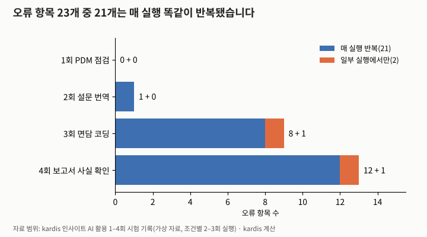
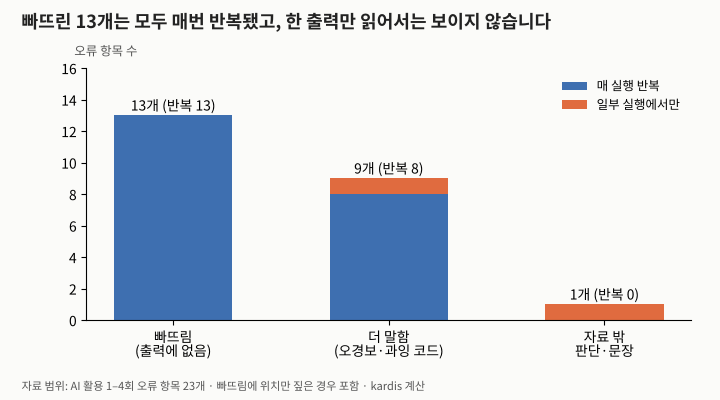
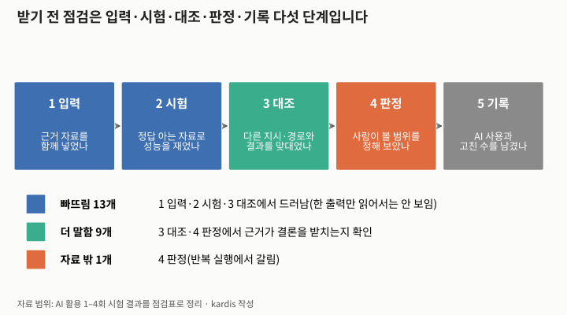

AI 산출물을 받아들이기 전에 무엇을 확인해야 할까요? 결론부터 말씀드리면, 같은 지시를 여러 번 돌려 결과가 같은지 보는 것만으로는 점검이 되지 못합니다. kardis가 앞선 네 번의 시험(PDM 점검, 설문 번역, 면담 코딩, 보고서 사실 확인)에서 「그대로 받았다면 틀렸을」 항목 23개를 다시 세어 보니 21개(91.3%)가 매 실행 똑같이 나왔습니다. 점검은 근거 자료를 함께 넣고, 정답을 아는 자료로 먼저 재고, 다른 지시나 경로와 맞대 보고, 사람이 볼 범위를 정해 판정하고, 기록하는 다섯 단계로 하기를 권합니다.

## 앞선 시험 네 번을 같은 기준으로 다시 세었습니다

이 연재 1–4회는 모두 kardis가 결함이나 오류를 심은 가상 자료로 AI를 2–3회씩 실행하고 정답과 대조했습니다. 이번 회는 새 시험을 하지 않고, 그 네 번의 기록에서 AI 출력을 검토 없이 받았다면 틀렸을 항목을 같은 기준으로 모았습니다. 항목은 조건마다 따로 셌습니다. 같은 구간이라도 지시문이 다르면 다른 항목입니다. 그리고 각 항목이 매 실행 반복됐는지, 어떤 종류의 오류인지 분류했습니다. 보고서 사실 확인에서 오류 위치는 짚었지만 이유가 틀린 경우(위치만 짚음)는 빠뜨림으로 셌습니다.

| 회차(조건) | 매 실행 반복 | 일부 실행에서만 | 합계 |
|---|---|---|---|
| 1회 PDM 점검(같은 지시 3회) | 0 | 0 | 0 |
| 2회 설문 번역(직접 대조·역번역 경로 각 3회) | 1 | 0 | 1 |
| 3회 면담 코딩(두 지시문 각 3회) | 8 | 1 | 9 |
| 4회 보고서 사실 확인(초안 3회, AI 검토 각 2회) | 12 | 1 | 13 |
| 합계 | 21 | 2 | 23 |

표 1. 회차별 오류 항목 수와 반복 여부(kardis 재집계).

## 반복 실행으로 드러난 것은 2개뿐이었습니다

반복 실행으로 드러난 것은 보고서 초안에 아무도 정하지 않은 3차년도 계획 문장을 넣은 실행(3회 중 1회)과 면담 코딩에서 S29 구간에 배제 코드를 더 붙인 실행(3회 중 1회)입니다. 나머지 21개는 매번 같았습니다. 역번역 경로는 3회 모두 원문 그대로인 번역을 오류로 지적했고, 면담 코딩은 지시문마다 같은 구간을 3회 모두 틀렸으며, 자료 없이 한 사실 확인은 2회 모두 같은 오류 9개를 정확히 짚지 못했습니다.

| 유형 | 항목 수 | 매 실행 반복 | AI 출력에 보이는가 |
|---|---|---|---|
| 빠뜨림(결함을 놓침, 코드를 빠뜨림) | 13 | 13 | 보이지 않음 |
| 더 말함(맞는 것을 틀렸다 함, 해당 없는 코드를 붙임) | 9 | 8 | 보임 |
| 자료 밖 문장(자료에 없는 계획) | 1 | 0 | 보임 |

표 2. 유형별 오류 항목과 반복 여부(kardis 재집계).

## 빠뜨린 것은 한 출력만 읽어서는 보이지 않습니다

유형으로 나누면 점검표의 순서가 나옵니다. 가장 많은 것은 빠뜨림 13개이고, 모두 매 실행 반복됐습니다. 빠뜨린 내용은 출력에 없으므로 한 출력만 아무리 꼼꼼히 읽어도 보이지 않습니다. 이번 기록에서 빠뜨림을 드러낸 것은 정답을 아는 시험 자료, 근거 자료, 다른 지시문과의 대조였습니다. 4회 시험에서 자료 없이 검토한 AI는 심은 오류 12개 중 3개만 정확히 짚었지만, 같은 AI에 자료를 주자 2회 모두 12개를 찾았습니다. 3회 시험에서 두 지시문의 결과가 갈린 7구간에는 오류 구간 4개 중 빠뜨림 3개가 들어 있었습니다.

더 말함 9개는 출력에 보이므로 근거를 확인해 거를 수 있는 위치에 있습니다. 다만 3회 면담 코딩에서는 인용 253개가 모두 원문에 있었는데도 코드가 틀렸으므로, 인용이 있다는 사실만으로는 부족하고 그 인용이 결론을 뒷받침하는지 사람이 봐야 합니다.

## 받기 전 점검 다섯 단계

| 단계 | 확인할 질문 | 근거 |
|---|---|---|
| 1 입력 | 근거 자료를 함께 넣었는가 | 4회: 자료 없이 3/12, 자료 주고 12/12 |
| 2 시험 | 정답을 아는 자료로 이 작업·이 지시문의 성능을 재었는가, 기준값을 미리 정했는가 | 1–4회 모두 이 방식으로 오류를 찾음, 빠뜨림 13개는 출력에 없음. IEG·IOE 지침에 적힌 방식: 사람이 정답을 붙인 검증 세트로 지시문을 다듬고 시험 세트는 지시문 개발에 쓰지 않음 |
| 3 대조 | 같은 지시 반복이 아니라 다른 지시문·다른 경로와 결과를 맞대었는가 | 3회: 두 지시문이 갈린 7구간에 오류 구간 4개 중 3개 |
| 4 판정 | 갈린 곳, 판단·인과·약속 문장, 무작위 표본을 사람이 원문과 보았는가 | 3회: 두 지시문이 같이 틀린 S18은 불일치 비교로 잡히지 않아 무작위 표본이 필요. WFP 평가국: AI 분석 결과는 사람의 검토·검증을 거친 뒤에만 증거로 씀(19항) |
| 5 기록 | AI를 쓴 단계, 시험 성능, 판정자, 사람이 고친 수를 남겼는가 | 1–4회 시사점의 종료 단계 기록. WFP 평가국: 착수보고서에 AI 사용 공개(13a항), 방법·검증 과정 문서화(20항) |

표 3. 받기 전 점검 다섯 단계.

평가 기관의 지침에도 이 가운데 몇 단계가 들어 있습니다. 세계은행 IEG와 IFAD IOE가 2025년에 낸 지침은 LLM이나 기계학습을 쓰는 자신들의 작업 흐름에서 사람의 검토를 필수로 두고, 자료를 학습·검증·시험·예측 세트로 나눠 사람이 정답을 붙인 검증 세트로 지시문을 다듬은 뒤, 지시문 개발에 쓰지 않은 시험 세트로 성능을 재는 방식을 적어 두었습니다. 세계식량계획(WFP) 평가국의 2025년 9월 안내서는 AI 사용에 평가국의 사전 서면 승인을 받아 착수보고서에 밝히고, AI 분석 결과는 사람이 검토·검증한 뒤에만 평가 결과의 증거로 쓰며, 방법과 검증 과정을 문서로 남기게 합니다. 다만 IEG·IOE 지침의 문헌 식별 시험은 정밀도가 0.7을 넘어야 한다고 보았으면서도, 과제의 복잡성, 과적합 우려, 작업 흐름 전체의 효율을 들어 정밀도 0.60을 이 용도에서는 만족스럽다고 판단했습니다. 기준값을 정하는 일과 함께, 기준에 못 미친 결과를 받아들일 때 그 이유를 남기는 일도 점검표에 들어가야 합니다.

## 반복 실행의 쓸모와 한계

반대 근거도 있습니다. Manakul 외(EMNLP 2023)의 SelfCheckGPT는 모델이 아는 내용이면 여러 번 뽑은 응답이 비슷하고, 지어낸 사실이면 응답끼리 갈리고 모순된다는 생각으로 환각을 찾습니다. Wang 외(ICLR 2023)의 자기 일관성(self-consistency)은 여러 추론 경로를 뽑아 가장 일관된 답을 고르면 GSM8K 수학 문제 등에서 성능이 오른다고 보고했습니다(초록 표기 +17.9%). 반복 실행이 쓸모없다는 뜻은 아닙니다. 이번 재집계에서 반복 실행으로 갈린 2개 중 1개는 자료에 없는 계획 문장이었습니다. 결과가 갈리면 의심할 신호가 됩니다. 그러나 같다고 해서 맞다는 증거는 되지 못합니다. 빠뜨림과 코드 과잉 같은 오류는 매번 같은 방향으로 반복됐습니다. 상황은 다르지만 Huang 외(ICLR 2024)도 외부 피드백 없이 모델이 스스로 답을 고치게 하면 잘 고치지 못하고 때로 성능이 떨어진다고 보고했습니다.

점검표가 있어도 사람이 그대로 따르지 않으면 소용이 없습니다. Goddard 외(JAMIA 2012)는 자동화 편향을 「자동화에 지나치게 기대는 경향」으로 정의하고, 문헌 74편을 검토해 업무량·과제 복잡도·시간 압박을 편향의 매개요인으로, 교육과 사용자 책임 강조를 완화요인으로 정리했습니다. 미국 국립표준기술연구소(NIST)의 생성형 AI 위험관리 프로파일(AI 600-1)도 사람이 생성형 AI에 지나치게 기대는 현상을 자동화 편향의 예로 들고, 자동화 편향이 확신에 찬 오류(confabulation) 같은 다른 위험을 키울 수 있다고 적습니다. 4단계 판정을 맡은 사람의 이름과 판정 결과를 5단계 기록에 남기는 것은 이 책임을 분명히 하기 위해서입니다.

## 맡길 일, 맡기지 말 일, 확인 방법

맡길 일은 근거 자료를 넣은 1차 작업, 원문 인용 붙이기, 다른 지시문으로 한 번 더 실행해 불일치 목록 만들기입니다. 맡기지 말 일은 기준값과 판정 범위를 정하는 일, 판단·인과·약속 문장의 채택, 「같은 결과가 반복됐으니 맞다」는 결론입니다. 확인 방법은 위 다섯 단계입니다.

## 한계

23개는 kardis가 만든 가상 자료 네 건과 조건별 2–3회 실행에서 나온 기록입니다. 모델은 1·2회에 Claude 계열로 적혀 있고 3·4회는 세부를 기록하지 못했으며, 오류를 심은 쪽과 판정한 쪽이 모두 kardis입니다. 3회의 반복 오류 8개 중 4개(S10, S16, S18 두 번)는 원 기록이 「판단이 갈릴 수 있다」고 표시한 구간입니다. 항목을 조건마다 따로 셌으므로 같은 구간이 두 번 들어간 경우(S18)가 있고, 위치만 짚은 경우를 빠뜨림으로 센 판단에 따라 수가 달라집니다. 반대로 4회에서 원문 근거까지 요구하면 빠뜨림이 늘 수 있습니다. 이 결과는 점검 단계와 찾은 오류의 관계를 보여 줄 뿐, 이 점검표가 실제 사업에서 오류를 줄인다는 인과를 보여 주지 않습니다.

## 시사점

| 단계 | 확인하거나 바꿀 일 |
|---|---|
| 기획 | 과업지시서나 평가 계획에 AI를 쓰는 단계와 받기 전 점검 다섯 단계를 적고, 작업별 기준값(예: 정답 일치 비율, 카파)을 미리 정합니다. 기준에 못 미친 결과를 받아들일 때는 그 이유를 적습니다. |
| 착수 | AI에 맡길 작업마다 정답을 아는 시험 자료 1건을 만들어 성능을 재고 기록합니다. 모델이나 지시문을 바꾸면 다시 잽니다. |
| 집행 | 같은 지시 반복 대신 다른 지시문이나 경로로 한 번 더 실행하고, 갈린 곳·판단 문장·무작위 표본을 사람이 원문과 봅니다. 반복 실행의 일치는 검증 결과로 보고하지 않습니다. |
| 종료 | 종료보고서 부록에 AI를 쓴 단계, 시험 성능, 판정자, 사람이 고친 수를 남깁니다. |

## 계산 방법

- 대상: kardis 인사이트 AI 활용 1회(가상 PDM, 같은 지시 3회), 2회(가상 설문, 직접 대조 3회·역번역 경로 3회), 3회(가상 면담 30구간, 간단·코드북 지시문 각 3회), 4회(가상 연차 자료, AI 초안 3회, 자료 없이·자료 주고·주장 단위 대조 각 2회, 숫자 스크립트 1회)의 시험 기록. 모두 kardis가 만든 가상 자료입니다.
- 오류 항목의 정의: AI 출력을 검토 없이 받았다면 틀렸을 항목 중 1회 이상 실행에서 나타난 것. 조건(지시문·경로)마다 따로 셌습니다. 원 기록에서 오류(지어낸 지적, 거짓 번역 오류, 오경보)로 판정하지 않은 추가 지적은 뺐습니다. 4회 초안의 표본오차 추론 문장은 검산상 타당해 뺐습니다. 1회의 목표치(32%→95%) 「비현실적」 판정은 kardis가 심은 결함과 같은 방향이고 1회에서 검출로 셌으므로 뺐습니다(넣으면 24개 중 21개, 87.5%). 숫자 스크립트(1회 실행)는 반복 여부를 볼 수 없어 뺐습니다. 넣으면 놓침 7개와 오경보 1개가 모두 「매번 같은 결과」 쪽에 더해집니다.
- 유형: 빠뜨림 = 심은 결함·오류를 정확히 짚지 못함(4회의 위치만 짚음 포함) 또는 기준 코드를 빠뜨림. 더 말함 = 맞는 내용을 오류로 지적하거나 해당 없는 코드를 붙임. 자료 밖 = 자료에 없는 계획 문장.
- 항목 목록(23개): 2회 역번역 Q4 오경보(3/3). 3회 간단 지시 S10 A·S16 A·S18 E 더 붙임(각 3/3), S29 E(1/3), S11 G 빠뜨림(3/3); 코드북 지시 S18 E(3/3), S14 G·S23 M·S25 G 빠뜨림(각 3/3). 4회 초안 3차년도 계획 문장(1/3); 자료 없이 검토 E1·E2·E5·E6·E7·E8·E10·E11·E12 정확히 짚지 못함(각 2/2), 오경보 「8개 중 7개」·「228명…12명 전보」(각 2/2); 자료 주고 검토 오경보 「C군이 평균을 끌어내렸다」(2/2). 1회와 2회 직접 대조, 4회 주장 단위 대조·초안 2·3에서는 해당 항목이 없었습니다.
- 계산: 매 실행 반복 = 틀린 실행 수가 전체 실행 수와 같은 항목. 21/23 = 91.3%. 유형별 빠뜨림 13(반복 13), 더 말함 9(반복 8), 자료 밖 1(반복 0).
- 민감도: 위치만 짚은 경우를 빠뜨림에서 빼면 4회 자료 없이 검토의 빠뜨림은 2회 모두 놓친 E1·E7·E10(반복)과 한 번만 놓친 E5·E12(일부)의 5개가 되어, 오류 항목 19개, 매 실행 반복 15개(78.9%)입니다. 반대로 원문 근거까지 요구하면 4회 자료 없는 검토의 「정확히 짚음」이 3개에서 1–3개로 줄어 빠뜨림이 최대 2개 늘 수 있습니다.
- 그림은 위 집계값으로 kardis가 직접 그렸습니다(Python).

## 출처

- [SelfCheckGPT: Zero-Resource Black-Box Hallucination Detection for Generative Large Language Models](https://aclanthology.org/2023.emnlp-main.557) · P. Manakul 외, EMNLP 2023
- [Self-Consistency Improves Chain of Thought Reasoning in Language Models](https://iclr.cc/virtual/2023/poster/11718) · X. Wang 외, ICLR 2023(arXiv:2203.11171)
- [Large Language Models Cannot Self-Correct Reasoning Yet](https://iclr.cc/virtual/2024/poster/18956) · J. Huang 외, ICLR 2024(arXiv:2310.01798)
- [Automation bias: a systematic review of frequency, effect mediators, and mitigators](https://academic.oup.com/jamia/article/19/1/121/732254) · K. Goddard 외, Journal of the American Medical Informatics Association 19(1), 2012
- [NIST AI 600-1: Artificial Intelligence Risk Management Framework: Generative Artificial Intelligence Profile](https://nvlpubs.nist.gov/nistpubs/ai/NIST.AI.600-1.pdf) · 미국 국립표준기술연구소(NIST), 2024-07
- [Ethical Use of Artificial Intelligence in WFP Evaluations (Info Brief)](https://docs.wfp.org/api/documents/WFP-0000168993/download) · 세계식량계획(WFP) 평가국, 2025-09
- [Balancing Innovation and Rigor: Guidance for the Thoughtful Integration of Artificial Intelligence for Evaluation](https://openknowledge.worldbank.org/bitstreams/07a162e2-f468-4eb6-be5a-a51db29a76ec/download) · 세계은행 IEG·IFAD IOE, 2025-05-13
- kardis 인사이트 AI 활용 1–4회(PDM 점검, 설문 번역, 면담 코딩, 보고서 사실 확인)의 시험 기록 · kardis, 2026-10-16–2026-11-13
