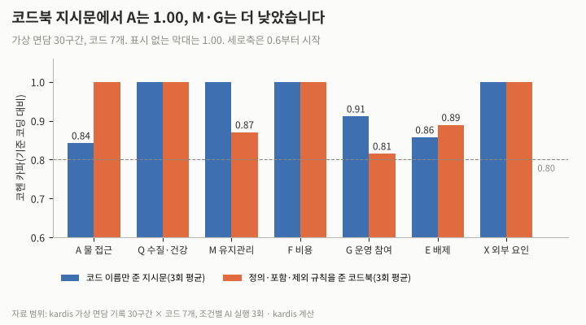
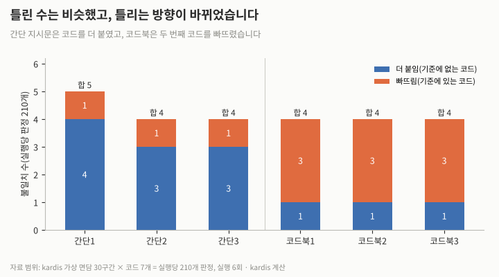
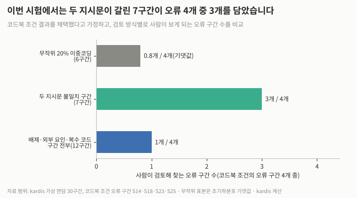
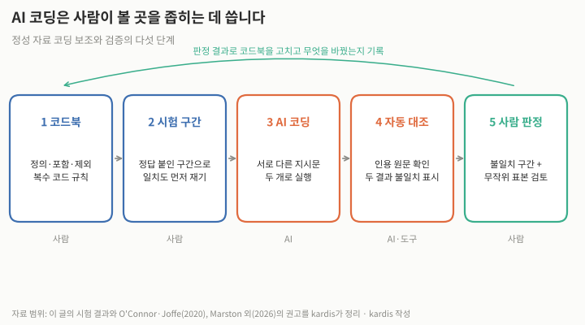

면담 기록을 코드북에 따라 분류하는 일(연역적 코딩)을 AI에 맡길 때 무엇을 맡기고 어떻게 확인해야 할까요? 결론부터 말씀드리면 정해진 코드북으로 구간마다 코드를 붙이는 1차 작업은 AI에 맡길 만합니다. 이번 시험에서 AI는 기준 코딩과 카파 0.93–0.94로 일치했습니다. 그러나 같은 지시문으로 세 번 돌려도 같은 곳을 틀렸고, 인용 문구가 원문에 있어도 코드가 틀린 경우가 있었습니다. 반복 실행과 인용 확인만으로는 검증이 되지 않습니다. 검증은 사람이 정답을 붙인 시험 구간으로 일치도를 먼저 재고, 서로 다른 지시문 두 개로 코딩해 결과가 갈린 구간과 무작위 표본을 사람이 판정하는 방식으로 하기를 권합니다.

## 직접 해 본 시험: 가상 면담 30구간, 코드 7개

kardis는 가상 농촌 식수 사업의 종료평가 주민 면담 기록 30구간을 만들고, 코드 7개(A 물 접근, Q 수질·건강, M 유지관리, F 비용, G 운영 참여, E 배제, X 외부 요인)로 기준 코딩을 먼저 정했습니다. 기준 코드는 42개이고 한 구간에 여러 개가 붙을 수 있습니다. 「여자들」, 「학교」처럼 엉뚱한 코드를 부르기 쉬운 단어와 부정문, 간접 표현을 일부러 넣었습니다.

그리고 두 가지 지시문으로 각각 3회씩, 서로 독립된 AI 세션에서 코딩하게 했습니다. 간단 지시문은 코드 이름만, 코드북 지시문은 정의와 포함·제외 규칙을 주었습니다. 둘 다 코드마다 근거 구절을 원문 그대로 인용하게 했습니다.

| 코드 | 간단 지시문 | 코드북 지시문 |
|---|---|---|
| A 물 접근 | 0.84 | 1.00 |
| Q 수질·건강 | 1.00 | 1.00 |
| M 유지관리 | 1.00 | 0.87 |
| F 비용 | 1.00 | 1.00 |
| G 운영 참여 | 0.91 | 0.81 |
| E 배제 | 0.86 | 0.89 |
| X 외부 요인 | 1.00 | 1.00 |
| 전체(실행당 판정 210개) | 0.93–0.94 | 0.94 |

표 1. 코드별 코헨 카파(기준 코딩 대비, kardis 시험).

## 틀린 수는 비슷했고, 틀리는 방향이 달랐다

전체 일치도는 거의 같았습니다. 실행당 판정 210개(30구간×7코드) 중 불일치는 간단 지시문 5·4·4개, 코드북 지시문 4·4·4개였습니다. 달라진 것은 틀리는 방향입니다. 간단 지시문은 코드를 더 붙였습니다. 비가 많아 수도를 덜 썼다는 구간(S10)과 휠체어 이용자가 받침대 때문에 물을 못 받는다는 구간(S16)에 3회 모두 A를 붙였습니다.

A의 정의를 거리·시간으로 좁힌 코드북 지시문에서는 이 두 오류가 나타나지 않았지만, 대신 두 번째 코드가 빠졌습니다. 수리비 장부를 공개하지 않는다는 구간(S14)에서 G를, 물탱크 뚜껑이 없다는 구간(S23)에서 M을, 고장 신고를 아무도 안 한다는 구간(S25)에서 G를 3회 모두 빠뜨렸습니다. 코드북이 「장부」를 F에, 「오염 위험에 대한 걱정」을 Q에, 「고장 신고 관행」을 M에 적어 둔 구간들입니다. 정의에 적힌 단어가 구간을 한 코드로 끌어당긴 것으로 보이지만, 이번 시험만으로 원인을 확정할 수는 없습니다.

| 실행 | 더 붙임 | 빠뜨림 | 합계 |
|---|---|---|---|
| 간단 1·2·3 | 4·3·3 | 1·1·1 | 5·4·4 |
| 코드북 1·2·3 | 1·1·1 | 3·3·3 | 4·4·4 |

표 2. 실행별 불일치 수(kardis 시험).

## 반복 실행과 인용 확인은 검증이 되지 못했다

검증에 중요한 결과는 두 가지입니다. 첫째, 반복 실행은 오류를 드러내지 못했습니다. 코드북 지시문 3회는 30구간 모두 똑같이 코딩했고(실행 간 카파 1.00), 간단 지시문 3회도 29구간이 같았습니다. 같은 결과는 안정성일 뿐 정확성이 아닙니다. 둘째, 6회 실행의 인용 253개는 모두 원문에 그대로 있었지만, 「누구도 반대 의견을 못 냅니다」(S29)를 근거로 E(배제)를 붙인 경우처럼 인용이 있어도 코드는 틀릴 수 있습니다. 인용 확인은 지어낸 근거를 거를 뿐, 코드의 옳고 그름은 사람이 판단해야 합니다.

## 사람은 어디를 봐야 하는가

코드북 지시문 결과를 채택했다고 가정하고 검토 방식 세 가지를 비교했습니다. 무작위 20%(6구간)를 사람이 다시 코딩하면 오류 구간 4개 중 평균 0.8개를 보고 하나라도 볼 확률은 61%입니다. 간단 지시문 결과와 코드북 지시문 결과가 갈린 7구간을 보면 오류 구간 4개 중 3개를 봅니다. AI가 배제·외부 요인 코드나 복수 코드를 붙인 구간 12개를 모두 보면 1개만 봅니다. 이 방식은 구조상 빠뜨린 코드를 잡지 못합니다. 두 지시문이 같이 틀린 S18(장날 회의로 장사하는 사람들이 못 온다는 구간에 E를 붙임)은 불일치 비교로 잡히지 않으므로 무작위 표본 검토를 함께 둡니다.

| 검토 방식 | 검토 구간 | 보게 되는 오류 구간(4개 중) |
|---|---|---|
| 무작위 20% 이중코딩 | 6 | 0.8(기댓값), 1개 이상 볼 확률 61% |
| 두 지시문 불일치 구간 | 7 | 3 |
| 배제·외부 요인·복수 코드 구간 전부 | 12 | 1 |

표 3. 검토 방식별 비교(kardis 계산).

## 방법론과 선행 연구가 말하는 것

다른 연구의 결과는 엇갈립니다. O'Connor와 Joffe(2020)는 자료의 10–25% 이중 코딩이 보통이고, 단순 일치율은 우연 일치를 고려하지 않아 부적절하며, 기준값은 임의적이므로 미리 정해 두라고 정리했습니다. Xiao 외(2023)는 GPT-3에 전문가 코드북을 주고 코딩하게 해, 가장 좋은 설정에서 카파 0.61(질문 복잡도)과 0.38(구문 구조)을 얻었고, 전문가끼리는 0.88과 0.90이었습니다.

하버드·맥길대와 Kobo Inc 연구진(Marston 외, 2026, 동료 심사 전 논문)은 인도적 지원 수요조사를 본뜬 가상 기록 150건을 46개 모델 설정으로 코딩해, 32개가 크리펜도르프 알파 0.80 이상이었다고 보고했습니다. 다만 차별과 「기타」 범주는 약했고 신체 안전이 가장 많이 틀린 범주였습니다. 연구진은 안전·차별 코드에 사람의 체계적 검토를 권했습니다. 배제 코드가 약하다는 점은 이번 시험과 겹칩니다. 다만 그 연구는 차별을 놓친 오류였고, 이번 시험은 E를 더 붙인 오류였습니다.

유엔인구기금(UNFPA) 평가국(IEO)은 면담·초점집단토의 600건 이상을 다룬 평가에서 AI를 사전 합의한 평가 매트릭스에 따른 수작업 코딩의 보완으로 썼고, 평가자가 모든 산출물을 자료와 대조했으며, 개인 식별 정보를 먼저 지우고 AI 사용을 부록에 기록했습니다. BetterEvaluation의 사례 글은 「teacher」 한 단어가 학교 교사와 지역사회 교육 교사를 함께 가리켜 생긴 오류를 팀이 AI 결과를 하나씩 검토해 잡았다고 전합니다.

## 맡길 일, 맡기지 말 일, 확인하는 방법

맡길 일은 정해진 코드북에 따른 구간별 1차 코딩, 코드마다 원문 근거 인용 붙이기, 서로 다른 지시문 결과의 불일치 목록 만들기입니다. 맡기지 말 일은 코드북을 만들고 정의를 바꾸는 판단, 배제·안전처럼 무게가 큰 코드의 최종 판정, 코딩 결과로 사업의 기여를 해석하는 일입니다. 확인 방법은 네 가지입니다. 사람이 정답을 붙인 시험 구간으로 일치도를 먼저 재고 기준값(예: 카파 0.80)을 미리 정합니다. 인용 문구가 원문에 있는지 도구로 확인합니다. 두 지시문이 갈린 구간을 사람이 판정합니다. 무작위 표본(10–25%)을 사람이 다시 코딩해 두 지시문이 같이 틀린 곳을 찾습니다.

| 단계 | 내용 | 맡는 쪽 |
|---|---|---|
| 1 코드북 | 정의·포함·제외·복수 코드 규칙 | 사람 |
| 2 시험 구간 | 정답 붙인 구간으로 일치도 먼저 재기 | 사람 |
| 3 AI 코딩 | 서로 다른 지시문 두 개로 실행 | AI |
| 4 자동 대조 | 인용 원문 확인, 두 결과 불일치 표시 | AI·도구 |
| 5 사람 판정 | 불일치 구간과 무작위 표본 검토, 코드북 수정·기록 | 사람 |

## 다른 해석과 한계

Marston 외(2026)에서 가장 좋은 모델의 알파는 0.922로 사람끼리의 0.938에 가까웠고, 이번 시험의 일치도도 높았으므로 사람 검토를 크게 줄여도 된다고 볼 수 있습니다. 그러나 두 시험 모두 가상 자료(그 연구는 영어)이고, 실제 면담에는 통역 흔적과 방언이 섞입니다. 또 S18은 「장사하는 사람들」을 배제 대상으로 볼지에 따라 기준 자체가 달라질 수 있어, AI보다 코드북의 모호함을 보여 준다고 읽을 수도 있습니다.

이 글의 한계도 밝힙니다. 시험은 가상 구간 30개, 코드 7개, 한국어, 모델 1종, 조건별 3회입니다. 구간과 기준 코딩, 코드북을 모두 kardis가 만들었으므로 코드북 규칙이 기준 코딩을 미리 알려 준 셈이 되어 일치도가 높게 나왔을 수 있고, 기준 코딩을 다른 사람이 이중 코딩하지도 않았습니다. 지시문 차이가 오류 방향을 바꿨다는 해석은 관찰일 뿐 인과로 확정한 것이 아니며, AI 사용이 평가의 질을 높인다는 인과도 보여 주지 않습니다.

## 시사점

| 단계 | 확인하거나 바꿀 일 |
|---|---|
| 기획 | 평가 계획에 정성 자료 코딩의 어느 단계에서 AI를 쓰는지, 일치도 기준값(예: 카파 0.80)과 사람 판정 범위를 미리 적습니다. 면담 전사본은 개인 식별 정보를 지운 뒤에만 AI에 넣는다고 명시합니다. |
| 착수 | 코드북에 포함·제외 규칙과 함께 「한 구간에 여러 코드가 붙는 경우」의 예시를 넣고, 사람이 정답을 붙인 시험 구간 20–30개로 AI 일치도를 먼저 재어 기록합니다. |
| 집행 | AI 코딩은 서로 다른 지시문 두 개로 돌려 결과가 갈린 구간을 사람이 판정하고, 무작위 표본 10–25%를 따로 이중 코딩합니다. 같은 지시문을 반복 실행한 일치는 검증으로 보고하지 않습니다. |
| 종료 | 평가보고서 부록에 AI를 쓴 단계, 시험 구간 일치도, 사람이 판정해 고친 코드 수를 남깁니다. |

## 계산 방법

- 대상: kardis가 만든 가상 농촌 식수 사업 종료평가 주민 면담 기록 30구간(S01–S30, 한국어). 실제 사업·기관·인물 자료는 쓰지 않았습니다.
- 기준 코딩: 코드 7개, 기준 코드 42개(A 8, G 8, F 6, Q 5, M 5, E 5, X 5). 코드가 없는 구간 1개(S21). 구간 작성 시 kardis가 정했고, 다른 사람의 이중 코딩은 없습니다.
- 방법: 범용 AI 모델을 서로 독립된 새 세션 6개로 호출했습니다(간단 지시문 3회, 코드북 지시문 3회). 도구 사용은 금지했고 정답은 주지 않았습니다. 출력은 구간별 코드 목록과 코드별 원문 인용입니다.
- 계산: 코드마다 30구간의 있음/없음을 이진값으로 보고 기준 코딩과의 코헨 카파를 계산했고, 7개 코드를 이어 붙인 210개 판정으로 전체 카파를 계산했습니다. 전체 카파는 간단 0.928·0.942·0.942, 코드북 0.939·0.939·0.939입니다. 실행 간 카파는 간단 0.986·0.986·1.000, 코드북 1.000·1.000·1.000입니다.
- 검토 방식 비교: 무작위 6구간 표본은 초기하분포로 1개 이상 포함 확률 1−C(26,6)/C(30,6)=0.612, 기댓값 6×4/30=0.8입니다. 불일치 구간은 간단 지시문 3회 중 하나라도 코드북 결과와 다른 구간 7개(S10, S11, S14, S16, S23, S25, S29)입니다.
- 그림은 위 집계값으로 kardis가 직접 그렸습니다(Python).

시험에 쓴 면담 기록과 기준 코드는 다음과 같습니다(가상).

| 구간 | 면담 기록(가상) | 기준 코드 |
|---|---|---|
| S01 | 예전에는 아침마다 강까지 왕복 한 시간 넘게 걸었는데, 이제 마을 안 수도까지 5분이면 갑니다. | A |
| S02 | 가끔 물에서 쇠 맛이 나서 아이들은 잘 안 마시려 합니다. | Q |
| S03 | 펌프 손잡이가 두 번 부러졌는데, 부품을 군청에서 받아 오는 데 3주가 걸렸습니다. | M |
| S04 | 한 달에 한 집당 2,000페소씩 내는데, 수확 전에는 그 돈도 부담됩니다. | F |
| S05 | 위원회 회의는 한 달에 한 번 열리고, 규칙은 다 같이 정했습니다. | G |
| S06 | 위원회에 여자도 들어가 있긴 한데, 회의에서 말하는 건 늘 남자들입니다. | G, E |
| S07 | 아이 설사가 줄었어요. 그게 물 때문인지, 같은 해에 보건소에서 손 씻기 교육을 해서인지는 모르겠지만요. | Q, X |
| S08 | 언덕 위 외곽 집들은 수도에서 멀어서 여전히 강물을 씁니다. | A, E |
| S09 | 고장 난 적은 한 번도 없어요. 관리인이 매주 점검합니다. | M |
| S10 | 올해 비가 많이 와서 강물도 많았으니, 사람들이 수도를 덜 쓴 것 같아요. | X |
| S11 | 물값을 못 낸 집은 수도 이용을 막는다는 규칙이 생겼어요. 과부 몇 집이 그래서 못 씁니다. | F, G, E |
| S12 | 솔직히 수도가 생겨서 좋아졌다는 건 잘 모르겠습니다. 거리야 가까워졌지만요. | A |
| S13 | 물을 길어 오던 시간에 딸이 학교에 갈 수 있게 됐습니다. | A |
| S14 | 수리비를 걷을 때 누가 얼마 냈는지 장부를 공개하지 않아서 말이 많습니다. | F, G |
| S15 | 다른 단체가 작년에 우물을 하나 더 파 줘서 줄 서는 시간이 줄었어요. | A, X |
| S16 | 휠체어를 타는 우리 형은 수도 받침대가 높아서 혼자서는 물을 못 받습니다. | E |
| S17 | 물맛은 강물보다 낫죠. 냄새도 안 나고요. | Q |
| S18 | 회의 날짜를 정할 때 장날과 겹치게 잡아서 장사하는 사람들은 못 옵니다. | G |
| S19 | 관리인이 수당을 못 받아서 지난달에 그만뒀어요. 지금은 아무도 안 봅니다. | M, F |
| S20 | 정부가 올해부터 농촌 수도 요금을 지원해 줘서 부담이 줄었습니다. | F, X |
| S21 | 그날은 그냥 날씨 얘기나 했지요. | 없음 |
| S22 | 우리 마을 말을 쓰지 않는 산족 가족들은 위원회 공지를 못 알아들어요. | G, E |
| S23 | 물탱크 뚜껑이 없어서 새 똥이 들어간다고 사람들이 걱정합니다. | Q, M |
| S24 | 줄 서는 데 예전엔 30분, 요즘은 10분 정도요. | A |
| S25 | 수도꼭지가 새도 위원회가 고쳐 주겠지 하고 아무도 신고하지 않아요. | M, G |
| S26 | 물은 공짜가 아니라는 걸 이제 다들 압니다. | F |
| S27 | 가뭄 때 수원이 말라서 두 달 동안 다시 강까지 다녔어요. | A, X |
| S28 | 여자들이 물 길으러 가는 길이 짧아져서 밤에 덜 무섭다고 해요. | A |
| S29 | 위원장은 군수 친척이라 누구도 반대 의견을 못 냅니다. | G |
| S30 | 보건소 기록을 보면 설사 환자가 줄었다고는 하는데, 저는 그 숫자를 본 적이 없어요. | Q |

코드북 지시문에 준 정의는 다음과 같습니다. A 물 접근: 물을 구하는 데 드는 거리·시간·횟수·대기 시간, 또는 그 변화(물 긷기에서 아낀 시간의 쓰임 포함, 물의 품질 제외). Q 수질·건강: 물의 맛·색·냄새·오염, 물과 관련된 질병의 변화(오염 위험에 대한 걱정 포함). M 유지관리: 시설의 고장·수리·부품·점검·관리 담당자(고장이 없었다는 언급, 고장 신고 관행 포함). F 비용: 물값·요금·수리비 분담·납부·장부, 관리 인력 수당 같은 운영 재원(요금 지원 같은 부담 변화 포함). G 운영 참여: 물관리위원회의 회의·규칙·의사결정·공지·권력 관계, 주민의 참여와 발언. E 배제: 특정 집단(여성, 장애인, 소수 언어·민족, 외곽 마을, 과부 등 취약 가구)이 이용이나 의사결정에서 빠지거나 불리한 상황(단순 언급이나 혜택을 본 경우 제외). X 외부 요인: 사업 밖의 원인(다른 기관·단체, 정부 정책, 날씨)이 결과의 변화에 영향을 주었다는 언급이나 그 가능성.

## 출처

- [Intercoder Reliability in Qualitative Research: Debates and Practical Guidelines](https://discovery.ucl.ac.uk/10091273/1/1609406919899220.pdf) · C. O'Connor(University College Dublin), H. Joffe(University College London), International Journal of Qualitative Methods 19, 2020
- [Supporting Qualitative Analysis with Large Language Models: Combining Codebook with GPT-3 for Deductive Coding](https://arxiv.org/pdf/2304.10548) · Z. Xiao 외(Microsoft Research, Inria), IUI '23 Companion, 2023
- [Can Large Language Models Reliably Code Qualitative Humanitarian Data? A Benchmark Study Against Human Expert Adjudication](https://arxiv.org/pdf/2606.26541) · J. Marston 외(Kobo Inc, McGill University, Harvard University), arXiv:2606.26541, 2026(동료 심사 전)
- [How AI supported evaluation of UNFPA's humanitarian action](https://www.unfpa.org/updates/how-ai-supported-evaluation-unfpas-humanitarian-action) · 유엔인구기금(UNFPA), 2026-05-15
- [Principle-led planning for analysis with artificial intelligence (AI)](https://www.betterevaluation.org/blog/principle-led-planning-analysis-artificial-intelligence-ai) · BetterEvaluation, 발행일 미표기
