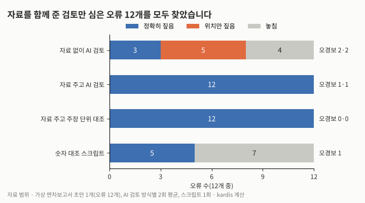
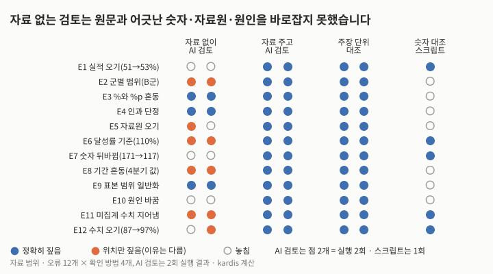
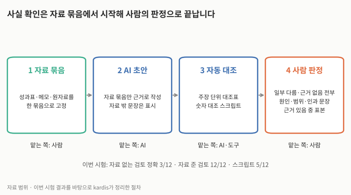

보고서 초안을 AI로 쓸 때 사실 확인은 어떻게 해야 할까요? 결론부터 말씀드리면 사실 확인은 초안을 쓴 자료 묶음을 검토자 옆에 두고, 문장을 주장 단위로 쪼개 하나씩 대조하는 방식으로 하기를 권합니다. 이번 시험에서 자료 없이 AI에 「사실 오류를 찾아 달라」고 하면 심어 둔 오류 12개 중 3개만 정확히 짚었습니다(오류 유형을 바르게 지목한 것 기준). 자료를 함께 주자 네 번의 실행 모두 12개를 찾았습니다. 숫자만 대조하는 스크립트는 5개를 찾았습니다.

## 직접 해 본 시험: 가상 연차보고서와 오류 12개

kardis는 가상 농촌 모자보건 사업의 2차년도 자료 묶음(성과표 지표 8개, 현장 모니터링 메모 6줄)을 만들고 두 가지를 시험했습니다. 첫째, AI에게 이 자료로 연차보고서의 「2차년도 성과 요약」을 세 번(서로 독립된 세션) 쓰게 했습니다. 둘째, 같은 자료로 쓴 것처럼 꾸민 초안에 실무 문서에서 볼 수 있는 유형의 오류 12개를 심고, 네 가지 방식으로 확인하게 했습니다. 자료 없이 AI가 검토, 자료를 주고 AI가 검토, 자료를 주고 주장 단위로 대조, 그리고 초안의 숫자가 자료에 있는지 보는 스크립트입니다. AI 검토는 방식마다 2회씩 실행했습니다.

## AI가 쓴 초안: 수치는 맞았고, 약속이 하나 끼어들었다

먼저 AI가 쓴 초안 세 개입니다. 공백 포함 812–878자 분량이었고, 자료와 다른 수치는 없었습니다. 달성률(95%), 여성 비율(75%), 목표와의 차이(4.0%p) 같은 계산값도 검산하면 모두 맞았습니다. 세 초안 모두 미달한 지표 4개를 빠뜨리지 않았고, 숙련 분만율 상승에 주 정부 현금 지원 제도가 함께 작용했을 수 있다는 점과 만족도가 A군 60명 조사라는 점을 밝혔습니다.

다만 한 초안은 자료에 없는 문장 두 개를 더했습니다. 산후 진찰률의 1.2%p 초과가 「표본오차 범위 안에 있을 수 있다」는 추론과, 「3차년도에는 C군 접근성, 전보 인원 보충, 개보수 일정을 먼저 점검하겠다」는 계획입니다. 앞의 추론은 계산해 보면 타당하지만(n=420, 단순무작위 표집을 가정하면 95% 오차 범위 약 ±4.6%p, 가구조사의 집락 표집을 반영하면 더 넓어짐), 뒤의 계획은 아무도 정하지 않은 약속이 보고서에 들어간 경우입니다.

## 자료 없이 검토하면 원문과 어긋난 값은 찾지 못한다

| 확인 방식 | 정확히 짚음 | 위치만 짚음 | 놓침 | 오경보(실행별, 맞는 주장 8개 기준) |
|---|---|---|---|---|
| 자료 없이 AI 검토(2회 평균) | 3 | 5 | 4 | 2·2 |
| 자료 주고 AI 검토(2회 평균) | 12 | 0 | 0 | 1·1 |
| 자료 주고 주장 단위 대조(2회 평균) | 12 | 0 | 0 | 0·0 |
| 숫자 대조 스크립트(1회, 이유 없이 숫자만 표시) | 5 | 0 | 7 | 1 |

표 1. 확인 방식별로 찾은 오류 수(kardis 시험).

자료 없이 검토한 AI는 %와 %p 혼동, 「교육 덕분」이라는 인과 단정, 출구조사 결과를 「대상 지역 전체」로 넓힌 문장을 두 번 모두 잡았습니다. 문장 안에서 드러나는 오류입니다. 그러나 실적 51.0%를 53.0%로, 여성 171명을 117명으로, 집행률 87%를 97%로 바꾼 오류와 지연 원인을 「시공사 부도」로 바꾼 오류는 두 번 모두 바로잡지 못했습니다. 자료가 없으니 원문과 어긋났는지 알 길이 없습니다.

「위치만 짚음」은 문제 문장을 가리켰지만 이유가 달랐던 경우입니다. 집계 중인 신생아 사망률에 19명이라는 값을 지어 넣은 문장에는 「측정 시점과 자료원이 없다」고만 했습니다. 오경보도 있었습니다. 맞는 문장인 「지표 8개 중 7개를 집계했다」와 「228명, 목표의 95%… 12명 전보」를 두 번 모두 문제로 꼽았습니다. 인과 단정(E4)도 「현금 지원 제도」라는 원문 근거가 아니라 「비교군이 없다」는 일반론으로 짚었습니다.

| 오류 유형 | 자료 없이 AI | 자료 주고 AI | 주장 단위 대조 | 숫자 스크립트 |
|---|---|---|---|---|
| 실적·수치 오기(E1, E7, E12) | 놓침(E12는 1회 위치만) | 찾음 | 찾음 | 찾음 |
| 미집계 수치 지어냄(E11) | 위치만 | 찾음 | 찾음 | 찾음 |
| 달성률 계산 기준(E6) | 위치만 | 찾음 | 찾음 | 찾음 |
| %와 %p 혼동(E3) | 찾음 | 찾음 | 찾음 | 놓침 |
| 인과 단정(E4), 표본 범위 일반화(E9) | 찾음 | 찾음 | 찾음 | 놓침 |
| 군별 범위(E2), 기간 혼동(E8) | 위치만 | 찾음 | 찾음 | 놓침 |
| 자료원 오기(E5), 원인 바꿈(E10) | 놓침 또는 위치만 | 찾음 | 찾음 | 놓침 |

표 2. 오류 유형별 확인 결과(kardis 시험).

## 자료를 준 두 방식의 차이는 오경보와 기록

자료를 준 두 방식은 모두 12개를 찾았고, 차이는 오경보와 기록에서 났습니다. 일반 지시는 맞는 문장인 「C군이 평균을 끌어내렸다」를 두 번 모두 문제로 꼽았습니다(한 번은 「8개 중 7개」 문장도 언급했으나 스스로 자료와 맞다고 밝혀 오경보로 세지 않았습니다). 주장 단위 대조는 초안을 주장 31–32개로 나누고 각각에 자료 인용과 판정을 붙였으며 오경보가 없었습니다. 맞다고 판정한 주장까지 근거와 함께 남으므로, 사람이 그 판정을 다시 확인할 수 있습니다.

숫자 스크립트는 자료에 없는 숫자(53, 110, 117, 19, 97)를 거르는 데는 빠르지만, 4.3일처럼 자료에 있는 숫자를 엉뚱한 기간에 쓴 오류는 구조상 잡지 못합니다. 또 95%처럼 맞는 계산값도 「자료에 없음」으로 표시하므로 계산값은 따로 검산해야 합니다.

다른 연구와 비교하면 이렇습니다. Huang 외(ICLR 2024)는 외부 피드백 없이 모델이 스스로 답을 고치게 하면 추론 과제에서 잘 고치지 못하고 때로 성능이 떨어진다고 보고했습니다. 상황은 다르지만(자기 추론 답 고치기), 자료 없는 검토가 약했던 이번 결과와 비슷합니다. Dhuliawala 외(2023)의 검증 연쇄(Chain-of-Verification)는 초안을 쓴 뒤 확인 질문을 만들고, 그 질문에 다른 답에 영향받지 않게 따로 답한 다음 최종 답을 쓰게 해 환각을 줄였습니다. 주장을 질문으로 쪼개 따로 확인한다는 점은 주장 단위 대조와 같지만, 검증 연쇄는 외부 자료 없이 모델 자신의 지식으로 답한다는 점이 다릅니다. 자료 없는 자기 검증도 일부 효과가 있다는 근거로 읽을 수 있습니다. 세계식량계획(WFP) 평가국은 2025년 9월 안내서에서 AI 산출물의 정확성 확인, 증거로 쓰기 전 사람의 검토, 검증 절차의 문서화, 착수보고서에서의 AI 사용 공개를 요구합니다.

## 맡길 일, 맡기지 말 일, 확인 방법

| 단계 | 내용 | 맡는 쪽 |
|---|---|---|
| 1 자료 묶음 | 성과표·메모·원자료를 한 묶음으로 고정 | 사람 |
| 2 AI 초안 | 자료 묶음만 근거로 작성, 자료 밖 문장은 표시 | AI |
| 3 자동 대조 | 주장 단위 대조표, 숫자 대조 스크립트 | AI·도구 |
| 4 사람 판정 | 일부 다름·근거 없음 전부, 원인·범위·인과 문장, 근거 있음 중 표본 | 사람 |

표 3. 보고서 초안 사실 확인의 네 단계.

업무로 옮기면, 맡길 일은 고정한 자료 묶음으로 초안 쓰기, 초안을 주장 단위로 나눠 자료와 대조한 표 만들기, 숫자 대조와 계산값 검산입니다. 맡기지 말 일은 기여·인과 해석의 최종 판단, 다음 해 계획이나 약속 문장을 정하는 일, 대조표의 「근거 있음」을 확인 없이 받아들이는 일입니다. 확인 방법은 자료를 함께 넣은 주장 단위 대조, 스크립트로 자료에 없는 숫자 거르기, 「일부 다름·근거 없음」과 원인·범위·인과 문장은 전부, 「근거 있음」은 표본을 사람이 원문과 다시 보는 것입니다.

## 다른 해석과 한계

Vectara 연구진(Tamber 외, EMNLP 2025)은 관련 자료를 주어도 모델이 근거 없는 정보나 모순을 자주 넣는다고 보고했는데, 이번 초안 세 개는 수치 오류가 없었습니다. 자료 묶음이 1,100자 정도로 짧고 서로 충돌하는 값이 없었기 때문일 수 있습니다. 실제 사업의 자료는 길고, 표가 PDF에 들어 있으며, 같은 지표의 값이 문서마다 다르기도 합니다. 그 경우 초안 단계의 오류는 늘어날 것으로 보는 편이 안전합니다. 또 E6의 110%는 기초선에서 목표까지 간 정도로 계산하면 실제로 나오는 값이어서, 단순 계산 오류라기보다 계산 기준을 밝히지 않은 문제로 볼 수도 있습니다. 자료를 준 검토 4회 중 3회가 이 점을 짚었습니다.

이 글의 한계도 밝힙니다. 시험은 가상 자료 하나, 심은 오류 12개, 한국어, 모델 1종, 방식별 2회입니다. 오류와 정답, 판정 기준을 모두 kardis가 정했고, 「정확히 짚음」과 「위치만 짚음」의 구분도 kardis가 했습니다. 자료 없는 검토는 오류 유형을 바르게 지목하면 「정확히 짚음」으로 셌는데, 원문 근거까지 요구하면 1–3개로 줄어듭니다. 자료를 준 검토 4회의 결과는 출력 전문이 아니라 kardis가 정리한 요지로 남아 있어, 제3자가 원문으로 다시 판정하기 어렵습니다. 초안을 쓴 모델과 검토한 모델이 같은 계열이며, 실제 사람 검토자와 비교하지 않았습니다. 이 결과는 확인 방식과 찾은 오류 수의 관계를 보여 줄 뿐, 어떤 방식이 보고서의 질을 높인다는 인과를 보여 주지 않습니다.

## 시사점

| 단계 | 확인하거나 바꿀 일 |
|---|---|
| 기획 | 보고서 작성 계획에 AI를 쓰는 단계와 사실 확인 방식(자료 묶음 대조, 주장 단위 대조표)을 적고, 착수보고서에서 AI 사용을 밝힙니다. |
| 집행 | AI에 초안을 맡길 때는 성과표와 메모를 한 묶음으로 고정해 함께 넣고, 자료에 없는 추론·계획 문장은 따로 표시하게 합니다. 다음 해 계획 문장은 사람이 정합니다. |
| 집행 | 검토는 자료를 함께 넣은 주장 단위 대조표로 하고, 숫자 대조 스크립트로 먼저 거릅니다. 사람은 「일부 다름·근거 없음」, 원인·범위·인과 문장 전부와 「근거 있음」 중 표본을 원문과 다시 봅니다. |
| 종료 | 종료보고서 부록에 주장 단위 대조표, 사람이 고친 주장 수, AI를 쓴 단계를 남깁니다. |

## 계산 방법

- 대상: kardis가 만든 가상 「농촌 모자보건 역량강화 사업(2025–2028)」 2차년도 자료 묶음(성과표 지표 8개, 현장 메모 6줄, 공백 포함 약 1,100자). 실제 사업·기관 자료는 쓰지 않았습니다.
- AI 초안: 범용 AI 모델을 서로 독립된 새 세션 3개로 호출했습니다. 지시는 「자료 묶음으로 연차보고서의 「2차년도 성과 요약」 절을 합니다체 700–900자로, 제목 없이」이고 도구 사용은 금지했습니다. 결과는 공백 포함 825·812·878자이며, 모든 수치를 자료·검산과 대조해 자료와 다른 수치는 0개였습니다.
- 확인 방식: (1) 자료 없이 AI 검토: 초안만 주고 사실 오류나 근거가 약한 서술을 인용과 이유로 적게 함 (2) 자료 주고 AI 검토: 같은 지시에 자료 묶음 추가 (3) 주장 단위 대조: 확인할 수 있는 주장을 모두 떼어 주장마다 자료 구절 인용·계산식과 판정(근거 있음/일부 다름/근거 없음)을 표로 출력 (4) 숫자 대조 스크립트: 초안과 자료에서 숫자를 정규식으로 뽑아(쉼표 제거, 실수 변환) 초안의 숫자가 자료에 없으면 표시. AI 방식은 각각 독립 세션 2회입니다.
- 판정 규칙: 정확히 짚음은 해당 구절을 문제로 꼽고 이유가 맞은 경우(자료 없는 검토는 오류 유형을 바르게 지목하면 인정), 위치만 짚음은 구절은 꼽았으나 이유가 다른 경우입니다. 오경보는 맞는 주장 8개 중 문제로 꼽은 것이며, 스스로 「자료와 맞다」고 밝힌 지적은 제외했습니다. 판정은 kardis가 했고 다른 사람의 이중 판정은 없습니다.
- 결과: 스크립트가 표시한 숫자는 53·110·95·117·19·97이며, 이 중 95는 맞는 계산값입니다. 산후 진찰률 95% 오차 범위는 1.96×√(0.362×0.638/420)=0.046(단순무작위 표집 가정)입니다.
- 그림은 위 집계값으로 kardis가 직접 그렸습니다(Python).

시험에 쓴 자료 묶음은 다음과 같습니다(가상). 대상은 3개 군(A·B·C), 보건지소 18곳입니다.

| 지표 | 기초선(2024) | 2026 목표 | 2026 실적 | 자료원 |
|---|---|---|---|---|
| 1 산전 진찰 4회 이상 수진율 | 42.0% | 55.0% | 51.0% | 보건지소 등록부(18곳 전수) |
| 2 숙련 조산 인력 분만율 | 61.0% | 68.0% | 70.5% | 주 보건정보시스템(HMIS) |
| 3 출생 후 2일 내 산후 진찰률 | 23.0% | 35.0% | 36.2% | 가구조사(n=420) |
| 4 교육 이수 보건요원 수(누적) | 0명 | 240명 | 228명(여성 171명) | 교육 출석부 |
| 5 필수 의약품 재고 부족 일수(월 평균) | 9.5일 | 5.0일 | 6.1일 | 보건지소 재고 대장 |
| 6 모자보건 서비스 만족도(5점) | 3.4 | 3.8 | 3.9 | 이용자 출구조사(n=60, A군만) |
| 7 분만실 개보수 완료 보건지소 | 0곳 | 12곳 | 9곳 | 공사 준공 확인서 |
| 8 신생아 사망률(출생아 1,000명당) | 24 | 없음(종료 시 측정) | 집계 중(2027년 3월 발표 예정) | 주 인구동태 통계 |

현장 메모: 산전 진찰 수진율은 A군 58%, B군 49%, C군 44%이고 C군은 7–8월 홍수로 도로가 끊겨 진찰이 줄었습니다. 숙련 분만율 상승에는 2026년 3월부터 주 정부가 시행한 시설 분만 현금 지원 제도가 함께 작용했을 수 있다고 주 보건국 담당자가 언급했습니다. 개보수 3곳의 지연은 자재 수입 통관 지연 때문이며 2027년 2분기 완공 예정입니다. 교육 이수자 중 12명은 다른 주로 전보되었습니다. 재고 부족 일수는 1분기 8.2일, 4분기 4.3일, 연평균 6.1일입니다. 2차년도 예산 집행률은 계획 대비 87%입니다.

오류를 심은 초안(가상): 2차년도(2026)에 사업은 성과지표 8개 중 7개의 실적을 집계했습니다. 산전 진찰 4회 이상 수진율은 기초선 42.0%에서 53.0%로 올랐으나 목표 55.0%에는 미치지 못했습니다. 군별로 보면 A군과 B군은 목표를 넘었고 C군이 평균을 끌어내렸습니다. 숙련 조산 인력 분만율은 61.0%에서 70.5%로 9.5% 상승해 목표(68.0%)를 넘었습니다. 이 상승은 사업의 조산 인력 교육 덕분입니다. 출생 후 2일 내 산후 진찰률은 HMIS 기준 36.2%로 목표 대비 110%를 달성했습니다. 교육을 이수한 보건요원은 228명으로 목표 240명의 95%이며, 이 중 여성은 117명입니다. 교육 이수자 중 12명은 이수 후 다른 주로 전보되었습니다. 필수 의약품 재고 부족 일수는 4.3일로 목표 5.0일을 달성했습니다. 이용자 출구조사에서 서비스 만족도는 3.9점으로 대상 지역 전체에서 목표를 넘었습니다. 분만실 개보수는 목표 12곳 중 9곳을 마쳤고, 3곳은 시공사 부도로 지연되어 2027년 2분기에 완공할 예정입니다. 신생아 사망률은 출생아 1,000명당 24명에서 19명으로 줄었습니다. 2차년도 예산 집행률은 계획 대비 97%입니다.

| 번호 | 심은 오류 | 자료 묶음의 내용 |
|---|---|---|
| E1 | 수진율 53.0% | 51.0% |
| E2 | A군과 B군은 목표를 넘음 | B군 49%(미달) |
| E3 | 9.5% 상승 | 9.5%p(상대 15.6%) |
| E4 | 교육 덕분 | 현금 지원 제도가 함께 작용했을 수 있음 |
| E5 | HMIS 기준 | 가구조사(n=420) |
| E6 | 목표 대비 110% | 36.2÷35.0=103.4%(110%는 진척률) |
| E7 | 여성 117명 | 171명 |
| E8 | 4.3일로 목표 달성 | 4.3일은 4분기 값, 연평균 6.1일(미달) |
| E9 | 대상 지역 전체 | A군만, n=60 |
| E10 | 시공사 부도 | 자재 수입 통관 지연 |
| E11 | 신생아 사망률 19명 | 집계 중 |
| E12 | 집행률 97% | 87% |

## 출처

- [Large Language Models Cannot Self-Correct Reasoning Yet](https://arxiv.org/abs/2310.01798) · J. Huang 외, ICLR 2024(arXiv:2310.01798)
- [Chain-of-Verification Reduces Hallucination in Large Language Models](https://arxiv.org/abs/2309.11495) · S. Dhuliawala 외, arXiv:2309.11495, 2023
- [Info Brief: Ethical Use of Artificial Intelligence in WFP Evaluations](https://docs.wfp.org/api/documents/WFP-0000168993/download) · 세계식량계획(WFP) 평가국, 2025-09
- [Benchmarking LLM Faithfulness in RAG with Evolving Leaderboards](https://aclanthology.org/2025.emnlp-industry.54) · M. S. Tamber 외(Vectara), EMNLP 2025 Industry Track
