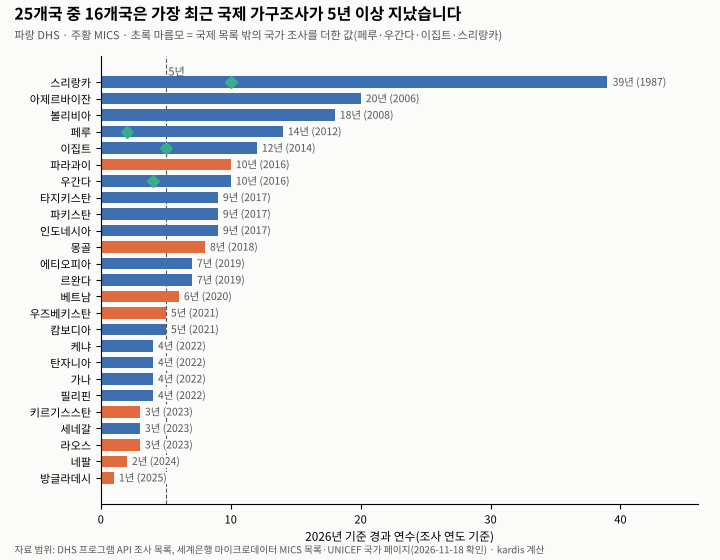
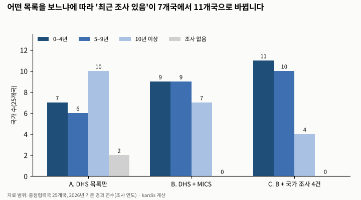
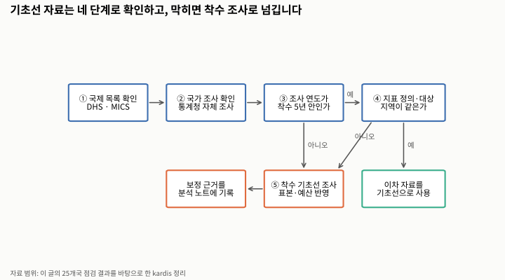

중점협력국은 기초선에 쓸 지표를 얼마나 갖추고 있을까요? 보건·영양·교육·물 같은 성과지표의 기초선은 대개 가구조사에서 나옵니다. 그래서 이 질문은 「그 나라에서 국제 비교가 가능한 가구조사가 언제 마지막으로 이뤄졌는가」로 바꿔 물을 수 있습니다. 제4차 종합기본계획의 중점협력국 25개국을 DHS(인구보건조사)와 MICS(복합지표군집조사) 목록으로 점검했습니다. 2026년 기준으로 16개국은 가장 최근 조사가 5년 이상 지났고, 7개국은 10년 이상 지났습니다. 다만 국제 목록 밖의 국가 조사를 더하면 공백이 줄어듭니다. 국제 목록만 보고 「자료 없음」으로 판단하지 말되, 착수 시점에 쓸 수 있는 조사가 5년 이상 지났다면 착수 기초선 조사를 예산에 넣어야 합니다. 5년은 이 글이 정한 실무 기준으로, DHS·MICS가 대체로 5년 안팎 간격으로 반복되는 점을 고려했습니다.

## 왜 지금 이 질문인가

DHS는 미국 국제개발처(USAID)가 재원을 대던 사업입니다. 2025년 초 미국 정부가 시행사(ICF)와의 2억 3,680만 달러 계약을 종료하면서 진행 중이던 조사 스물네 개 이상이 멈췄습니다. Devex는 2026년 2월 DHS가 게이츠 재단 재원으로 규모를 줄여 다시 시작한다고 보도했습니다. DHS 자료는 지속가능발전목표(SDG) 지표 30개 이상의 계산에 쓰입니다. kardis는 이 때문에 새 DHS 자료가 당분간 예전보다 드물게 나올 수 있다고 봅니다. 2026–2030년 사업을 기획할 때는 지금 있는 자료가 얼마나 오래됐는지가 실무 문제가 됩니다.

## 25개국의 가장 최근 국제 가구조사

DHS 프로그램 API의 조사 목록(363건)에서 25개국의 표준 DHS를 뽑았습니다. 세계은행 마이크로데이터 라이브러리의 MICS 목록과 UNICEF 국가 페이지에서는 전국 단위 MICS를 뽑았습니다. 나라마다 둘 중 더 최근 조사의 연도를 「가장 최근 국제 가구조사」로 정하고, 2026년에서 그 연도를 빼 경과 연수를 계산했습니다.

| 경과 연수(2026년 기준) | 국가(가장 최근 조사 연도, 종류) | 국가 수 |
|---|---|---|
| 0–4년 | 방글라데시(2025 MICS), 네팔(2024 MICS), 라오스(2023 MICS), 세네갈(2023 DHS), 키르기스스탄(2023 MICS), 필리핀·가나·탄자니아·케냐(2022 DHS) | 9 |
| 5–9년 | 캄보디아(2021 DHS), 우즈베키스탄(2021 MICS), 베트남(2020 MICS), 르완다·에티오피아(2019 DHS), 몽골(2018 MICS), 인도네시아·파키스탄·타지키스탄(2017 DHS) | 9 |
| 10년 이상 | 우간다(2016 DHS), 파라과이(2016 MICS), 이집트(2014 DHS), 페루(2012 DHS), 볼리비아(2008 DHS), 아제르바이잔(2006 DHS), 스리랑카(1987 DHS) | 7 |

지역별 경과 연수의 중앙값은 아시아 10개국과 아프리카 8개국(이집트 포함)이 5.5년, 중남미 3개국이 14년, 중동·CIS 4개국이 7년입니다. 25개국 중 8개국은 가장 최근 조사가 MICS였습니다. 라오스와 몽골은 DHS 프로그램 목록에 조사가 없습니다. 베트남·우즈베키스탄·키르기스스탄·파라과이는 MICS가 DHS보다 10년 이상 최근입니다.

## 목록을 바꾸면 숫자가 바뀝니다

같은 25개국이라도 어떤 목록을 보느냐에 따라 「최근 5년 안에 조사가 있다」는 나라 수가 달라집니다. DHS 목록만 보면 7개국이고, 라오스와 몽골은 조사가 없는 나라로 보입니다. MICS를 더하면 9개국이 됩니다. 여기에 국제 목록 밖의 국가 조사 네 건을 더하면 11개국이 되고, 10년 이상 지난 나라는 4개국으로 줄어듭니다. 네 건은 페루 ENDES 2024, 우간다 UDHS 2022, 이집트 가구 보건조사 2021, 스리랑카 DHS 2016입니다. 스리랑카의 39년은 「39년간 자료 없음」이 아니라 「국제 목록에는 1987년 이후 없음」이라는 뜻입니다.

| 기준 | 0–4년 | 5–9년 | 10년 이상 | 조사 없음 | 중앙값 |
|---|---|---|---|---|---|
| A. DHS 목록만 | 7 | 6 | 10 | 2 | 9년 |
| B. DHS + MICS | 9 | 9 | 7 | 0 | 7년 |
| C. B + 국가 조사 4건 | 11 | 10 | 4 | 0 | 5년 |

중앙값을 계산할 때 「조사 없음」은 가장 오래된 쪽으로 놓았습니다.

우간다 통계청이 시행하고 DHS 프로그램(ICF)이 일부 기술지원한 UDHS 2022는 2023년 11월에 보고서가 공개됐습니다. 그러나 이번에 확인한 API 목록에는 아직 없고, 마지막 표준 DHS가 2016년으로 나옵니다. 국제 목록에 없다는 것이 조사가 없다는 뜻은 아닙니다. 페루처럼 국가 통계청이 DHS 방식의 조사를 자체로 이어 가는 나라(ENDES 2024)도 있습니다. 이집트 통계청(CAPMAS)은 2021년 가구 보건조사를, 스리랑카 통계청은 2016년 인구보건조사를 발표했습니다.

## 다른 해석과 한계

반대 근거부터 적습니다. 첫째, 기초선은 가구조사만으로 만들지 않습니다. 학교 등록, 보건소 진료 기록 같은 행정자료는 해마다 나옵니다. 사업 지표가 이런 자료로 측정된다면 가구조사의 경과 연수는 큰 문제가 아닐 수 있습니다. 둘째, 국제 목록 밖의 국가 조사는 네 나라만 확인했습니다. 다른 나라(예: 볼리비아)에도 그런 전국 조사가 있을 수 있으므로, 기준 B의 「10년 이상」은 「국제 목록 기준으로 10년 이상」으로 읽어야 합니다. 또 국가 조사는 지표 정의나 표본 설계가 DHS와 다를 수 있습니다.

- 조사 연도는 현장조사를 시작한 해입니다. 결과 보고서와 원자료는 보통 1–2년 뒤에 나옵니다.
- 파키스탄의 주(州) 단위 MICS처럼 전국 조사가 아닌 것은 넣지 않았습니다.
- 몽골은 2023년 사회지표 표본조사 결과가 언론에 보도됐지만, 통계청이나 UNICEF 원문을 찾지 못해 2018년 MICS를 썼습니다.
- 에티오피아의 2019년 조사는 지표 범위가 좁은 소규모(Mini) DHS입니다.
- 가나(2025), 우간다(2026-27, 첫 MICS), 파라과이(MICS7) 등 계획·진행 중인 조사는 결과가 공개되지 않아 넣지 않았습니다.
- 이 글은 조사가 「있는지」와 「언제인지」를 본 것입니다. 지표별로 값이 실제로 있는지, 사업 대상 지역과 지표 정의가 맞는지는 따로 확인해야 합니다.
- 경과 연수와 사업 성과의 관계는 다루지 않았습니다. 오래된 조사가 성과 측정을 어렵게 만든다는 것은 측정 설계상의 판단이며, 이 자료로 확인한 인과관계가 아닙니다.

## 기초선 자료를 확인하는 순서

| 단계 | 확인할 것 | 다음 |
|---|---|---|
| ① 국제 목록 | DHS·MICS의 최근 조사 연도 | ② |
| ② 국가 조사 | 국제 목록 밖의 통계청 조사(ENDES, UDHS 등) | ③ |
| ③ 경과 연수 | 착수 시점에서 5년 안인가 | 예: ④ / 아니오: ⑤ |
| ④ 정의·지역 | 지표 정의와 대상 지역이 같은가 | 예: 이차 자료 사용 / 아니오: ⑤ |
| ⑤ 착수 조사 | 표본과 예산을 사업계획에 반영하고 보정 근거를 기록 | - |

## 시사점

| 단계 | 확인하거나 바꿀 일 |
|---|---|
| 기획 | 성과지표의 기초선 자료원을 적을 때 조사 이름과 함께 조사 연도를 적고, 착수 예정 연도와의 차이를 계산해 둡니다. 이 글의 실무 기준(5년) 이상이면 착수 기초선 조사 예산을 사업비에 넣습니다. |
| 기획 | 「자료 없음」으로 판단하기 전에 DHS 목록, MICS 목록, 협력국 통계청 자체 조사를 모두 확인합니다. 이 글의 계산에서는 목록을 넓히자 5년 안의 조사가 있는 나라가 7개국에서 11개국으로 늘었습니다. |
| 착수 | 이차 자료를 기초선으로 쓸 때는 조사 연도, 대상 지역, 지표 정의를 사업 지표와 나란히 적은 대조표를 남깁니다. 정의가 다르면 착수 조사로 다시 잽니다. |
| 착수 | 종료평가에서 같은 국제 조사의 다음 회차를 비교 자료로 쓸 계획이라면, 다음 회차가 사업 기간 안에 나오지 않을 수 있음을 위험 목록에 적고 자체 종료선 조사를 대안으로 정해 둡니다. |

## 계산 방법

- 대상: 제4차 국제개발협력 종합기본계획(2026–2030) 중점협력국 25개국. 지역 구분은 아시아 10개국, 아프리카 8개국(이집트 포함), 중남미 3개국, 중동·CIS 4개국(아제르바이잔·우즈베키스탄·키르기스스탄·타지키스탄)입니다.
- DHS: DHS API 조사 목록에서 SurveyType이 DHS인 조사만 썼습니다(MIS·AIS 제외). 연도는 SurveyYear입니다.
- MICS: 세계은행 마이크로데이터 MICS 목록(전국 조사만)에 UNICEF 국가 페이지에서 결과 보고서가 공개된 조사(네팔 2024-25, 라오스 2023, 방글라데시 2025 예비보고서, 키르기스스탄 2023)를 더했습니다. 연도는 조사 이름의 첫 해입니다. 목록 일부 쪽은 사이트 검색으로 보완해 빠진 조사가 있을 수 있습니다.
- 경과 연수 = 2026 − max(DHS 최신 연도, MICS 최신 연도). 기준 C는 국가 조사 네 건을 더해 같은 방식으로 계산했습니다.
- 나라별 값(DHS / MICS / 국가 조사 → 경과 연수 B, C): 네팔 2022/2024/− → 2, 2 · 라오스 −/2023/− → 3, 3 · 몽골 −/2018/− → 8, 8 · 방글라데시 2022/2025/− → 1, 1 · 베트남 2002/2020/− → 6, 6 · 스리랑카 1987/−/2016 → 39, 10 · 인도네시아 2017/−/− → 9, 9 · 캄보디아 2021/−/− → 5, 5 · 파키스탄 2017/−/− → 9, 9 · 필리핀 2022/−/− → 4, 4 · 가나 2022/2017/− → 4, 4 · 르완다 2019/−/− → 7, 7 · 세네갈 2023/−/− → 3, 3 · 에티오피아 2019/−/− → 7, 7 · 우간다 2016/−/2022 → 10, 4 · 이집트 2014/2013/2021 → 12, 5 · 탄자니아 2022/−/− → 4, 4 · 케냐 2022/−/− → 4, 4 · 볼리비아 2008/−/− → 18, 18 · 파라과이 1990/2016/− → 10, 10 · 페루 2012/−/2024 → 14, 2 · 아제르바이잔 2006/2000/− → 20, 20 · 우즈베키스탄 1996/2021/− → 5, 5 · 키르기스스탄 2012/2023/− → 3, 3 · 타지키스탄 2017/2005/− → 9, 9
- 표와 그림은 위 자료와 계산값으로 kardis가 직접 만들었습니다.

## 출처

- [DHS API 조사 목록](https://api.dhsprogram.com/rest/dhs/surveys?f=html) · The DHS Program(ICF), 2026-11-18 확인(363건)
- [UNICEF Multiple Indicator Cluster Surveys 컬렉션](https://microdata.worldbank.org/index.php/catalog/MICS) · 세계은행 마이크로데이터 라이브러리, 2026-11-18 확인(229건)
- [Nepal MICS 2024-25](https://www.unicef.org/nepal/reports/multiple-indicator-cluster-survey-2024-25) · UNICEF 네팔, 2026-11-18 확인
- [Lao Social Indicator Survey III 2023 Key Indicators Report](https://www.unicef.org/laos/reports/lao-social-indicator-survey-iii-lsis-iii-2023-key-indicators-report) · UNICEF 라오스, 2026-11-18 확인
- [Bangladesh MICS 2025](https://www.unicef.org/bangladesh/en/reports/bangladesh-multiple-indicator-cluster-survey-2025) · UNICEF 방글라데시, 2026-11-18 확인
- [MICS Kyrgyz Republic 2023](https://www.unicef.org/kyrgyzstan/publications/mics-kyrgyz-republic-2023) · UNICEF 키르기스스탄, 2026-11-18 확인
- [Uganda Demographic and Health Survey 2022 Report](https://www.ubos.org/wp-content/uploads/publications/UDHS-2022-Report.pdf) · 우간다 통계청(UBOS), 2023
- [Perú: Encuesta Demográfica y de Salud Familiar, Endes 2024](https://www.gob.pe/institucion/inei/informes-publicaciones/6813623-peru-encuesta-demografica-y-de-salud-familiar-endes-2024) · 페루 통계청(INEI), 2026-11-18 확인
- [Demographic and Health Survey 2016](https://www.statistics.gov.lk/Health/StaticalInformation/DHS) · 스리랑카 통계청(Department of Census and Statistics), 2026-11-18 확인
- [Health Survey for the Egyptian Households 2021](https://censusinfo.capmas.gov.eg/Metadata-en-v4.2/index.php/catalog/665/overview) · 이집트 통계청(CAPMAS), 2022(북시나이 주를 제외한 26개 주)
- [Demographic and Health Surveys reemerge with Gates funds after Trump cut](https://www.devex.com/news/demographic-and-health-surveys-reemerge-with-gates-funds-after-trump-cut-111840) · Devex, 2026-02-24
- [중점협력국 25개국 목록](https://github.com/kardisceo-kr/kardis-data/blob/main/countries.json) · 제4차 국제개발협력 종합기본계획(2026–2030) 기준, kardis 정리
