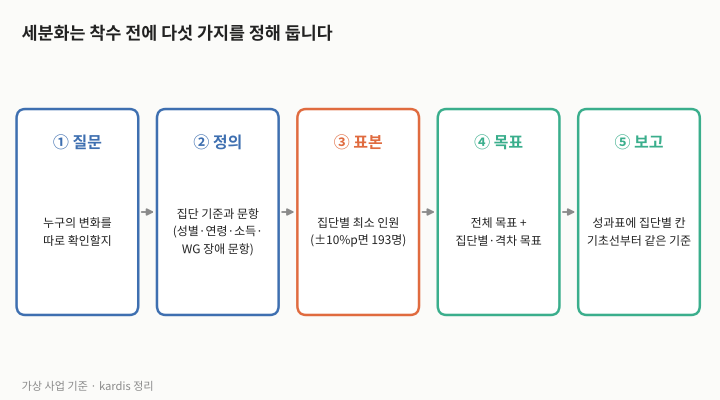
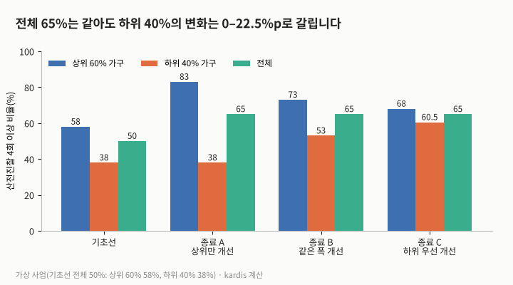
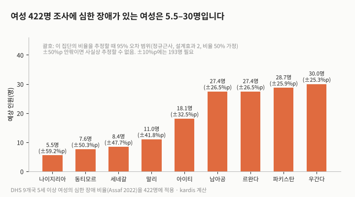
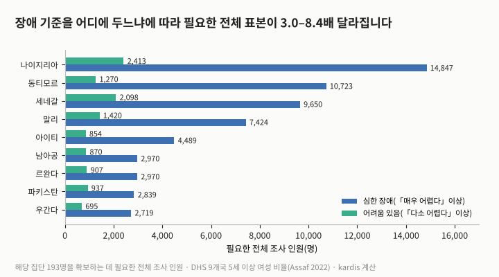

성과표에 「성별·취약계층별 분리」라고 적어 두고도, 종료 때 집단별 값을 내지 못하거나 냈더라도 오차가 너무 커 쓸 수 없는 경우가 있습니다. 세분화는 처음부터 어떻게 설계해야 할까요? 이 글의 결론은 「세분화는 보고 서식이 아니라 착수 전에 정하는 표본·문항·목표의 문제」라는 것입니다. 가상 사업에서 전체 지표가 50%에서 목표 65%에 이르는 세 가지 경우를 계산해 보면, 하위 40% 가구의 변화는 0%p에서 22.5%p까지 갈렸습니다. 또 공개된 인구보건조사(DHS) 9개국의 장애 비율을 적용하면, 여성 422명 조사에 심한 장애가 있는 여성은 5.5–30명 정도만 들어와, 이 집단의 비율은 정규근사로 계산한 95% 오차 범위가 ±25–59%p에 이르렀습니다. 이 수치는 모두 가정값을 넣은 계산입니다.

## 국제 기준이 요구하는 것

유엔 총회 결의 A/RES/71/313은 지속가능발전목표(SDG) 지표를 소득, 성별, 연령, 인종, 민족, 이주 상태, 장애, 지리적 위치 등에 따라 관련 있는 경우 세분화하도록 했습니다. OECD 개발원조위원회(DAC)의 성평등 정책 마커 안내서(2025년판)는 성평등을 중요한 목적(점수 1)으로 표시하는 최소 기준의 하나로, 성평등 목표가 하나 이상 있고 그 목표를 성별 특화 지표가 하나 이상 뒷받침할 것을 듭니다. 장애는 측정 문항이 따로 필요합니다. 워싱턴 그룹 단문 문항(WG-SS)은 보기, 듣기, 걷기·계단 오르기, 기억·집중, 자기 돌봄, 의사소통 여섯 기능 영역(Assaf, 2022)의 어려움을 묻고, 한 영역 이상에서 「매우 어렵다」 또는 「전혀 할 수 없다」고 답한 사람을 장애인으로 분류하도록 권고합니다.

## 직접 해 본 계산 1: 같은 65%, 다른 사업

3회의 가상 「B국 농촌 모자보건 개선 사업」을 그대로 씁니다. 지표는 「최근 2년 내 출산 여성 중 산전진찰 4회 이상 비율」, 기초선 50%, 목표 65%입니다. 대상 여성의 60%가 소득 상위 60% 가구, 40%가 하위 40% 가구에 속하고, 기초선 값이 각각 58%와 38%라고 가정했습니다. 전체 값은 두 집단 값의 가중평균이므로, 서로 다른 세 가지 변화가 모두 같은 65%를 만듭니다.

| 단계 | 정할 것 | 이 글의 가상 사업 예 |
|---|---|---|
| ① 질문 | 누구의 변화를 따로 확인할지 | 소득 하위 40% 가구, 장애 여성 |
| ② 정의 | 집단을 가르는 기준과 문항(성별·연령·소득·장애) | 여성 응답자의 연령대, 자산 지수 하위 40%, WG-SS 여섯 문항 |
| ③ 표본 | 집단별 최소 인원 | ±10%p 추정에 193명(설계효과 2) |
| ④ 목표 | 전체 목표와 집단별·격차 목표 | 전체 65%, 하위 40% 가구 55% 이상 |
| ⑤ 보고 | 성과표의 집단별 칸 | 기초선부터 같은 기준으로 기록 |

표 1. 그림 1의 내용(가상, kardis 정리).

| 시점·경우 | 상위 60% 가구 | 하위 40% 가구 | 전체 | 두 집단 격차 |
|---|---|---|---|---|
| 기초선 | 58% | 38% | 50% | 20%p |
| 종료 A: 상위만 개선 | 83% | 38% | 65% | 45%p |
| 종료 B: 같은 폭 개선 | 73% | 53% | 65% | 20%p |
| 종료 C: 하위 우선 개선 | 68% | 60.5% | 65% | 7.5%p |

표 2. 그림 2의 값(가상, kardis 계산). 전체 = 0.6 × 상위 + 0.4 × 하위.

세 경우 모두 전체 목표를 달성했지만, A에서는 하위 40% 가구에 아무 변화가 없고 격차가 20%p에서 45%p로 벌어졌습니다. 전체 지표 하나만 있으면 A와 C를 구별할 수 없습니다. 「하위 40% 가구 55% 이상」 같은 집단별 목표를 함께 두어야 A가 목표 미달로 드러납니다.

## 직접 해 본 계산 2: 장애 여성은 표본에 몇 명 들어오는가

DHS 비교보고서(Assaf, 2022)는 WG-SS 문항을 넣은 9개국 조사에서 5세 이상 가구원 중 심한 장애(한 영역 이상 「매우 어렵다」 이상) 비율이 나이지리아 1.4%에서 우간다 6.5%까지라고 보고했습니다. 여성만 보면 1.3–7.1%입니다. 이 비율을 3회에서 계산한 조사 1회당 여성 422명에 곱하면 장애 여성은 5.5–30명입니다. 이 인원으로 장애 여성 집단의 산전진찰 비율을 추정하면 정규근사로 계산한 95% 오차 범위가 ±25.3–59.2%p가 됩니다(설계효과 2, 비율 50% 가정). 인원이 10명 안팎인 나라에서는 근사식 자체가 맞지 않아 사실상 추정할 수 없다고 보아야 합니다. ±10%p로 추정하려면 장애 여성만 193명이 필요합니다.

| 국가(조사 연도) | 심한 장애 비율(여성) | 422명 중 예상 인원 | 95% 오차 범위 |
|---|---|---|---|
| 나이지리아(2018) | 1.3% | 5.5명 | ±59.2%p |
| 동티모르(2016) | 1.8% | 7.6명 | ±50.3%p |
| 세네갈(2019) | 2.0% | 8.4명 | ±47.7%p |
| 말리(2018) | 2.6% | 11.0명 | ±41.8%p |
| 아이티(2016–17) | 4.3% | 18.1명 | ±32.5%p |
| 남아공(2016) | 6.5% | 27.4명 | ±26.5%p |
| 르완다(2019–20) | 6.5% | 27.4명 | ±26.5%p |
| 파키스탄(2017–18) | 6.8% | 28.7명 | ±25.9%p |
| 우간다(2016) | 7.1% | 30.0명 | ±25.3%p |

표 3. 그림 3의 값(비율은 Assaf 2022, 인원과 오차는 kardis 계산).

장애를 어디서부터로 보느냐도 표본을 바꿉니다. 같은 보고서에서 한 영역 이상 「다소 어렵다」 이상인 여성의 비율은 8.0–27.8%였습니다. 해당 여성 193명을 확보하는 데 필요한 전체 조사 인원을 두 기준으로 계산하면, 나라마다 3.0–8.4배 차이가 났습니다.

| 국가 | 심한 장애 비율(여성) | 필요 인원 | 어려움 있음 비율(여성) | 필요 인원 | 배수 |
|---|---|---|---|---|---|
| 나이지리아 | 1.3% | 14,847 | 8.0% | 2,413 | 6.2 |
| 동티모르 | 1.8% | 10,723 | 15.2% | 1,270 | 8.4 |
| 세네갈 | 2.0% | 9,650 | 9.2% | 2,098 | 4.6 |
| 말리 | 2.6% | 7,424 | 13.6% | 1,420 | 5.2 |
| 아이티 | 4.3% | 4,489 | 22.6% | 854 | 5.3 |
| 남아공 | 6.5% | 2,970 | 22.2% | 870 | 3.4 |
| 르완다 | 6.5% | 2,970 | 21.3% | 907 | 3.3 |
| 파키스탄 | 6.8% | 2,839 | 20.6% | 937 | 3.0 |
| 우간다 | 7.1% | 2,719 | 27.8% | 695 | 3.9 |

표 4. 그림 4의 값(비율은 Assaf 2022, 필요 인원 = 193 ÷ 비율, kardis 계산).

## 다른 해석과 한계

「다소 어렵다」까지 넣으면 표본 부담은 줄지만, 워싱턴 그룹의 권고 기준과 달라 다른 조사와 비교하기 어렵습니다. 반대로 Hanass-Hancock 외(2023)는 「매우 어렵다」 이상만 장애로 묶고 「다소 어렵다」를 어려움 없는 사람과 합치면 격차를 과소평가할 수 있다며, 어려움 없음·다소 어려움·매우 어려움 이상의 세 범주로 나누고 표본이 작으면 「어려움 없음」과 「어려움 있음」 두 범주로라도 보라고 권합니다. 어느 기준을 쓸지는 사업의 질문에 따라 정할 일이며, 이 글은 어느 쪽이 옳다고 판단하지 않습니다. 또 전체 표본을 키우는 대신 장애인 단체 명부 등으로 추가 표본을 뽑는 방법도 있으나, 이때는 가중치를 따로 설계해야 합니다.

한계도 분명합니다. DHS 비율은 5세 이상 가구원 기준입니다. 같은 보고서의 연령대별 값(남녀 전체)을 보면 15–34세의 심한 장애 비율은 9개국 모두 5세 이상 전체보다 낮고, 35–49세는 9개국 중 7개국에서 낮습니다. 출산 여성은 대부분 이 연령대이므로 실제로 표본에 들어오는 장애 여성은 표 3보다 적을 가능성이 있습니다. 그림 2의 집단 구성과 값은 kardis가 정한 가정이며, 실제 사업에서 하위 40% 가구의 변화가 작았더라도 그것이 사업 설계 때문인지 다른 요인 때문인지는 이 계산으로 알 수 없습니다. 이 글의 계산은 집단별 값을 「볼 수 있는가」를 다룰 뿐, 격차의 원인을 설명하지 않습니다.

## 시사점

| 단계 | 확인하거나 바꿀 일 |
|---|---|
| 기획 | 성과표의 「세분화」 칸에 집단 이름만 쓰지 말고, 집단을 가르는 기준(예: 자산 지수 하위 40%, WG-SS 「매우 어렵다」 이상)과 문항을 함께 적습니다. |
| 기획 | 따로 확인할 집단마다 최소 인원을 계산하고, 전체 표본으로 모자라면 추가 표본 여부와 예산을 착수 전에 정합니다. 비율이 2% 안팎인 집단을 ±10%p로 보려면 전체 표본이 만 명 가까이 필요할 수 있습니다. |
| 착수 | 전체 목표와 함께 집단별 목표나 격차 목표를 하나 이상 둡니다. 전체 65% 달성만으로는 그림 2의 A와 C를 구별할 수 없습니다. |
| 종료 | 집단별 인원이 작아 추정이 불안정한 경우에는 값과 함께 인원과 오차 범위를 보고하고, 수치 대신 면담 등 정성 자료로 보완했다고 밝힙니다. |

## 계산 방법

- 대상: kardis가 만든 가상 사업과 가정값, 그리고 공개 보고서의 국가별 비율. 실제 사업·기관 자료는 쓰지 않았습니다.
- 계산 1(그림 2·표 2): 전체 = 0.6 × 상위 60% 값 + 0.4 × 하위 40% 값. 기초선 0.6×58 + 0.4×38 = 50. A: 0.6×83 + 0.4×38 = 65. B: 0.6×73 + 0.4×53 = 65. C: 0.6×68 + 0.4×60.5 = 65. 집단 비중 60:40과 기초선 58%·38%는 kardis 가정.
- 집단별 최소 인원: n = 설계효과 × 1.96² × p(1−p) / e², p=0.5, e=0.10, 설계효과 2 → 192.07 → 193명.
- 계산 2(그림 3·표 3): 예상 인원 = 422 × 여성의 심한 장애 비율(Assaf 2022 표 4, 5세 이상 여성). 95% 오차 범위 = 1.96 × √(2 × 0.25 ÷ 예상 인원) × 100. 422명은 3회의 조사 1회당 표본(기초선 50%→62%, 단측 5%, 검정력 80%, 설계효과 2). 오차 범위는 정규근사이며 예상 인원이 10명 안팎이면 근사가 맞지 않습니다.
- 계산 3(그림 4·표 4): 필요 인원 = ⌈193 ÷ 비율⌉. 두 비율 모두 Assaf 2022 표 4의 5세 이상 여성 값(심한 장애: any severe disability, 어려움 있음: any disability)입니다. 배수 = 심한 장애 기준 필요 인원 ÷ 어려움 있음 기준 필요 인원.
- 그림은 위 계산값으로 kardis가 직접 그렸습니다(Python).

## 출처

- [Global indicator framework for the Sustainable Development Goals (A/RES/71/313 부속서)](https://unstats.un.org/sdgs/indicators/Global%20Indicator%20Framework_A.RES.71.313%20Annex.pdf) · United Nations General Assembly, 2017-07-06 채택
- [Handbook on the OECD DAC Gender Equality Policy Marker, 2025 Edition](https://one.oecd.org/document/DCD/DAC/GEN%282025%292/en/pdf) · OECD DAC, 2025-10
- [How are people with disability identified by the WG-SS questions?](https://www.washingtongroup-disability.com/resources/frequently-asked-questions/how-are-people-with-disability-identified-by-the-wg-ss-questions-10) · Washington Group on Disability Statistics, 발행일 미표기
- [Profile and Correlates of Persons Living with Disability](https://dhsprogram.com/pubs/pdf/AB23/CR51.pdf) · Shireen Assaf, DHS Comparative Reports No. 51, ICF, 2022-05
- [What cut-off(s) to use with the Washington Group Short Set of Questions?](https://doi.org/10.1016/j.dhjo.2023.101499) · Jill Hanass-Hancock 외, Disability and Health Journal 16(4): 101499, 2023
