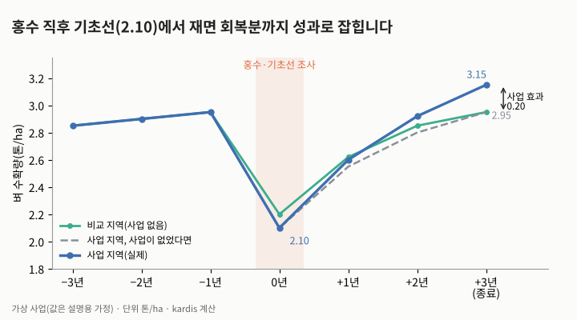
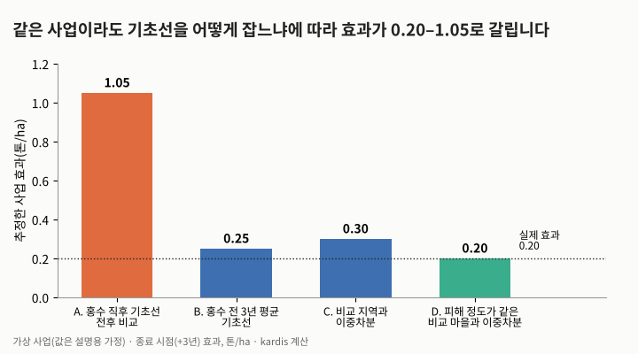
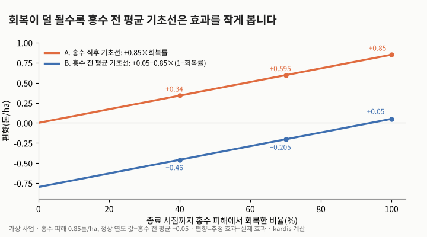
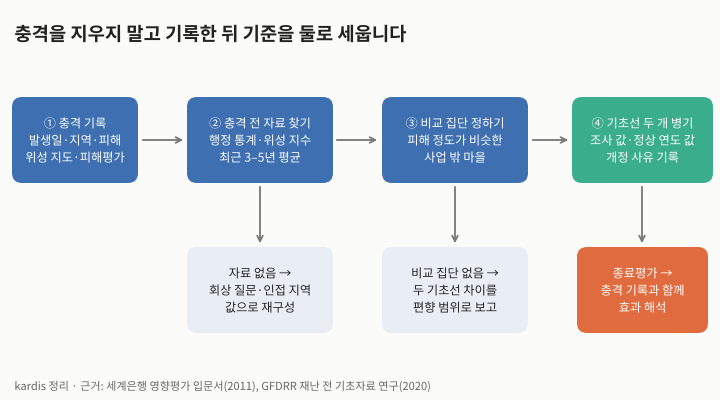

재난과 기후 사건이 기초선 값을 흔들 때 어떻게 보정해야 할까요? 결론은 충격 직후 값 하나만 기초선으로 두지 말고, 충격 전 자료로 만든 「정상 연도 값」을 함께 적고 비교 집단을 정해야 한다는 것입니다. 충격 직후 값을 기준으로 전후를 비교하면 자연 회복분이 사업 성과로 잡히고, 반대로 충격 전 평균만 기준으로 삼으면 회복이 덜 된 경우 성과를 작게 봅니다. 두 오류는 방향이 반대이므로 어느 한쪽 기준만으로는 안전하지 않습니다.

## 무엇이 일어나고 있는가

kardis 중점협력국 동향(2026-11-06 기준, 25개국 119건, 2026-09-01–11-04)에서 홍수·가뭄·엘니뇨·폭우·눈사태를 언급한 항목은 6개국 13건입니다(주제로 다룬 것은 일부). 네팔에서는 8월 26일 부테코시·트리슐리 강 홍수로 사망 1,457명, 실종 4,720명이 집계됐고(10월 10일, 네팔 경찰), 세계은행은 직접 물적 피해를 16억 6천만 달러로 추정했습니다. 그중 83%가 인프라입니다. 페루는 10월 15일 엘니뇨 대응책을 발표했고, 미국 해양대기청(NOAA) 기후예측센터는 10월 8일 「강한–매우 강한 엘니뇨가 2027년 1–3월까지 이어질 가능성이 높다」고 밝혔습니다.

| 나라(항목 수) | 충격과 시점 | 기초선에 미치는 경로 | 흔들리는 지표 예 |
|---|---|---|---|
| 네팔(6) | 8월 26일 홍수, 이미 발생(눈사태 1건 포함) | 조사 시점 값이 일시적으로 낮음, 이재민 이동으로 표본 틀 변화 | 소득, 주거, 수력 발전량, 접근성 |
| 페루(3) | 엘니뇨, 2027년 1–3월 예보 | 조사 기간과 충격이 겹칠 수 있음 | 작황, 수인성 질병, 물가 |
| 에티오피아(1) | 엘니뇨 연계 가뭄, 분쟁과 겹침 | 충격 두 개가 섞여 원인 분리가 어려움 | 식량 안보, 실향 가구 비율 |
| 르완다(1) | 동부 가뭄, 2025년 건기 작황 피해 | 직전 해 값이 정상 연도가 아님 | 소농 수확량 |
| 세네갈(1) | 10월 다카르 돌발홍수 | 도시 일부 지역만 충격, 지역 간 차이 확대 | 시설 이용, 위생 |
| 필리핀(1) | 폭우에 따른 공급 차질 | 물가를 거쳐 간접 영향 | 실질 소득, 식비 비중 |

## 직접 계산 1: 가상 사업에서 기초선 시점만 바꿔도 효과가 다섯 배로 보입니다

가상 농업 사업의 지표는 벼 수확량(톤/ha)이고, 홍수가 난 해(0년)에 기초선을 조사했습니다. 홍수 해에 2.95에서 2.10으로 떨어진 뒤 사업이 없어도 종료 시점(+3년)에 2.95로 회복하고, 사업은 0.20을 더한다고 두었습니다. 비교 지역은 피해가 덜해 2.20이었습니다(값은 설명용 가정).

| 연도 | −3 | −2 | −1 | 0(홍수) | +1 | +2 | +3 |
|---|---|---|---|---|---|---|---|
| 사업 지역(실제) | 2.85 | 2.90 | 2.95 | 2.10 | 2.60 | 2.92 | 3.15 |
| 사업이 없었다면 | 2.85 | 2.90 | 2.95 | 2.10 | 2.55 | 2.80 | 2.95 |
| 비교 지역 | 2.85 | 2.90 | 2.95 | 2.20 | 2.62 | 2.85 | 2.95 |

네 방식으로 효과를 계산했습니다(그림 2). A는 홍수 직후 기초선과 전후 비교로 3.15 − 2.10 = 1.05입니다. B는 홍수 전 3년 평균(2.90)을 기초선으로 써서 0.25입니다. C는 비교 지역과의 이중차분으로 (3.15 − 2.10) − (2.95 − 2.20) = 0.30입니다. 비교 지역의 피해가 덜해 0.10이 남습니다. D는 비교 지역 안에서 홍수 해 값이 2.10으로 같은 마을만 골라(이 마을들도 2.95로 회복한다고 가정) 이중차분한 값으로, 실제 효과 0.20과 같습니다.

| 방식 | 계산 | 추정 효과 | 실제와 차이 |
|---|---|---|---|
| A. 홍수 직후 기초선, 전후 비교 | 3.15 − 2.10 | 1.05 | +0.85 |
| B. 홍수 전 3년 평균 기초선 | 3.15 − 2.90 | 0.25 | +0.05 |
| C. 비교 지역과 이중차분 | 1.05 − 0.75 | 0.30 | +0.10 |
| D. 피해 정도가 같은 비교 마을과 이중차분 | 1.05 − 0.85 | 0.20 | 0 |

## 직접 계산 2: 회복이 덜 되면 오류의 방향이 바뀝니다

A의 오류는 「홍수 피해 × 종료 시점까지의 회복률」, B의 오류는 「정상 연도 값과 충격 전 평균의 차이 − 홍수 피해 × (1 − 회복률)」로 쓸 수 있습니다. 가상 사업에서 피해는 0.85(정상 연도 2.95 대비 약 29%), 그 차이는 +0.05입니다. 회복률이 100%이면 A는 +0.85, B는 +0.05로 B가 거의 맞습니다. 회복률이 70%이면 A는 +0.595, B는 −0.205이고, 40%이면 A는 +0.34, B는 −0.46입니다(그림 3). 회복이 일어나는 한 홍수 직후 기초선은 효과를 부풀리고, 충격 전 평균 기초선은 회복이 더딜수록 효과를 깎습니다.

| 회복률 | A 편향 | B 편향 |
|---|---|---|
| 40% | +0.34 | −0.46 |
| 70% | +0.595 | −0.205 |
| 100% | +0.85 | +0.05 |

## 기초선을 보정하는 순서

세계은행 영향평가 입문서(Gertler 외, 2011)는 사업 기간에 가뭄이 든 예를 들어, 사업 전 값은 적절한 반사실(사업이 없었을 때의 값)이 될 수 없다고 설명합니다. 이를 뒤집어 적용하면(kardis 추론) 충격이 기초선 해에 올 때는 효과가 크게 보입니다. 세계은행 GFDRR 연구(2020)는 취약국에서 재난 전 자료가 흔히 없거나 바로 쓸 수 없다고 지적하고, 가장 작은 행정 단위까지 나눈 자료를 해마다 갱신해 두라고 권합니다. 이를 사업 단위에 옮기면 그림 4의 순서가 됩니다.

| 단계 | 내용 | 자료가 없을 때 |
|---|---|---|
| ① 충격 기록 | 발생일, 지역, 피해 정도(위성 지도, 정부 피해평가) | 행정 보고와 언론 보도로 날짜·지역만이라도 기록 |
| ② 충격 전 자료 찾기 | 행정 통계, 위성 지수의 최근 3–5년 평균 | 회상 질문, 인접 지역 값으로 재구성(인사이트 「기초선 자료가 없을 때 기초선 만들기」 참고) |
| ③ 비교 집단 정하기 | 피해 정도가 비슷한 사업 밖 마을 | 두 기초선의 차이를 편향 범위로 보고 |
| ④ 기초선 두 개 병기 | 조사 값과 정상 연도 값, 개정 사유 기록 | 다음 단계: 종료평가에서 충격 기록과 함께 효과 해석 |

## 다른 해석

1. **충격은 회복되지 않을 수도 있습니다.** Hsiang과 Jina(2014)는 1950–2008년 열대성 저기압 6,700여 건을 분석해, 국민소득이 재난 전 추세보다 낮아진 뒤 20년 안에 회복하지 않는다고 보고했습니다. 국가 단위 소득 연구라 사업 지역 수확량에 그대로 옮길 수는 없지만, 회복이 더디다면 그림 3의 왼쪽에 해당하므로 충격 전 평균만 기준으로 삼으면 사업 효과를 작게 보게 됩니다.
2. **충격이 측정의 방해물만은 아닙니다.** 에티오피아 건조지의 PRIME 사업(2012–2017) 평가는 엘니뇨 가뭄을 「회복력」을 재는 기회로 삼았습니다. 패널 조사를 하고 위성 자료와 가구 응답으로 충격 노출을 측정했으며, 연구 소개 자료에 따르면 사업에 노출된 가구의 식량 안보 하락 폭이 평균 24% 작았습니다. 사업 목표가 회복력이라면 충격 직후 값은 지워야 할 잡음이 아니라 성과를 보여 주는 값입니다.
3. **정상 연도 값도 완전하지 않습니다.** 행정 통계와 위성 지수는 조사 지표와 정의가 다를 수 있습니다.

## 연관과 인과, 그리고 한계

- 그림 1–3의 값은 가정입니다. 실제 크기는 사업 자료로만 알 수 있습니다. 이 글은 특정 나라의 사업 성과가 부풀려졌다고 주장하지 않습니다.
- D가 실제 효과와 같아진 것은 「피해 정도가 같으면 회복도 같다」고 가정했기 때문입니다.

## 시사점

| 단계 | 확인하거나 바꿀 일 |
|---|---|
| 기획 | 최근 3–5년 행정 통계와 위성 지수(강수, 식생 등)를 확보할 수 있는지, 기초선 조사 기간이 우기·엘니뇨 예보와 겹치는지 점검합니다. |
| 착수 | 기초선 보고서에 조사 값과 정상 연도 값을 함께 적고, 조사 직전 1년 안의 충격(날짜, 지역, 피해 정도)을 기록합니다. 비교 마을은 피해 정도를 기준으로 고릅니다. |
| 집행 | 충격이 새로 생기면 지점별 피해를 기록하고, 목표치를 고칠 때는 개정 사유와 근거 자료를 성과관리 문서에 남깁니다. |
| 종료 | 종료평가에서 전후 비교만으로 효과를 말하지 않고, 비교 집단 결과와 두 기초선의 차이를 함께 보고합니다. |

## 계산 방법

- 동향 집계: kardis 중점협력국 동향(2026-11-06 갱신본) 119건(25개국, 2026-09-01–11-04) 중 제목·요약에 「홍수, 가뭄, 엘니뇨, 폭우, 눈사태, 돌발홍수」가 들어간 13건. 네팔 6(09-27 눈사태, 10-09, 10-10, 10-15, 10-27, 10-29), 페루 3(10-07, 10-15, 10-21), 에티오피아 1(10-16), 르완다 1(11-03), 세네갈 1(10-06), 필리핀 1(10-05). 키워드에 걸리지 않는 재해성 항목도 직접 훑어보았고, 몽골 오유톨고이 낙석(10-30)은 광산 사고로 보고 넣지 않았습니다. 경로와 지표 분류는 kardis 판단입니다.
- 그림 1·2: A = 3.15 − 2.10 = 1.05. B = 3.15 − (2.85 + 2.90 + 2.95)/3 = 0.25. C = (3.15 − 2.10) − (2.95 − 2.20) = 0.30. D = (3.15 − 2.10) − (2.95 − 2.10) = 0.20. 실제 효과 = 3.15 − 2.95 = 0.20.
- 그림 3: 피해 d = 2.95 − 2.10 = 0.85, 정상 연도 값과 충격 전 평균의 차이 g = 2.95 − 2.90 = 0.05, 회복률 r. A 편향 = d × r, B 편향 = g − d × (1 − r). 피해 비율 0.85/2.95 = 28.8%.
- 표와 그림은 위 자료와 계산값으로 kardis가 직접 만들었습니다.

## 출처

- [ENSO Diagnostic Discussion](https://www.cpc.ncep.noaa.gov/products/analysis_monitoring/enso_advisory/ensodisc.shtml) · 미국 해양대기청 기후예측센터(NOAA CPC), 2026-10-08
- [Impact Evaluation in Practice](https://documents1.worldbank.org/curated/en/823791468325239704/pdf/Impact-evaluation-in-practice.pdf) · Gertler, Martinez, Premand, Rawlings, Vermeersch, 세계은행, 2011(3장 40–42쪽)
- [Pre-Disaster Baseline Datasets for Quick, Effective and Coordinated Disaster Assessment and Recovery](https://documents1.worldbank.org/curated/en/439711585803223033/text/Scoping-Study-Pre-Disaster-Baseline-Datasets-for-Quick-Effective-and-Coordinated-Disaster-Assessment-and-Recovery.txt) · Tadonki, 세계은행 GFDRR, 2020
- [The Causal Effect of Environmental Catastrophe on Long-Run Economic Growth: Evidence From 6,700 Cyclones](https://www.nber.org/papers/w20352) · Hsiang, Jina, NBER Working Paper 20352, 2014
- [PRIME 사업 평가 연구 소개](https://www.scientia.global/wp-content/uploads/Dr-Lisa-C.-Smith-Timothy-R.-Frankenberger.pdf) · Scientia(Lisa C. Smith, Timothy R. Frankenberger 연구)
- [Nepal floods cause $1.66 billion in direct physical damage: World Bank](https://www.dtnext.in/news/world/nepal-floods-cause-166-billion-in-direct-physical-damage-world-bank) · DT Next(IANS), 2026-10-09
- [Bhotekoshi flood official death toll put at 1,457](https://english.nepalnews.com/s/nation/bhotekoshi-flood-official-death-toll-put-at-1457/) · Nepal News, 2026-10-10
- [페루 정부, 엘니뇨 대응책 발표](https://www.notiperu.com.pe/peru/noticia-peru-presidenta-fujimori-anuncia-importantes-acciones-gobierno-frente-fenomeno-nino-20261016052434.html) · Notiperú, 2026-10-16
- [중점협력국 동향](https://github.com/kardisceo-kr/kardis-data) · kardis, 2026-11-06 확인
