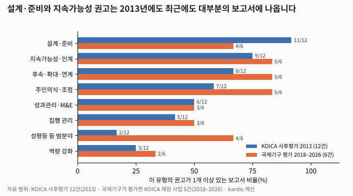
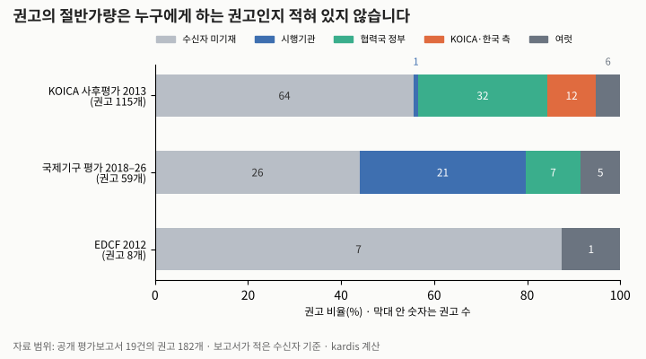
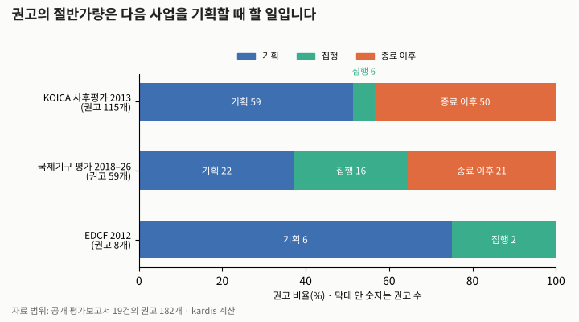
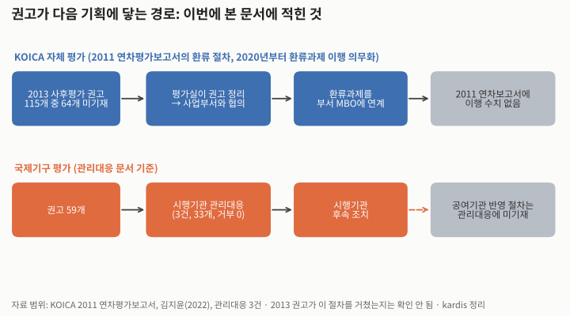

평가보고서의 권고는 보고서마다 반복될까요? 공개 평가보고서 19건에서 권고 182개를 뽑아 8개 유형으로 나누었습니다. 설계·준비 권고는 19건 중 16건, 지속가능성·인계 권고는 14건에 있었고, 두 유형이 권고의 52%였습니다. 2013년 KOICA 사후평가 12건과 2018–2026년 국제기구가 평가한 KOICA 재원 사업 6건 모두에서 이 두 유형이 대부분의 보고서에 나옵니다. 그런데 권고 182개 중 97개(53%)는 누구에게 하는 권고인지 적혀 있지 않고, KOICA·한국 측을 단독 수신자로 적은 권고는 12개(7%)입니다. 권고의 48%는 다음 사업을 기획할 때 할 일이므로, 수신자가 비어 있으면 그 권고가 기획 절차에 들어갈 길도 문서에서 보이지 않습니다.

## 어떤 보고서를 보았나

| 묶음 | 보고서 | 권고 수 |
|---|---|---|
| KOICA 사후평가(2013. 12., 한국 대학·컨설팅사·공공기관 수행) | 12건: 베트남 3, 캄보디아 2, 몽골 2, 필리핀·이집트·우즈베키스탄·이라크·과테말라 각 1 | 115 |
| 국제기구가 평가한 KOICA 재원 사업(2018–2026) | 6건: WFP 캄보디아, UNICEF 탄자니아, UNDP 파푸아뉴기니, ILO, GGGI 네팔·요르단 | 59 |
| EDCF 사후평가(2012) | 1건: 스리랑카 도로 | 8 |

권고마다 미리 정한 8개 유형 중 하나, 할 일의 단계(기획·집행·종료 이후), 보고서가 적은 수신자를 기록했습니다. KOICA 사후평가 12건은 OECD 평가자료실(DEReC)에 실린 보고서입니다.

## 2013년과 최근 평가에 같은 유형이 나옵니다

| 유형 | KOICA 2013(12건) | 국제기구 2018–2026(6건) | 전체 19건 |
|---|---|---|---|
| 설계·준비 | 11 | 4 | 16 |
| 지속가능성·인계 | 9 | 5 | 14 |
| 후속·확대·연계 | 8 | 5 | 13 |
| 주인의식·조정 | 7 | 5 | 13 |
| 성과관리·M&E | 6 | 3 | 10 |
| 집행 관리 | 5 | 3 | 9 |
| 성평등 등 범분야 | 2 | 4 | 7 |
| 역량 강화 | 3 | 2 | 5 |

(그 유형의 권고가 1개 이상 있는 보고서 수. 전체 19건에는 EDCF 1건이 포함됩니다.)

두 묶음은 평가 주체도 시기도 다르지만 설계·준비, 지속가능성·인계, 후속·확대·연계, 주인의식·조정 네 유형이 두 묶음 모두에서 절반을 넘는 보고서에 나옵니다. 보고서 비율이 가장 크게 늘어난 유형은 성평등 등 범분야로, 2013년 2건(17%)에서 최근 4건(67%)이 되었습니다.

## 누구에게 하는 권고인가

| 묶음 | 수신자 미기재 | 시행기관 | 협력국 정부 | KOICA·한국 측 | 여럿 |
|---|---|---|---|---|---|
| KOICA 사후평가(115) | 64 | 1 | 32 | 12 | 6 |
| 국제기구 평가(59) | 26 | 21 | 7 | 0 | 5 |
| EDCF(8) | 7 | 0 | 0 | 0 | 1 |

KOICA 사후평가에서 KOICA·한국 측을 단독 수신자로 적은 권고는 12개(필리핀 보고서의 양국 공동 권고 5개는 별도)이고, 12건 중 6건에 있습니다. 국제기구 평가는 수신자를 적은 경우 대부분 시행기관이며, KOICA는 네팔 보고서에서 여럿 중 하나로 3번 나옵니다. 관리대응이 공개된 3건(WFP 1, GGGI 2)은 권고 33개를 하나도 거부하지 않았고 책임 부서는 모두 시행기관이었습니다.

## 다음 기획으로 가는 길

기획 단계 권고는 KOICA 사후평가 59개(51%), 국제기구 평가 22개(37%), EDCF 6개로 모두 87개(48%)입니다.

KOICA는 2011 연차평가보고서(2012. 6.)에서 2009년부터 환류체계를 운영한다고 밝혔습니다. 평가실이 권고를 정리하고, 사업부서와 협의해 환류과제를 정한 뒤, 부서의 목표관리(MBO)에 연계하고 이행을 점검하는 절차입니다. 다만 이 보고서는 평가 11건의 권고 중 몇 개가 이행되었는지 수치를 싣지 않았고, 11건 중 8건에 「환류과제를 선정해 MBO에 반영할 것」이라는 예정형 문장이 있습니다. 이후 KOICA는 「2020년 이후에는 동 제언을 교훈, 환류과제로 분류하여 … 환류과제는 반드시 이행하는 것으로」 구분했습니다(김지윤 2022). 같은 글은 평가 결과를 「의사결정과 향후 사업 발굴, 기획 및 모니터링에 반드시 적용하게 하는 제도적 틀은 부족한 상황」이라고 진단했습니다.

KOICA 자체 평가에는 환류 절차가 있고 2011 연차보고서에는 이행 수치가 없습니다. 2013년 권고가 이 절차를 거쳤는지는 확인하지 못했습니다. 국제기구 평가의 관리대응 3건에는 공여기관이 권고를 다음 기획에 반영하는 절차가 적혀 있지 않습니다. 다만 네팔 보고서의 3개 권고는 KOICA를 수신자 중 하나로 적었습니다.

## 다른 해석

1. **유형이 겹치는 것은 평가 틀 때문일 수 있습니다.** OECD DAC 기준에 지속가능성이 있어 어느 평가든 관련 권고가 나오기 쉽습니다. 같은 평가사가 같은 달에 낸 보고서 3건(우즈베키스탄 1, 몽골 2)에는 같은 문장의 권고가 있어, 반복의 일부는 작성 관행에서 옵니다.
2. **보고서 19건은 사업이 모두 다릅니다.** 같은 사업에서 같은 권고가 되풀이되었는지는 알 수 없습니다.
3. **KOICA는 2020년부터 환류과제를 반드시 이행하도록 구분했습니다.** 2013년 보고서의 수신자 공백이 지금의 KOICA 자체 평가에도 있는지, 이 절차가 국제기구 위탁 평가에도 적용되는지는 이 자료로 판단할 수 없습니다.

## 연관과 인과, 그리고 한계

- 표본은 무작위가 아닙니다. 웹에서 원문을 읽을 수 있었던 보고서만 들어갔고, KOICA 국문 종료평가는 넣지 못했습니다.
- 권고를 나누는 단위가 보고서마다 다릅니다. 캄보디아 관개·홍수, 베트남 IT대학 보고서는 하위 항목을 한 권고로 셌습니다. 그래서 권고 수 비율보다 보고서 수를 주로 보았습니다.
- 분류는 같은 기준으로 했고, 독립 검토의 재분류 일치도는 국제기구·EDCF 표본 75%(24개 중 18개), KOICA 사후평가 유형 98%(47개 중 46개)였습니다. 같은 문장이 반복된 3건은 설계·준비 유형의 보고서 수에 그대로 들어 있습니다.
- 유형이 겹친다는 것은 연관입니다. 권고가 반영되지 않아 반복된다는 인과는 이 자료로 확인할 수 없습니다.

## 시사점

| 단계 | 확인하거나 바꿀 일 |
|---|---|
| 기획 | 같은 분야·같은 나라의 지난 평가에서 「기획 단계에서 할 일」 권고를 뽑아 기획서에 적고, 반영 여부를 한 줄씩 표시합니다. 이번 자료에서 기획 단계 권고는 48%였습니다. |
| 기획 | 지속가능성·인계 권고가 반복되는 분야라면 종료 뒤 활동을 이어 갈 예산 주체와 금액을 기획 문서에 적습니다. |
| 착수 | 국제기구 위탁 사업은 평가 권고와 관리대응을 공여기관이 받아 환류과제로 정리하는 절차(누가, 언제)를 협약이나 착수 보고서에 정합니다. |
| 종료 | 평가 과업지시서에 권고마다 수신자(시행기관·협력국 정부·공여기관)를 적도록 요구합니다. 이번 자료에서 53%는 수신자가 적혀 있지 않았습니다. |

## 계산 방법

- KOICA 사후평가 12건(권고 쪽, 권고 수, 인쇄 쪽 번호): 베트남 하노이 친선병원 3단계(52–55, 7), 캄보디아 바티 홍수 방지(70–74, 8), 필리핀 부수앙가 공항(90–95, 15), 몽골 울란바토르 난방문화 개선(80–83, 7), 이집트 자동차 직업훈련(71–73, 6), 우즈베키스탄 호레즘 열공급(87–89, 8), 몽골 울란바토르 지역난방·급수(93–94, 3), 베트남 전자조달(63–64, 5), 캄보디아 바티 관개(80–86, 17), 베트남 다낭 IT대학(83–89, 23), 이라크 아르빌 교통관리(74–75, 5), 과테말라 치말테낭고 모자보건(44–46, 11).
- 권고 단위: 번호·글머리표·소제목으로 나뉜 권고 1개 = 1개. 교훈(lessons)으로 표시된 항목은 제외했습니다. 같은 권고를 잇는 단락은 하나로 합쳤습니다.
- 유형: 지속가능성·인계(종료 뒤 운영 예산, 유지관리, 인계, 출구 전략) / 설계·준비(수요 조사, 대상 선정, 범위, 변화 이론, 현지 여건 반영) / 후속·확대·연계(후속 단계, 확대, 다른 사업과 연계, 홍보) / 주인의식·조정(협력국 기관·수혜자 참여와 조정, 국가 정책 정합) / 성평등 등 범분야 / 성과관리·M&E(기초선, 지표, 모니터링, 평가 계획) / 집행 관리(조달, 일정, 예산, 감독) / 역량 강화(교육훈련, 기술 이전). 두 유형에 걸치면 권고의 주 동사가 가리키는 행동으로 정했습니다.
- 단계: 기획, 집행, 종료 이후. 수신자: 보고서가 그 권고나 묶음 제목에 적은 대상만 기록하고, 적지 않았으면 「미기재」로 셌습니다.
- 계산: 유형별로 그 유형의 권고가 있는 보고서 수, 단계·수신자별 권고 수. 관리대응은 문서의 수용 여부와 책임 부서 칸을 셌습니다.
- 표와 그림은 위 계산값으로 kardis가 직접 만들었습니다. 보고서 원문은 다시 싣지 않았습니다.

## 출처

- KOICA 사후평가보고서 12건(Ex-post Evaluation Report) · KOICA, 2013. 12.(OECD 평가자료실 DEReC 게재, 보고서 목록은 「계산 방법」)
- [2011 Annual Evaluation Report](https://www.oecd.org/content/dam/oecd/en/toolkits/derec/evaluation-reports/derec/korea/2011%20Annual%20Evaluation%20Report.pdf) · KOICA, 2012. 6.(환류체계 p.6, 평가별 항목 p.10–20)
- [Final Activity Evaluation: KOICA Supported Home-Grown School Feeding Programme in Cambodia](https://docs.wfp.org/api/documents/WFP-0000164504/download/) · WFP, 2024. 12. / [관리대응](https://docs.wfp.org/api/documents/WFP-0000166542/download)
- [Endline Evaluation Report (UNICEF-KOICA Project)](https://www.unicef.org/tanzania/media/2381/file/Endline%20Evaluation%20Report%20(UNICEF-KOICA%20Project).pdf) · UNICEF Tanzania, 2020-08-04
- [Final Evaluation of the Project Addressing Conflict and Fragility in the Highlands of Papua New Guinea](https://erc.undp.org/evaluation/documents/download/24510) · UNDP, 2025. 5.
- [Final Evaluation of Global Component of ILO KOICA project](https://webapps.ilo.org/ievaldiscovery/files/file/216473) · ILO, 2018. 3.
- [네팔 NP07 종료평가 보고서](https://gggi.org/wp-content/uploads/2026/10/NP07-E2026-Evaluation-Report.pdf) · GGGI, 2026. 7. / [관리대응](https://gggi.org/wp-content/uploads/2026/11/NP07-E2026-Management-Response-and-Action-Plan-1.pdf) · 2026. 11.
- [요르단 JO11 종료평가 보고서](https://gggi.org/wp-content/uploads/2026/07/JO11_Cleaned-Evaluation-Report-1.pdf) · GGGI, 2026. 7. / [관리대응](https://gggi.org/wp-content/uploads/2026/11/JO11-E2026-Management-Response-and-Action-Plan.pdf) · 2026. 8.
- [Ex-post Evaluation Report 2012-07: Sri Lanka Road Rehabilitation Project](https://t4.oecd.org/derec/korea/EDCFSri_Lanka_Road_Rehabilitation.pdf) · 한국수출입은행(EDCF), 2012
- [KOICA 평가 체계 발전 과정과 향후 과제](https://www.ejidc.org/archive/view_article?pid=jidc-17-2-105) · 김지윤, 『국제개발협력』 17(2): 105–120, 2022
