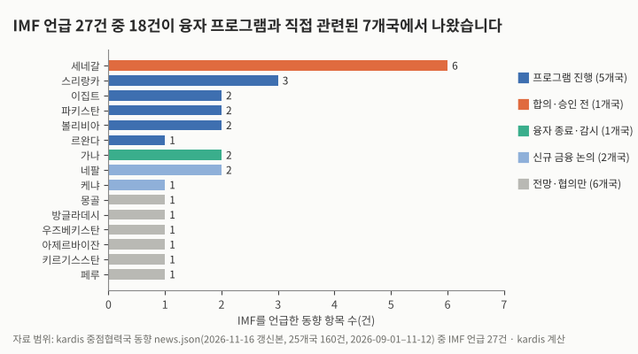
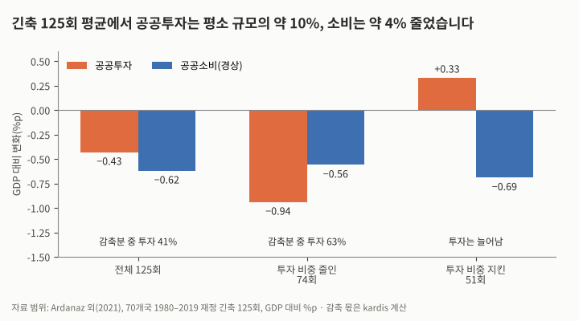
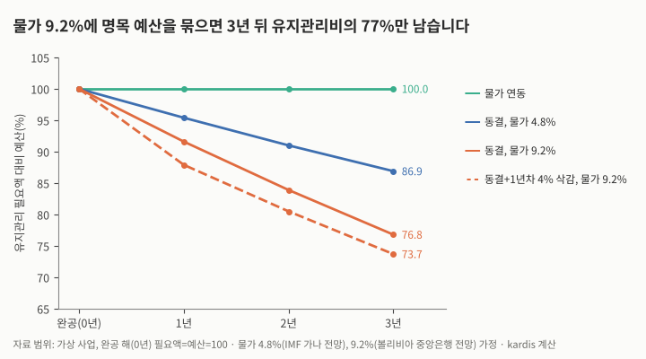
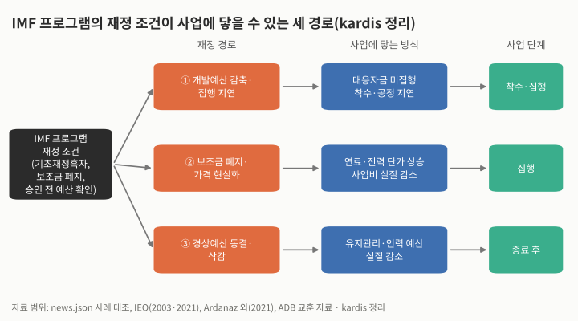

IMF 프로그램과 재정 긴축은 수원국 분담금과 사업 지속성에 어떤 영향을 줄까요? 결론은 영향이 한 경로가 아니라 세 경로로 온다는 것입니다. ① 개발예산 감축과 예산 승인 지연은 대응자금을 늦출 수 있고, ② 보조금 폐지와 가격 현실화는 연료·전력 단가를 올려 사업비의 실질 가치를 줄일 수 있으며, ③ 경상예산 동결은 완공 뒤 유지관리비를 갉아먹을 수 있습니다. 착수 단계에서 대응자금만 점검하면 ②와 ③을 놓칩니다. 다만 투자를 지킨 긴축 사례도 많습니다.

## 무엇이 일어나고 있는가

kardis 중점협력국 동향(2026-11-16 기준, 25개국 160건, 2026-09-01–11-12)에서 IMF를 언급한 항목은 15개국 27건입니다(그림 1). 이 중 18건은 융자 프로그램이 진행 중이거나 합의·종료된 7개국에서 나왔고, 나머지 9건은 8개국 소식으로, 신규 금융 논의(네팔, 케냐)와 전망·협의 등입니다. 같은 기간 우간다는 IMF 언급 없이 2026/27 회계연도 2분기 운영지출을 약 3조 실링 줄이고 부처의 연료·출장·워크숍 예산을 절반으로 줄이라고 지시했습니다(Daily Monitor, 10월 25일).

| 나라(항목 수) | 동향에 나온 상태와 조건 | 경로(그림 4) |
|---|---|---|
| 세네갈(6) | 22억 달러 프로그램 9월 합의, 이사회 승인 전. 11월 3일 국회가 2026년 수정예산을 찬성 20, 반대 126, 기권 3으로 부결 | ① 예산 미확정으로 대응자금 배정 지연 가능 |
| 스리랑카(3) | 29억 달러 확대신용, 2027년 3월 종료. 2027년 예산은 기초재정흑자 GDP 2.6% 요건, 유류가격 국제가 연동 권고 | ① ② |
| 파키스탄(2) | 확대신용 4차·회복지속성 3차 점검 실무 합의(약 12억 달러), 세제 개편 워크숍 | ① |
| 이집트(2) | 확대신용 최종 점검, 세계은행 10억 달러 개발정책차관(국영기업·조세 개혁 조건) | ① |
| 볼리비아(2) | 36개월 약 19억 달러 확대금융 승인, 연료보조금 철폐. 경유 리터당 9.80볼에서 17.95볼로 83.2% 인상 | ② |
| 르완다(1) | 확대신용 1차 점검 실무 합의(약 3,570만 달러), 8월 물가 15.7% | ② ③ |
| 가나(2) | 30억 달러 확대신용 5월 종료, 비융자 정책조정수단으로 전환. 2027년 예산 기초재정흑자 GDP 0.5% 이상 | ③ |

## 직접 계산 1: 긴축에서는 투자가 소비보다 더 큰 비율로 줄었습니다

Ardanaz 외(2021, 미주개발은행)는 70개국의 1980–2019년 재정 긴축 125회를 분석했습니다. 평균적으로 공공투자는 GDP 대비 0.43%p, 공공소비(경상)는 0.62%p 줄었습니다. 저자들은 투자 감축분이 평균 투자 규모의 약 10%, 소비 감축분은 평균 소비의 약 4%라고 계산했습니다. kardis가 감축분 가운데 투자 몫을 계산하면 전체 평균은 41%(0.43 ÷ 1.05)이고, 투자 비중이 줄어든 74회에서는 63%(0.94 ÷ 1.50)입니다(그림 2). IMF도 경기 하강기의 재정 조정은 「흔히 투자 지출에 떨어진다」고 적었습니다(IMF, 2015, Box 7).

| 구분 | 공공투자 | 공공소비 | 감축분 중 투자 몫 |
|---|---|---|---|
| 전체 125회 | −0.43 | −0.62 | 41% |
| 투자 비중 줄인 74회 | −0.94 | −0.56 | 63% |
| 투자 비중 지킨 51회 | +0.33 | −0.69 | 투자 증가 |

이를 가상 사업에 적용했습니다. 총사업비 1,000만 달러, 수원국 대응자금 150만 달러(15%)를 4년간 나눠 내는 사업에서 개발예산이 평균 사례처럼 10% 줄면 대응자금 부족은 15만 달러, 사업비의 1.5%입니다. 금액은 작지만 시점이 문제입니다. 아시아개발은행의 우즈베키스탄 도시 상수도 사업(2010년 자체평가) 교훈은 지방정부 대응자금이 「예외 없이 늦어져」 집행이 지연됐다고 적었습니다. 토지 보상이나 전력 연결처럼 공정의 선행 조건에 대응자금이 묶여 있으면 1.5%의 부족도 공정 전체를 멈출 수 있습니다(kardis 추론).

## 직접 계산 2: 동결된 유지관리 예산은 물가만큼 줄어듭니다

같은 가상 사업이 완공된 해에 유지관리 필요액과 예산이 같다고(100) 두고, 이후 예산은 명목으로 동결하고 필요액은 물가만큼 오른다고 가정했습니다. 물가는 동향에 나온 두 값, IMF의 가나 연말 물가 전망 4.8%와 볼리비아 중앙은행의 연말 전망 9.2%를 3년간 그대로 썼습니다. 3년 뒤 충족률은 4.8%일 때 86.9%, 9.2%일 때 76.8%이고, 1년차에 경상예산을 평균 사례처럼 4% 깎으면 73.7%입니다(그림 3).

| 시나리오 | 완공 | 1년 | 2년 | 3년 |
|---|---|---|---|---|
| 물가 연동 | 100.0 | 100.0 | 100.0 | 100.0 |
| 동결, 물가 4.8% | 100.0 | 95.4 | 91.0 | 86.9 |
| 동결, 물가 9.2% | 100.0 | 91.6 | 83.9 | 76.8 |
| 동결+1년차 4% 삭감, 물가 9.2% | 100.0 | 87.9 | 80.5 | 73.7 |

## 세 경로를 한 장으로 보기

| 경로 | 사업에 닿는 방식 | 단계 | 미리 볼 지표 |
|---|---|---|---|
| ① 개발예산 감축·집행 지연 | 대응자금 미집행, 착수·공정 지연 | 착수·집행 | 대응자금 배정액 대비 집행률, 선행 공정 완료일 |
| ② 보조금 폐지·가격 현실화 | 연료·전력 단가 상승, 사업비 실질 감소 | 집행 | 현지 화폐 기준 단가, 예비비 사용률 |
| ③ 경상예산 동결·삭감 | 유지관리·인력 예산 실질 감소 | 종료 후 | 유지관리 필요액 대비 배정액, 시설 가동률 |

## 다른 해석

1. **IMF 프로그램이 사회 지출을 줄인다고 단정할 수 없습니다.** IMF 독립평가실(IEO, 2003)이 146개국(1985–2000)을 계량 분석한 결과, 프로그램이 있어도 보건·교육 공공지출은 줄지 않았고 각각 GDP 대비 약 0.3–0.4%p 늘었습니다. 다만 IEO(2021)는 2008–2019년 프로그램에서 보건·교육 지출이 크게 늘지 않았고, 일반재원 프로그램은 지출 삭감에 크게 기댔다고 평가했습니다.
2. **투자가 늘어난 경우도 있습니다.** IEO(2021)는 저소득국 프로그램에서 세수 확충 덕분에 자본지출이 그렇지 않았을 때보다 높았다고 밝혔고, Ardanaz 외의 125회 중 51회는 투자 비중을 지켰습니다. 투자 비중을 가장 크게 늘린 경우(상위 5%)에는 GDP 1% 규모 긴축 뒤 3년 안에 생산이 약 0.9% 늘어난 것으로 추정됐습니다(연관 추정).
3. **IMF 프로그램은 다른 재원을 끌어오기도 합니다.** 스리랑카의 아시아개발은행 1억 달러 차관은 IMF 프로그램 개혁을 뒷받침하는 6억 2천만 달러 묶음의 일부입니다. 예산 지원이 늘면 대응자금 여력이 생길 수 있습니다.

## 연관과 인과, 그리고 한계

- Ardanaz 외의 125회는 IMF 프로그램이 아니라 재정 긴축 일반입니다. 이 글은 IMF 프로그램이 투자 삭감의 원인이라고 주장하지 않으며, 긴축이 있을 때 투자가 더 깎이는 경향을 연관으로 보여 줄 뿐입니다.
- 표의 프로그램 상태는 동향 항목에 적힌 내용 기준입니다. 기사에 프로그램이 언급되지 않은 나라도 실제로는 프로그램이 있을 수 있습니다.
- 대응자금 비율과 물가 3년 고정은 설명용 가정입니다. 특정 나라 사업의 지속성이 나빠졌다고 주장하지 않습니다.

## 시사점

| 단계 | 확인하거나 바꿀 일 |
|---|---|
| 기획 | 협력국의 IMF 프로그램 상태(점검 일정, 기초재정수지 목표, 보조금 개편 계획)를 위험 분석에 적고, 대응자금이 선행 공정(토지, 전력 연결)에 묶여 있는지 확인합니다. |
| 착수 | 대응자금 연도별 배정표를 협의 의사록에 남기고, 연료·전력 단가 상승에 대비한 예비비 근거를 현지 물가 전망으로 적습니다. |
| 집행 | 대응자금 배정액 대비 집행률을 분기 성과 보고에 넣고, 예산 부결·동결 같은 사건이 생기면 날짜와 영향을 기록합니다. |
| 종료 | 지속성 평가에서 유지관리 필요액 대비 배정액을 물가를 반영한 실질 기준으로 보고하고, 명목 예산 유지만으로 지속성이 확보됐다고 쓰지 않습니다. |

## 계산 방법

- 동향 집계: kardis 중점협력국 동향(2026-11-16 갱신본) 160건(25개국, 2026-09-01–11-12) 중 제목·요약에 「IMF」 또는 「국제통화기금」이 들어간 27건, 15개국. 세네갈 6, 스리랑카 3, 이집트·가나·파키스탄·네팔·볼리비아 각 2, 르완다·케냐·몽골·방글라데시·우즈베키스탄·아제르바이잔·키르기스스탄·페루 각 1. 프로그램 관련 7개국 합계 6+3+2+2+2+1+2 = 18건. 상태 분류와 경로 분류는 kardis 판단입니다. 세네갈 표결 수는 AFP 보도(반대 126, 찬성 20, 기권 3)를 따랐습니다.
- 볼리비아 경유 인상률: (17.95 − 9.80) ÷ 9.80 = 83.2%.
- 그림 2: Ardanaz 외(2021)의 GDP 대비 변화(%p). 감축분 중 투자 몫 = 투자 감소 ÷ (투자 감소 + 소비 감소): 0.43 ÷ 1.05 = 41.0%, 0.94 ÷ 1.50 = 62.7%.
- 대응자금: 150만 달러 × 10% = 15만 달러, 15만 ÷ 1,000만 = 1.5%.
- 그림 3: 충족률 = (1 − c) ÷ (1 + π)^t, 완공 해는 100. π는 4.8% 또는 9.2%, c는 1년차부터 4% 삭감 시나리오에서만 적용.
- 표와 그림은 위 자료와 계산값으로 kardis가 직접 만들었습니다.

## 출처

- [Fiscal Adjustment in IMF-Supported Programs: Summary of Findings and Recommendations](https://ieo.imf.org/-/media/ieo/files/evaluations/completed/09-09-2003-evaluation-of-fiscal-adjustment-in-imf-supported-programs/fiscal-adjustment-summary-of-findings-and-recommendations.pdf) · IMF 독립평가실(IEO), 2003
- [Growth and Adjustment in IMF-Supported Programs, Executive Summary](https://ieo.imf.org/-/media/IEO/Files/evaluations/completed/09-09-2021-growth-and-adjustment-in-imf-supported-programs/adg-executive-summary-web.ashx) · IMF 독립평가실(IEO), 2021
- [Making Public Investment More Efficient](https://infrastructuregovern.imf.org/content/dam/PIMA/Forum/IGEUR/Resources/Making%20Public%20Investment%20More%20Efficient%202015.pdf) · IMF, 2015(Box 7)
- [Output effects of fiscal consolidations: does spending composition matter?](https://www.jifp.eco.unc.edu.ar/images/Ardanaz-Cavallo-Izquierdo-Puig.pdf) · Ardanaz, Cavallo, Izquierdo, Puig, 미주개발은행·라플라타국립대, 2021
- [Lessons: Urban Water Supply Project, Uzbekistan](https://lessons.adb.org/lesson/328) · 아시아개발은행(ADB), 2010
- [2027 budget balances IMF discipline with public relief](https://www.sundaytimes.lk/261108/business-times/2027-budget-balances-imf-discipline-with-public-relief-662898.html) · The Sunday Times(스리랑카), 2026-11-08
- [Govt halves non-essential spending as local currency hits 33-year low](https://www.monitor.co.ug/uganda/news/national/govt-halves-non-essential-spending-as-local-currency-hits-33-year-low-against-us-dollar-5645604) · Daily Monitor(우간다), 2026-10-25
- [Senegal's opposition-dominated parliament rejects key budget bill](https://citizen.digital/article/senegals-opposition-dominated-parliament-rejects-key-budget-bill-n393269) · Citizen Digital(AFP), 2026-11-03
- [IMF 이사회, 볼리비아 확대금융 승인](https://www.riotimesonline.com/bolivia-imf-loan-approved-214-million-expats-2026/) · Rio Times, 2026-10-02
- [볼리비아 중앙은행 물가 전망 9.2% 유지](https://correodelsur.com/economia/20261008/bcb-ratifica-proyeccion-inflacion-llegara-este-ano-a-9-2-este-ano-pese-al-ajuste-del-diesel.html) · Correo del Sur, 2026-10-08
- [IMF, 가나 성장률 상향·연말 물가 4.8% 전망](https://www.adomonline.com/imf-raises-ghanas-2026-growth-forecast-to-5-7-sees-inflation-falling-to-4-8/) · Adom Online, 2026-10-13
- [중점협력국 동향](https://github.com/kardisceo-kr/kardis-data) · kardis, 2026-11-16 확인(파키스탄·이집트·르완다·가나·스리랑카 항목의 개별 출처는 동향 파일에 있습니다)
