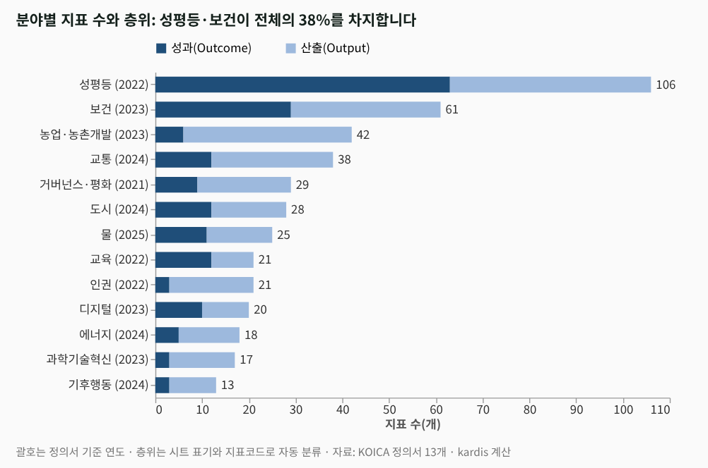
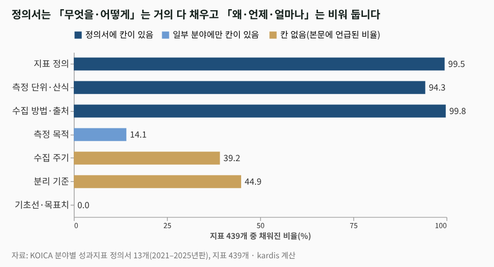

KOICA가 공개한 분야별 성과지표 정의서에서 지표를 고르면 측정 설계가 끝날까요? 13개 분야 정의서에 실린 지표 439개를 하나씩 세어 보았습니다. 지표 정의와 수집 방법·출처는 99% 넘게 채워져 있고, 측정 단위와 산식도 94%에 있습니다. 반면 측정 목적은 14%에만 있고, 수집 주기와 담당, 기초선과 목표치를 적는 칸은 13개 정의서 어디에도 없습니다. 정의서는 「무엇을 어떻게 잴지」를 분야 공통으로 정해 둔 자료입니다. 「왜, 언제, 누가, 어디까지」는 사업이 정해야 합니다. kardis 측정 설계표의 다섯 칸으로 보면 두 칸은 정의서에서 가져올 수 있고, 세 칸은 사업이 채워야 합니다.

## 어떤 자료를 보았나

KOICA 홈페이지 정책 문서 게시판에는 분야별 성과프레임워크와 지표 정의서가 엑셀 파일로 올라와 있습니다. 2024년 1월 게시된 「SDGs-KOICA 성과프레임워크 개정본(2023년)」에 13개 분야, 2025년 5월 게시된 「기후, 환경, 경제개발 분야 KOICA 성과프레임워크」에 6개 분야 파일이 있습니다. 두 게시글에 같은 분야가 있으면 최신판을 골라 13개 파일을 분석했습니다. 기준 연도는 거버넌스·평화 2021년판부터 물 2025년판까지 다릅니다.

정의서는 지표마다 지표명, 지표코드, 지표 정의, 측정 단위 및 방법, 수집 방법 및 출처, 대리지표, 유의사항을 적는 카드 형식입니다. 카드를 모두 뽑으니 470개였고, 국문·영문 중복과 같은 분야 안의 같은 이름을 빼면 439개였습니다.

성평등(106개)과 보건(61개)이 전체의 38%입니다. 다만 성평등 정의서의 106개 중 48개는 다른 분야 정의서에도 같은 이름으로 실린 지표입니다. 겹치는 분야는 보건이 26개로 가장 많고 교통 6개, 거버넌스·평화 5개 순입니다. 다른 분야 지표에 성별 분리를 붙여 다시 실은 것입니다. 시트 표기와 지표코드로 층위를 나누면 성과(Outcome) 지표가 178개, 산출(Output) 지표가 261개입니다. 지표코드나 지표명에 SDG 번호가 붙은 지표는 105개(24%)입니다.

## 측정 설계표 다섯 칸에 대 보면

kardis는 지표 하나마다 측정 목적, 측정 지표, 자료원 및 수집 방법, 수집 주기 및 담당, 성공 판정 기준의 다섯 칸을 채우도록 권합니다. 정의서 카드의 항목을 이 다섯 칸에 맞춰 보았습니다.

| 측정 설계표 칸 | 정의서에 있는 항목 | 채워진 지표(439개 중) | 사업이 정할 것 |
|---|---|---|---|
| 측정 목적 | 지표 수집 목적(보건·도시 정의서에만 있음) | 62개, 14.1% | 이 값으로 어떤 결정을 할지 |
| 측정 지표 | 지표 정의, 측정 단위 및 방법 | 정의 437개(99.5%), 단위·산식 414개(94.3%) | 대상 지역과 집단에 맞춘 분모, 분리 기준 |
| 자료원 및 수집 방법 | 수집 방법 및 출처 | 438개, 99.8% | 실제로 쓸 조사나 대장의 이름 |
| 수집 주기 및 담당 | 전용 칸 없음 | 본문에 주기가 언급된 지표 172개(39.2%) | 언제, 누가 모으는지 |
| 성공 판정 기준 | 칸 없음 | 0개 | 기초선 값, 목표치, 목표치의 근거 |

분리 기준도 전용 칸이 없습니다. 지표명, 정의, 유의사항 가운데 어디든 성별 등의 분리를 언급한 지표는 197개(44.9%)입니다. 지표명으로 가려낸 사람 수 지표 133개만 보면 99개(74%)에 분리 언급이 있습니다.

## 다른 해석: 비어 있는 것이 아니라 역할을 나눈 것

정의서에 목표치와 수집 주기가 없는 것을 결함으로 볼 일은 아닙니다. 목표치와 주기는 사업의 규모, 기간, 대상에 따라 달라지므로 분야 공통 정의서에 정해 둘 수 없습니다. 2026년 6월 KOICA가 게시한 「제4차 무상분야 기본계획」 붙임자료도 앞으로 만들 대표 지표 체계에 「지표 설명, 데이터 수집 방법 등 방법론」을 담겠다고 적었습니다. 분야 정의서가 맡는 범위는 거기까지이고, 나머지는 사업 단계에서 정하도록 나뉘어 있다고 읽는 편이 맞습니다.

그래서 확인할 지점은 사업 쪽에 있습니다. 표준 지표를 그대로 옮겨 적은 성과표라도 나머지 세 칸이 비어 있으면, 종료 시점에 달성 여부를 판단할 기준이 없습니다.

## 한계

- 칸이 있는지와 채워졌는지만 셌고, 정의나 산식의 질은 평가하지 않았습니다.
- 수집 주기와 분리 기준의 언급은 낱말 검색(주기, 매년, 분기, 분리, 성별 등)으로 셌으므로 실제보다 많거나 적을 수 있습니다.
- 성과·산출 구분은 자동 분류라 일부 지표는 원문 구분과 다를 수 있습니다.
- 정의서 기준 연도가 분야마다 다르고, 4차 무상분야 기본계획에 따라 대표지표가 새로 정해질 예정입니다. 이 글의 숫자는 2026년 11월 공개본 기준입니다.
- PDM이나 성과관리계획처럼 사업 단계에서 쓰는 양식은 보지 않았습니다.

## 시사점

| 단계 | 확인하거나 바꿀 일 |
|---|---|
| 기획 | 정의서에서 지표를 고를 때 지표코드와 정의서 기준 연도를 함께 적어 둡니다. 정의서 판이 바뀌면 어느 판과 맞췄는지 대조할 수 있습니다. |
| 기획 | 표준 지표를 그대로 쓰더라도 측정 목적, 수집 주기와 담당, 기초선과 목표치를 성과표에 따로 적습니다. 정의서에는 이 칸이 없습니다. |
| 착수 | 사업 지표의 측정 기간과 단위가 정의서와 같은지 대조합니다. 예를 들어 보건 정의서의 산후관리 지표는 출산 후 48시간 이내를 기준으로 합니다. 다른 기간을 쓰면 정의서 기준으로 합산되지 않습니다. |
| 착수 | 사람 수 지표는 정의서에 분리 기준이 없더라도 성별, 연령, 지역 분리를 착수 때 정해 둡니다. 종료 뒤에는 명단 없이 다시 나눌 수 없습니다. |

## 계산 방법

- 대상: KOICA 정책 문서 게시판의 분야별 정의서 엑셀 13개(거버넌스·평화 2021, 과학기술혁신 2023, 교육 2022, 디지털 2023, 보건 2023, 성평등 2022, 인권 2022, 농업·농촌개발 2023, 도시 2024, 물 2025, 에너지 2024, 교통 2024, 기후행동 2024). 2026년 11월 19일 내려받았습니다.
- 추출: 모든 시트에서 「지표명」 칸을 찾아, 그 아래 같은 열의 항목명과 오른쪽 값을 한 지표로 묶었습니다. 영문 블록과 같은 분야 안의 같은 이름은 하나로 셌습니다(470개 → 439개).
- 채움 판정: 값이 비었거나 「없음」, 「해당 없음」, 「상동」이면 채워지지 않은 것으로 셌습니다.
- 칸 존재 확인: 13개 파일의 모든 셀에서 기초선, 목표치, 수집 주기, 담당을 항목명으로 쓴 칸을 찾았고, 없었습니다.
- 층위: 지표 위쪽의 Outcome·Output 표기와 시트 이름으로 나누고, 지표코드에 OC·OP가 있으면 코드를 따랐습니다.
- 성평등 중복: 괄호 속 분리 표기와 SDG 번호를 지운 지표명이 다른 분야 정의서와 같으면 중복으로 셌습니다.
- 표와 그림은 위 계산값으로 kardis가 직접 만들었습니다. 정의서 원문은 다시 싣지 않았습니다.

## 출처

- KOICA, 「SDGs-KOICA 성과프레임워크 개정본(2023년)」, KOICA 홈페이지 정책 문서, 2024. 1. 18. 게시. https://www.koica.go.kr/koica_kr/8131/subview.do (2026. 11. 19. 확인)
- KOICA, 「기후, 환경, 경제개발 분야 KOICA 성과프레임워크」, KOICA 홈페이지 정책 문서, 2025. 5. 29. 게시. https://www.koica.go.kr/koica_kr/8131/subview.do (2026. 11. 19. 확인)
- 관계부처 합동, 「제4차 무상분야 기본계획」 붙임자료(제12차 무상개발협력전략회의 의결안건 제12-2호, 의결본), KOICA 홈페이지 정책 문서, 2026. 6. 19. 게시. (2026. 11. 19. 확인)
