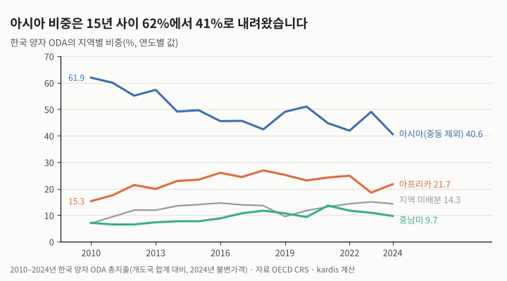
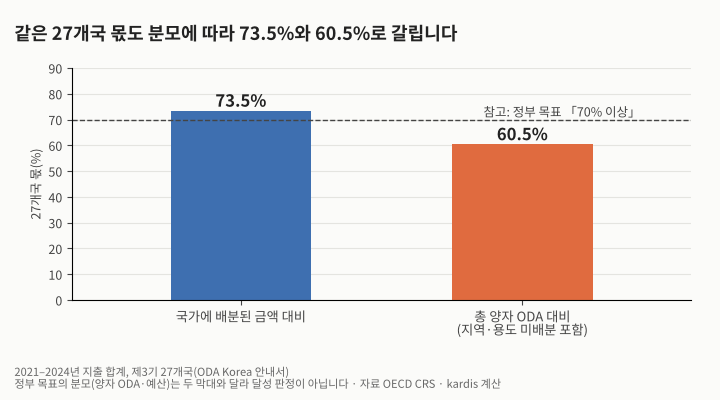
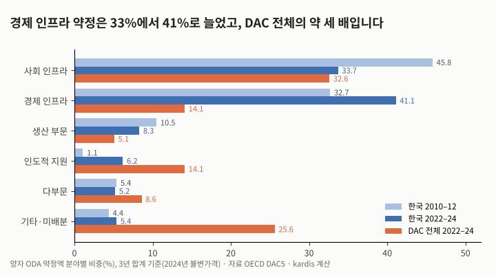
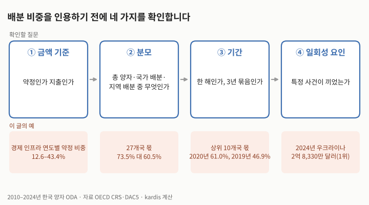

한국 ODA의 지역·국가·분야 배분은 15년간 어떻게 바뀌었을까요? OECD 채권자보고체계(CRS)와 분야별 통계(DAC5)로 2010–2024년을 직접 계산했습니다. 세 가지가 바뀌었습니다. 첫째, 아시아(중동 제외) 비중은 2010–2012년 58.7%에서 2022–2024년 43.5%로 내려왔고 아프리카·중남미 비중이 올랐습니다. 둘째, 수원국은 넓어졌습니다. 상위 10개국 몫은 60.0%에서 53.1%로 줄고, 연 100만 달러 이상 받은 나라는 평균 63개국에서 90개국으로 늘었습니다. 셋째, 분야 약정은 경제 인프라 쪽으로 기울었습니다(32.7% → 41.1%). 다만 아시아 금액은 1.9배로 늘었으므로 「다른 지역이 더 빨리 늘었다」가 정확하고, 같은 수치도 분모와 금액 기준에 따라 크게 달라집니다.

## 무엇을 계산했는가

국가·지역 배분은 CRS의 ODA 총지출(gross disbursements, 2024년 불변가격)을 썼습니다. 한국의 개발도상국 합계 지출은 2010년 10억 900만 달러에서 2024년 35억 7,100만 달러로 3.5배가 됐습니다. 분야 배분은 DAC5의 양자 ODA 약정액을 썼습니다. 한 해 값은 크게 흔들리므로 3년 합계로 비교했습니다. 2024년 아시아 40.6%, 아프리카 21.7%, 최빈국 28.1%, 경제 인프라 42.4%는 OECD 공여국 프로필 값과 일치합니다.

| 지역(총 양자 지출 대비) | 2010–2012 | 2016–2018 | 2022–2024 | DAC 전체 2022–2024 |
|---|---|---|---|---|
| 아시아(중동 제외) | 58.7% | 44.5% | 43.5% | 14.7% |
| 아프리카 | 18.3% | 25.8% | 21.6% | 21.8% |
| 중남미 | 6.7% | 10.5% | 10.6% | 5.5% |
| 지역 미배분 | 9.6% | 14.0% | 14.5% | 38.2% |
| 최빈국(LDC) | 34.8% | 35.8% | 30.8% | 17.8% |

3년 합계 기준 지역·소득군 비중입니다(kardis 계산, 자료: OECD CRS). 같은 기간 중동은 3.7%에서 3.3%, 유럽은 2.5%에서 5.4%, 오세아니아는 0.4%에서 0.9%였습니다.

## 넓어진 수원국, 늘어난 중점협력국 몫

국가 배분 대비 몫의 제곱합인 집중도(HHI)는 2010–2012년 평균 568에서 2022–2024년 376으로 낮아졌습니다. 「유효 수원국 수」로 바꾸면 17.6개국에서 26.6개국입니다. 베트남의 몫은 2012년 19.6%에서 2024년 4.6%가 됐습니다.

제3기 중점협력국 27개국(2021–2025) 목록을 거슬러 적용하면, 27개국 몫은 국가 배분 대비 68.7%에서 73.4%로 오히려 늘었습니다. 연 100만 달러 이상 받은 나라는 주로 27개국 밖에서 늘었지만(37개국 → 63개국), 그 몫은 31.3%에서 26.6%로 줄었습니다. 집중도 하락(568 → 376)의 약 70%는 27개국 안에서 배분이 고르게 퍼진 결과입니다. 27개국만 보면 유효 수원국 수가 10.0개국에서 15.7개국으로 늘었습니다. 정부는 제4기(2026–2030)에도 양자 ODA 예산의 70% 이상을 중점협력국에 집중한다고 밝혔습니다. 다만 그 목표의 분모는 아래 두 값과 달라, 그림 3은 목표 달성 판정이 아닙니다.

| 지표 | 2010–2012 | 2022–2024 |
|---|---|---|
| 상위 10개국 몫(국가 배분 대비, 연평균) | 60.0% | 53.1% |
| 집중도 HHI(연평균) | 568 | 376 |
| 유효 수원국 수 | 17.6 | 26.6 |
| 연 100만 달러 이상 수원국(연평균) | 62.7 | 90.0 |
| 제3기 27개국 몫: 국가 배분 대비 / 총 양자 대비 | 68.7% / 59.8% | 73.4% / 60.3% |

국가 배분 집중도입니다(kardis 계산). 그림 3의 2021–2024년 값은 국가 배분 대비 73.5%, 총 양자 대비 60.5%입니다.

## 분야: 경제 인프라로 기울었습니다

약정 3년 합계 기준으로 경제 인프라는 32.7%에서 41.1%로, 인도적 지원은 1.1%에서 6.2%로 늘었고, 사회 인프라는 45.8%에서 33.7%로 줄었습니다. 같은 기간 DAC 전체의 경제 인프라 비중은 14.5%에서 14.1%로 거의 그대로여서, 한국은 DAC 전체의 약 세 배를 경제 인프라에 약정합니다. OECD 프로필에 따르면 2024년 경제 인프라 약정 25억 달러 중 교통·저장이 21억 달러입니다.

| 분야(약정, 3년 합계) | 한국 2010–2012 | 한국 2022–2024 | DAC 2022–2024 |
|---|---|---|---|
| 사회 인프라 | 45.8% | 33.7% | 32.6% |
| 경제 인프라 | 32.7% | 41.1% | 14.1% |
| 생산 부문 | 10.5% | 8.3% | 5.1% |
| 인도적 지원 | 1.1% | 6.2% | 14.1% |
| 다부문 | 5.4% | 5.2% | 8.6% |
| 기타·미배분 | 4.4% | 5.4% | 25.6% |

분야별 약정 비중입니다(kardis 계산, 자료: OECD DAC5).

## 다른 해석과 반대 근거

첫째, 비중 하락이 곧 축소는 아닙니다. 아시아 지출은 3년 평균으로 1.9배, 아프리카는 3.1배, 전체는 2.6배로 늘었습니다. DAC 전체의 아시아 몫도 23.6%에서 14.7%로 줄었습니다. 지역 미배분 증가(25.0% → 38.2%)가 일부를 설명하지만, 지역 배분 금액 대비로도 31.5%에서 23.8%로 줄었고, 총 양자 대비 유럽 몫이 2.8%에서 12.3%로 늘었습니다(우크라이나 9.9%). 한국도 지역 배분 금액만 분모로 하면 아시아(중동 제외) 몫이 2010년 66.6%에서 2024년 47.4%로 내려가 결론은 같습니다.

둘째, 분야 약정은 해마다 크게 흔들립니다. 한국의 경제 인프라 약정 비중은 2020년 12.6%에서 2023년 43.4%까지 오갔고(표준편차 7.7%p), DAC 전체는 12.3–18.0%(1.6%p)였습니다. 대형 차관 약정 시점 때문일 수 있으나, 이 글에서는 유상·무상을 나눠 확인하지 않았습니다. 한 해 값을 추세로 읽지 않아야 합니다.

셋째, 일회성 사건이 섞입니다. 2024년 우크라이나 지출은 2억 8,330만 달러로 단일국 1위였고, 이를 빼면 2024년 상위 10개국 몫은 55.6%에서 54.3%가 됩니다.

넷째, 선행 연구와 어긋나지 않습니다. Patterson·Choi(2019)는 1987–2016년 자료로 한국 원조의 수원국 「목록」은 대체로 안정적이었지만 지출 양상은 바뀌었다고 보고했습니다. Kim·Oh(2021)는 16년 패널에서 중점협력국 지정이 분야별 무상원조 배분과 일관되게 양(+)의 관계라고 보고했습니다. 이 글의 계산도 배분의 변화와 정책 시기가 겹친다는 연관만 보여 주며, 정책이 변화를 일으켰는지는 확인하지 않았습니다.

## 한계

- 국가 배분은 지출, 분야 배분은 약정이어서 두 결과를 한 해 단위로 맞대어 볼 수 없습니다.
- 2021년 이전 27개국 몫은 제3기 목록을 소급 적용한 값이며, 당시의 중점협력국 목록과 다릅니다. 제4기 목록은 정부가 공개하지 않아 쓰지 않았습니다.
- DAC 전체의 미배분에는 공여국 안 난민 비용 같은 항목이 들어갈 수 있어, 분야 비교에서 DAC의 다른 비중이 함께 낮아 보일 수 있습니다.
- ODA Korea는 2024년 아시아 53.4%, 아프리카 26.8%를 제시합니다. 이 글에서 지역 배분 금액을 분모로 하면 아시아(중동 포함) 51.9%, 아프리카 25.4%여서 가까워지지만 같지 않습니다. 남은 차이의 원인은 확인하지 못했습니다.

| 단계 | 확인할 질문 | 이 글의 예 |
|---|---|---|
| ① 금액 기준 | 약정인가 지출인가 | 경제 인프라 연도별 약정 비중 12.6–43.4% |
| ② 분모 | 총 양자·국가 배분·지역 배분 중 무엇인가 | 27개국 몫 73.5% 대 60.5% |
| ③ 기간 | 한 해인가, 3년 묶음인가 | 상위 10개국 몫 2020년 61.0%, 2019년 46.9% |
| ④ 일회성 요인 | 특정 사건이 끼었는가 | 2024년 우크라이나 2억 8,330만 달러(1위) |

## 시사점

| 단계 | 확인하거나 바꿀 일 |
|---|---|
| 기획 | 사업 제안서에 국가·분야 배분 비중을 인용할 때는 분모(총 양자, 국가 배분, 지역 배분)와 금액 기준(약정·지출)을 함께 적습니다. 같은 27개국 몫이 73.5%도 되고 60.5%도 됩니다. |
| 기획 | 경제 인프라 약정 비중이 41%로 커진 만큼, 인프라 사업의 성과지표는 준공 같은 산출에서 멈추지 않도록 이용·서비스 수준의 성과 단계를 처음부터 정해 두기를 권합니다. 이 권고는 배분 변화에서 끌어낸 kardis의 판단이며, 이 글의 계산이 성과와의 관계를 보여 주지는 않습니다. |
| 착수 | 27개국 밖의 100만 달러 이상 수원국이 37개국에서 63개국으로 늘었습니다. 이런 나라의 사업은 국가 단위 결과틀이나 현지 지원이 얇을 수 있다고 kardis는 판단합니다(이 글의 계산이 보여 주는 것은 아닙니다). 기초선 자료원과 모니터링 인력을 착수 보고서에 구체적으로 적습니다. |
| 종료 | 국가·분야 추세와 사업 성과를 비교할 때는 한 해 값 대신 3년 묶음을 쓰고, 우크라이나 같은 일회성 배분을 따로 표시합니다. |

## 계산 방법

- 국가·지역 자료: OECD Data Explorer CRS(flows), 공여국 Korea·DAC countries, ODA 총지출, 2024년 불변가격(백만 달러), 2010–2024년, 2026-11-09 내려받음. 5,724행.
- 분야 자료: OECD DAC5, 양자 ODA 약정, 2024년 불변가격, 2010–2024년, 2026-11-09 내려받음. 분야 대분류 100·200·300·400·500·700·998을 합계로 쓰고, 700의 하위 항목인 730은 중복이라 뺐습니다. 한국의 이 합계는 CRS 개도국 합계 약정과 일치합니다(2024년 60억 1,025만 달러).
- 지역 구분: 아시아(중동 제외) = Asia − Middle East. 총 양자 = Developing countries 합계. 지역 미배분 = Developing countries unspecified. 일곱 구분의 합은 총 양자와 일치합니다.
- 3년 비교: 지역·소득군·분야 비중은 3년 금액 합계를 3년 분모 합계로 나눈 값입니다. 상위 10개국 몫·HHI·100만 달러 이상 수원국 수는 연도별 값의 평균이며, 유효 수원국 수는 10,000 ÷ 연평균 HHI입니다.
- 국가 배분: 영문자 3자리 국가 코드 146개(지역·소득군 집계 코드 제외, 코소보 포함). HHI = Σ(국가 몫)² × 10,000, 몫의 분모는 국가 배분 합계입니다.
- 제3기 중점협력국 27개국(ODA Korea 안내서): 네팔, 라오스, 몽골, 미얀마, 방글라데시, 베트남, 스리랑카, 인도네시아, 캄보디아, 파키스탄, 필리핀, 인도 / 가나, 르완다, 세네갈, 에티오피아, 우간다, 이집트, 탄자니아 / 볼리비아, 콜롬비아, 파라과이, 페루 / 우즈베키스탄, 우크라이나, 키르기스스탄, 타지키스탄.
- 그림은 위 계산값으로 kardis가 직접 그렸습니다(Python).

## 출처

- [CRS: Creditor Reporting System (flows)](https://data-explorer.oecd.org) · OECD Data Explorer(OECD.DCD.FSD:DSD_CRS@DF_CRS 1.7), 2026-11-09 내려받음
- [DAC5: Aid (ODA) by sector and provider](https://data-explorer.oecd.org) · OECD Data Explorer(OECD.DCD.FSD:DSD_DAC1@DF_DAC5 1.7), 2026-11-09 내려받음
- [Development Co-operation Profiles: Korea](https://www.oecd.org/en/publications/development-co-operation-profiles_04b376d7-en/korea_d358baed-en.html) · OECD, 2026-06-16
- [ODA Korea: Sharing Hope, Sharing Future](https://www.developmentaid.org/api/frontend/cms/file/2023/07/brochureeng_2021.pdf) · 국무조정실(ODA Korea) 영문 안내서, 2021년 기준
- [제4차 기본계획 핵심과제 이행을 본격적으로 추진](https://eiec.kdi.re.kr/policy/materialView.do?num=280883) · 국무조정실 국제개발협력본부(제57차 국제개발협력위원회), 2026-05-11
- [우리나라 ODA 지원실적](https://odakorea.go.kr/kor/cont/ContShow?cont_seq=36) · 국무조정실(ODA Korea), 2026-02-26 갱신
- [Policy and Practice in ODA Disbursements: An Analysis of Changes in South Korea's Official Development Assistance](https://doi.org/10.1017/jea.2019.17) · Dennis Patterson, Jangsup Choi, Journal of East Asian Studies 19(2), 2019
- [Sectoral Determinants of Korean Development Assistance: Similar, yet Different?](https://doi.org/10.35866/caujed.2021.46.1.004) · Han Na Kim, Jinhwan Oh, Journal of Economic Development 46(1), 2021
