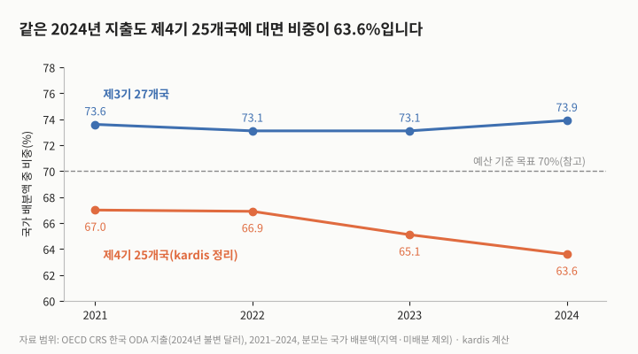
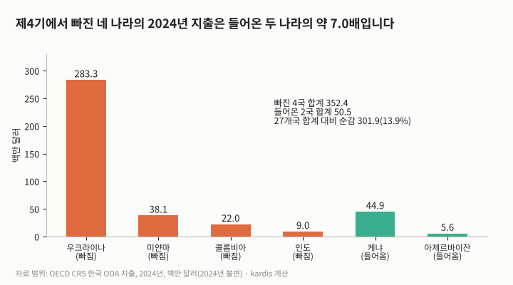
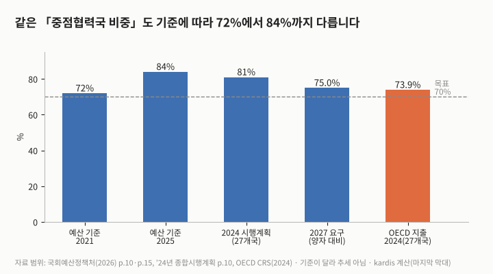
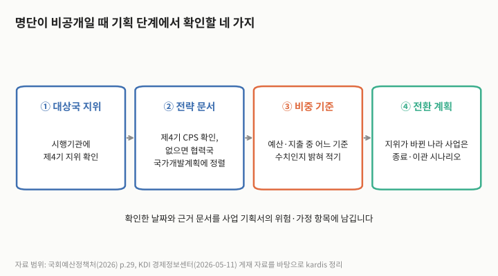

제4차 국제개발협력 종합기본계획의 중점협력국 재편은 사업 기획에 무엇을 바꿀까요? 결론은 두 가지입니다. 첫째, 대상국이 중점협력국인지를 공개 명단으로 확인할 수 없게 되어, 기획 단계에서 시행기관을 통해 지위를 확인하고 그 근거를 남기는 일이 필요해졌습니다. 둘째, 명단이 바뀌면 같은 돈의 흐름에서도 집중도 수치가 크게 달라집니다. 제4기 25개국을 2024년 지출(국가 배분액 기준)에 대 보면 70%까지 약 1억 8,800만 달러가 모자랍니다. 다만 이것은 예산 목표를 지출 자료에 대 본 가정상 차이이고, 예산 기준 수치는 이미 70%를 넘습니다.

## 무엇이 바뀌었는가

국회예산정책처(2026년 11월)는 「2026년 5월 제4기 중점협력국 재지정, 대외 비공개」라고 적고, 제3기(27개국)까지는 명단을 공개했으나 제4차 계획은 중점협력국 수를 재조정하고 전략적 유연성을 확보하려고 비공개로 했다고 설명합니다. 그보다 앞선 국무조정실 발표(제57차 국제개발협력위원회, 2026-05-11)도 제4기 중점협력국(2026–2030)을 「대외비로 선정하여 양자 ODA 예산의 70% 이상을 집중 지원할 예정」이라고 밝혔습니다. 공개된 것은 연합뉴스(2026-04-08) 보도로, 27개국에서 25개국으로 줄이는 계획이 「확인됐다」며 미얀마·우크라이나 제외, 콜롬비아 조정, 케냐 추가를 전했습니다. 이 글은 kardis가 정리한 제4기 25개국을 씁니다. 제3기 명단에서 미얀마·우크라이나·콜롬비아·인도가 빠지고 케냐·아제르바이잔이 들어간 구성입니다.

kardis 중점협력국 동향(2026-09-01–11-19, 193건)에서 「한국ODA」로 분류된 7건은 필리핀·인도네시아·페루·타지키스탄·우즈베키스탄·방글라데시·탄자니아 소식으로, 모두 제3기와 제4기에 함께 들어 있는 나라입니다. 이 중 필리핀(정상회담, 무상원조 기본협정 보충 약정)과 페루(대통령 방문 준비, 「2026–2030년 한국 협력 중점 파트너」로 거론)는 정상외교와 맞물려 있습니다. 새로 들어온 케냐의 같은 기간 동향 5건에는 한국 ODA 소식이 없고, 10월 물가 7.3%, 연료 가격 항의 행진, IMF 협의 일정처럼 사업비와 일정에 닿을 수 있는 소식만 있습니다.

## 직접 계산 1: 같은 2024년 지출도 명단을 바꿔 대면 비중이 10.3%p 낮습니다

OECD CRS의 한국 ODA 지출(2024년 불변 달러)로 2021–2024년 중점협력국 비중을 계산했습니다. 분모는 지역·미배분 항목을 뺀 국가 배분액입니다. 제3기 27개국의 비중은 네 해 모두 73.1–73.9%로 70% 목표를 넘었습니다. 같은 지출을 제4기 25개국에 대면 비중은 67.0%, 66.9%, 65.1%, 63.6%로 네 해 모두 70%에 못 미칩니다(그림 1). 2024년 25개국 지출(18억 6,660만 달러)과 국가 배분액의 70%(20억 5,490만 달러)의 차이는 1억 8,830만 달러입니다.

| 연도 | 국가 배분액(백만 달러) | 27개국 지출 | 27개국 비중 | 25개국 지출 | 25개국 비중 |
|---|---|---|---|---|---|
| 2021 | 1,859.0 | 1,369.0 | 73.6% | 1,245.5 | 67.0% |
| 2022 | 2,053.3 | 1,500.9 | 73.1% | 1,373.2 | 66.9% |
| 2023 | 2,160.9 | 1,579.5 | 73.1% | 1,405.7 | 65.1% |
| 2024 | 2,935.6 | 2,168.5 | 73.9% | 1,866.6 | 63.6% |

2024년 차이의 대부분은 우크라이나입니다. 빠진 네 나라의 2024년 지출은 우크라이나 2억 8,330만, 미얀마 3,810만, 콜롬비아 2,200만, 인도 900만 달러로 합계 3억 5,240만 달러이고, 들어온 케냐(4,490만)와 아제르바이잔(560만)은 합계 5,050만 달러입니다. 27개국 합계 대비 순감은 3억 190만 달러(13.9%)입니다(그림 2).

| 나라(제4기 변경) | 2021 | 2022 | 2023 | 2024 |
|---|---|---|---|---|
| 우크라이나(빠짐) | 1.4 | 79.0 | 52.5 | 283.3 |
| 미얀마(빠짐) | 37.5 | 41.6 | 37.2 | 38.1 |
| 콜롬비아(빠짐) | 114.8 | 47.3 | 22.7 | 22.0 |
| 인도(빠짐) | 6.8 | 3.2 | 101.2 | 9.0 |
| 케냐(들어옴) | 32.6 | 38.8 | 34.0 | 44.9 |
| 아제르바이잔(들어옴) | 4.4 | 4.6 | 5.9 | 5.6 |

(단위: 백만 달러, 2024년 불변)

## 직접 계산 2: 「비중」은 기준을 밝혀야 비교할 수 있습니다

공개 자료의 중점협력국 비중을 같은 표에 모았습니다(그림 3). 예산 기준으로 국회예산정책처가 인용한 제4차 계획의 평가는 72%(2021)에서 84%(2025)이고, 2024년 종합시행계획(확정액)은 27개국 대상 약 81%(다국가 사업 제외), 2027년 요구액 기준 양자 ODA 중 비중은 75.0%입니다. kardis가 계산한 2024년 지출 기준 값은 73.9%입니다. 예산은 계획액, 지출은 집행액이고 분모도 달라 한 줄의 추세로 읽으면 안 됩니다.

| 수치 | 기준 | 출처 |
|---|---|---|
| 72% → 84% | 중점협력국 지원 예산 비중, 2021 → 2025 | 국회예산정책처 p.10(제4차 계획 인용) |
| 약 81% | 2024년 확정액, 27개국, 다국가 사업 제외 | ’24년 종합시행계획 p.10 |
| 75.0% | 2027년 요구액, 양자 ODA 중(다국가 제외) | 국회예산정책처 p.15 |
| 73.9% | 2024년 지출, 국가 배분액 중 27개국 | OECD CRS, kardis 계산 |

## 기획 단계에서 확인할 네 가지

| 점검 | 할 일 | 남길 기록 |
|---|---|---|
| ① 대상국 지위 | 시행기관에 제4기 지위를 확인 | 확인 날짜, 근거 문서 |
| ② 전략 문서 | 제4기 CPS를 확인하고, 없으면 협력국 국가개발계획에 정렬 | 정렬한 문서와 목표 번호 |
| ③ 비중 기준 | 예산·지출, 분모를 밝혀 수치 인용 | 수치, 기준, 연도 |
| ④ 전환 계획 | 지위가 바뀐 나라 사업의 종료·이관 시나리오 | 지속성 지표와 책임 기관 |

## 다른 해석

1. **예산 기준으로는 이미 목표를 넘습니다.** 국회예산정책처는 양자 ODA 중 중점협력국 대상 비중(다국가 제외)이 약 71%에서 2027년 요구액 기준 75.0%로 높아졌다고 밝혔습니다(p.15). 지출 기준 부족분이 예산 배분의 부족을 뜻하지는 않습니다. 다만 같은 보고서는 2027년 분쟁·취약국 예산 증액이 NATO 정상회의 계기의 우크라이나 1억 달러 포괄지원 공약에 따른 것이라고 설명합니다(p.34). 명단 밖 지원이 계속 늘면 지출 기준 비중은 더 낮아질 수 있습니다.
2. **비공개가 실무에 주는 영향은 작을 수 있습니다.** 시행기관은 내부적으로 명단을 알 것으로 보이고, 사업 발굴은 기관 지침과 협력국 요청에 따라 움직입니다(kardis 추론). 다만 외부 평가자와 PMC는 공개 근거 없이 정렬 여부를 판단해야 합니다.
3. **집중도가 높아도 나라별 비중은 낮을 수 있습니다.** KDI 지식공유 Brief(2026-02)는 27개 중점협력국 중 DAC 전체 공여 대비 한국 비율이 5%를 넘는 나라가 일부에 불과하다고 지적했습니다.

## 연관과 인과, 그리고 한계

- 정부는 제4기 명단을 공개하지 않았습니다. 이 글의 25개국은 kardis가 정리한 목록이며, 공개 자료로 대조할 수 있는 것은 연합뉴스 보도의 네 나라(미얀마·우크라이나·콜롬비아·케냐)뿐입니다.
- 2024년 지출은 제4기 지정 전 자료입니다. 25개국 비중 63.6%는 과거 지출을 새 구성에 대 본 값이며, 앞으로의 배분을 예측하지 않습니다.
- OECD 지출(불변 달러)과 정부 예산(원화)은 범위와 시점이 달라 직접 비교할 수 없습니다.

## 시사점

| 단계 | 확인하거나 바꿀 일 |
|---|---|
| 기획 | 대상국의 제4기 지위를 시행기관에 확인하고, 확인 날짜와 근거를 사업 기획서의 가정 항목에 남깁니다. 공개 보도나 이전 명단을 근거로 쓰지 않습니다. |
| 기획 | 「중점협력국 비중」을 인용할 때 예산·지출, 다국가 포함 여부, 연도를 함께 적습니다. |
| 착수 | 새로 들어온 나라에서는 제4기 CPS가 없을 수 있으므로 협력국 국가개발계획에 성과 목표를 정렬하고, 물가·연료 가격 같은 동향 위험을 위험표에 넣습니다. |
| 집행·종료 | 지위가 바뀐 나라의 진행 사업은 후속 재원이 줄 수 있음을 가정해 종료·이관 시나리오와 지속성 지표를 미리 정합니다. |

## 계산 방법

- 제3기 27개국: ’24년 국제개발협력 종합시행계획 붙임 5의 명단(가나, 네팔, 라오스, 르완다, 몽골, 미얀마, 방글라데시, 베트남, 볼리비아, 세네갈, 스리랑카, 에티오피아, 우간다, 우즈베키스탄, 우크라이나, 이집트, 인도, 인도네시아, 캄보디아, 콜롬비아, 키르기스스탄, 타지키스탄, 탄자니아, 파라과이, 파키스탄, 페루, 필리핀).
- 제4기 25개국: kardis 정리 목록(네팔, 라오스, 몽골, 방글라데시, 베트남, 스리랑카, 인도네시아, 캄보디아, 파키스탄, 필리핀, 가나, 르완다, 세네갈, 에티오피아, 우간다, 이집트, 탄자니아, 케냐, 볼리비아, 파라과이, 페루, 아제르바이잔, 우즈베키스탄, 키르기스스탄, 타지키스탄). 정부 공식 명단은 비공개입니다.
- 자료: OECD CRS, 공여국 한국, ODA 지출(Disbursements), 2024년 불변 달러, 모든 분야. 수원국 코드가 국가·영토인 146개(지역·소득군 등 집계 항목 제외)의 합을 국가 배분액으로 썼습니다. 개도국 전체 합계(Developing countries)를 분모로 쓰면 27개국 비중은 2021–2024년 61.5%, 60.4%, 59.6%, 60.7%, 25개국은 56.0%, 55.3%, 53.1%, 52.3%입니다.
- 계산: 비중 = 명단 국가 지출 합 ÷ 국가 배분액. 2024년 25개국 = 2,168.5 − 352.4 + 50.5 = 1,866.6, 1,866.6 ÷ 2,935.6 = 63.6%. 70% 부족분 = 0.70 × 2,935.6 − 1,866.6 = 188.3(백만 달러). 순감 301.9 ÷ 2,168.5 = 13.9%. 빠진 4국 합 ÷ 들어온 2국 합 = 352.4 ÷ 50.5 = 약 7.0배.
- 동향 집계: kardis 중점협력국 동향(2026-11-25 갱신본) 193건 중 「한국ODA」 분류 7건과 케냐 항목 5건.
- 표와 그림은 위 자료와 계산값으로 kardis가 직접 만들었습니다.

## 출처

- [ODA 사업 평가](https://www.nabo.go.kr/board/file/down.do?fid=33319733) · 국회예산정책처, 2026년 11월(p.10, 15, 29, 34)
- [제57차 국제개발협력위원회 결과](https://eiec.kdi.re.kr/policy/materialView.do?num=280883) · 국무조정실, 2026-05-11(KDI 경제정보센터 게재)
- [’24년 국제개발협력 종합시행계획(확정액 기준)](https://www.odakorea.go.kr/static/main/main_05.PDF) · 관계부처 합동, 제48-1호, 2024-02-29(p.10, 붙임 5)
- [CRS: Creditor Reporting System (flows)](https://data-explorer.oecd.org) · OECD Data Explorer(OECD.DCD.FSD:DSD_CRS@DF_CRS 1.7), 2026-11-09 내려받음
- [KDI 지식공유 Brief Vol.01](https://m.kdi.re.kr/upload/notice/52887/editor/8EB1F5CE91_20260225155837.pdf) · 한승헌, 2026-02(p.3, KDI 공식 견해 아님)
- [캄보디아 남고 케냐 들어온다…ODA 중점협력국 25개국 재편 가닥](https://www.koreancenter.or.kr/news/articleView.html?idxno=1336188) · 연합뉴스(한민족센터 전재), 2026-04-08
- [중점협력국 동향](https://github.com/kardisceo-kr/kardis-data) · kardis, 2026-11-25 확인(개별 기사 출처는 동향 파일에 있습니다)
