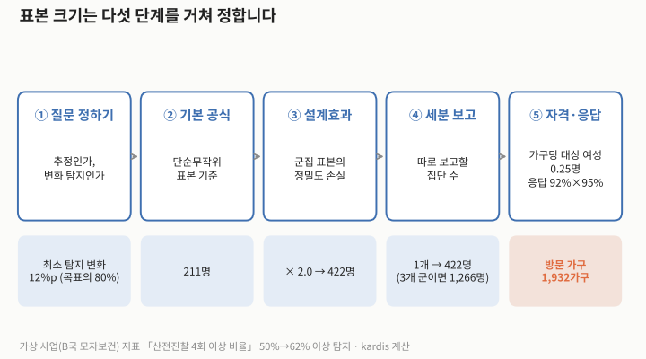
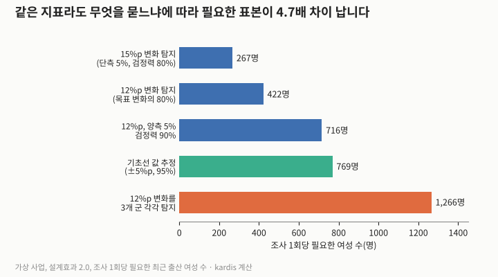
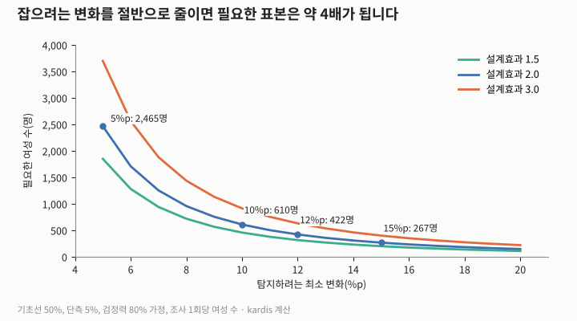
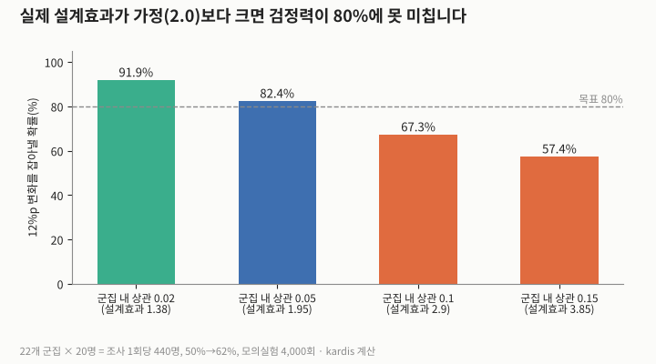

조사 설계서에는 「표본 400명」 같은 숫자만 적히고, 그 숫자가 어떤 질문에 답하려고 정해졌는지는 빠지는 경우가 있습니다. 표본 크기는 실무에서 어떻게 계산해야 할까요? 이 글의 결론은 「지표의 값만큼, 그보다 먼저 조사가 답할 질문이 표본 크기를 정한다」입니다. 같은 가상 지표에 지침의 공식을 적용하면, 「15%p 변화를 확인할 것인가」, 「목표의 80%인 12%p 변화를 확인할 것인가」, 「3개 군을 각각 보고할 것인가」에 따라 필요한 표본이 267명에서 1,266명까지 4.7배(변화 폭에서 1.58배, 군별 보고에서 3배) 차이가 났습니다. 이는 관찰된 차이가 아니라 가정값으로 계산한 결과입니다. 또 설계효과(군집 표본의 정밀도 손실)를 2로 가정했는데 실제 군집 내 상관이 0.10–0.15(설계효과 2.9–3.85)라면, 계산상 검정력 80%인 설계도 실제로는 57–67%에 그칠 수 있습니다.

## 지침이 말하는 것

미국 국제개발처(USAID)의 Feed the Future 표본 지침(Stukel, 2018)은 기초선과 종료선 사이의 변화를 확인하는 공식을 제시하고, 유의수준 5%(단측), 검정력 80%를 기본값으로 씁니다. 설계효과는 자료가 없을 때 2를 기본값으로 쓰되, 이 값이 과소추정일 가능성이 높다고 적었습니다. 최소 탐지 변화는 예시에서 목표 변화의 80%로 잡았고, 여러 핵심 지표 중 가장 큰 표본을 조사 전체의 표본으로 택하라고 권합니다. 인구보건조사(DHS) 표본 지침(ICF, 2012)은 비율 추정 공식에 설계효과의 제곱근(deft, 기본값 1.5)과 가구·개인 응답률, 가구당 대상자 수를 넣어 방문 가구 수를 구합니다. 같은 지침은 한 군집에서 농촌은 여성 25–30명, 도시는 20–25명 정도를 조사하라고 권하며, 군집당 인원이 적을수록 설계효과는 줄지만 군집이 많아져 비용이 커진다고 설명합니다.

## 직접 해 본 계산: 같은 지표, 다섯 가지 질문

2회의 가상 「B국 농촌 모자보건 개선 사업」을 그대로 씁니다. 지표는 「최근 2년 내 출산 여성 중 산전진찰 4회 이상 비율」, 기초선 50%, 목표 65%(+15%p)입니다. 먼저 두 지침의 공식을 각 지침의 예시(Stukel 2018의 발육부진 예시 1,403명, ICF 2012의 846가구)에 넣어 같은 값이 나오는지 확인한 뒤, 이 가상 사업에 적용했습니다.

| 단계 | 내용(가정) | 결과 |
|---|---|---|
| ① 질문 정하기 | 최소 탐지 변화 12%p(목표 변화 15%p의 80%), 단측 5%, 검정력 80% | 50%→62% |
| ② 기본 공식 | 단순무작위 표본 기준 | 211명 |
| ③ 설계효과 | 2.0 | 422명 |
| ④ 세분 보고 | 사업 지역 전체 1개(3개 군 각각이면 ×3) | 422명(1,266명) |
| ⑤ 자격·응답 | 가구당 대상 여성 0.25명, 가구 응답 92%, 개인 응답 95% | 방문 1,932가구 |

표 1. 그림 1의 값(가상, kardis 계산). 조사 1회당 값이며, 기초선과 종료선에 각각 필요합니다.

| 질문 | 조건 | 조사 1회당 여성 수 |
|---|---|---|
| 목표 변화 그대로 확인 | 15%p, 단측 5%, 검정력 80% | 267명 |
| 목표의 80% 변화 확인 | 12%p, 단측 5%, 검정력 80% | 422명 |
| 더 엄격한 기준 | 12%p, 양측 5%, 검정력 90% | 716명 |
| 기초선 값 추정 | ±5%p, 신뢰수준 95% | 769명 |
| 3개 군 각각 변화 확인 | 12%p, 단측 5%, 검정력 80%, 군별 | 1,266명 |

표 2. 그림 2의 값(가상, 설계효과 2.0, kardis 계산).

세 가지가 눈에 띕니다. 첫째, 「기초선 값을 ±5%p로 알고 싶다」는 질문(769명)이 「12%p 변화를 확인한다」는 질문(422명)보다 표본이 더 많이 듭니다. 기초선 조사를 설계할 때 추정 정밀도를 기준으로 삼을지, 종료 때의 변화 확인을 기준으로 삼을지를 먼저 정해야 하는 이유입니다. 둘째, 군별 보고는 표본을 군의 수만큼 곱합니다. 셋째, 같은 12%p라도 양측 검정과 검정력 90%를 요구하면 422명이 716명이 됩니다.

| 최소 탐지 변화 | 5%p | 8%p | 10%p | 12%p | 15%p | 20%p |
|---|---|---|---|---|---|---|
| 설계효과 1.5 | 1,849 | 719 | 458 | 316 | 200 | 110 |
| 설계효과 2.0 | 2,465 | 958 | 610 | 422 | 267 | 147 |
| 설계효과 3.0 | 3,698 | 1,437 | 915 | 632 | 400 | 220 |

표 3. 그림 3의 값(기초선 50%, 단측 5%, 검정력 80%, 조사 1회당 여성 수, kardis 계산). 잡으려는 변화를 10%p에서 5%p로 절반으로 줄이면 표본은 610명에서 2,465명으로 약 4배가 됩니다.

## 설계효과를 낮게 잡으면 생기는 일

설계효과는 군집 내 상관(같은 마을 사람끼리 응답이 비슷한 정도)과 군집당 조사 인원으로 정해집니다(설계효과 = 1 + 군집 내 상관 × (군집당 인원 − 1)). 군집당 20명이면 군집 내 상관 0.05에서 설계효과는 1.95이지만 0.10이면 2.9가 됩니다. 422명 설계를 22개 군집 × 20명(440명)으로 조사한다고 보고, 실제 군집 내 상관을 바꿔 가며 기초선·종료선 조사를 4,000번씩 모의실험했습니다. 실제 변화가 12%p일 때 이를 잡아낸 비율은 군집 내 상관 0.05에서 82.4%로 계산과 맞았지만, 0.10에서 67.3%, 0.15에서 57.4%로 떨어졌습니다.

| 군집 내 상관 | 0.02 | 0.05 | 0.10 | 0.15 |
|---|---|---|---|---|
| 설계효과(군집당 20명) | 1.38 | 1.95 | 2.90 | 3.85 |
| 모의실험 검정력 | 91.9% | 82.4% | 67.3% | 57.4% |
| 공식으로 계산한 검정력(440명) | 92.2% | 82.4% | 67.9% | 57.3% |

표 4. 그림 4의 값(가상, kardis 계산).

어떤 값을 가정해야 하는지는 지표마다 다릅니다. 정기 예방접종 조사의 경우, 세계보건기구(WHO) 자료는 과거에 군집 내 상관이 1/6을 넘는 일은 드물다고 보았으나, 2015년에 초안을 쓰고 2018년에 확정한 권고는 최근 근거가 없을 때 1/3이라는 보수적인 값을 쓰도록 했습니다(Rhoda 외, 2025). 1/3이면 군집당 20명에서 설계효과가 7.33이 됩니다. 이 값은 예방접종 지표에 대한 것이므로 산전진찰 지표에 그대로 옮길 수는 없습니다. 이 글의 가정값이 맞는지는 같은 나라의 이전 DHS 보고서 표본오차 부록에서 해당 지표의 설계효과(deft)를 찾아 확인하는 것이 현실적인 방법입니다.

## 다른 해석과 한계

모든 모니터링에 이 정도 표본이 필요한 것은 아닙니다. 로트품질보증표본(LQAS)은 감독 구역마다 19가구(표본 지점)만 조사해 지표가 목표에 이르렀는지를 판정합니다(MEASURE Evaluation). 목표 80%, 하한 50%를 kardis가 가정하고 19가구 중 13가구 이상이면 달성으로 판정하는 규칙을 계산해 보면, 실제 80%인 구역을 달성으로 볼 확률은 93.2%, 실제 50%인 구역을 달성으로 잘못 볼 확률은 8.4%였습니다. 다만 이는 구역을 분류하는 방법이지 비율을 정밀하게 추정하거나 변화의 크기를 재는 방법은 아닙니다. 또 Stukel(2018)은 단측 검정이 생의학 연구에서는 논란이 있지만 사업 성과 확인에서는 문제가 덜하다고 보았습니다. 평가자가 양측 검정을 요구한다면 표 2의 716명 쪽에 가까워집니다.

이 글의 수치는 모두 가정값입니다. 대상 여성 비율, 응답률, 군집 내 상관은 kardis가 정한 것이며, 모의실험은 군집 크기가 같고 가중치가 없는 단순한 경우입니다. 같은 가구를 다시 조사하는 패널 설계라면 필요한 표본이 줄 수 있습니다. 무엇보다 표본이 충분해 변화를 확인하더라도, 그 변화가 사업 덕분인지는 별개의 문제입니다(7회 기여 분석에서 다룹니다).

## 시사점

| 단계 | 확인하거나 바꿀 일 |
|---|---|
| 기획 | 조사 설계서에 표본 크기와 함께 「답하려는 질문」(추정 정밀도인지 변화 확인인지), 최소 탐지 변화, 유의수준과 단측·양측, 검정력, 설계효과의 근거를 적습니다. |
| 기획 | 군·성별 등 따로 보고할 집단을 착수 전에 확정합니다. 보고 집단 수만큼 표본이 곱해지므로, 나중에 세분 보고를 요구받으면 표본이 모자랍니다. |
| 착수 | 기초선 조사 자료로 실제 설계효과(또는 군집 내 상관)를 계산해 기록하고, 가정값보다 크면 종료선 표본을 다시 계산합니다. 그림 4에서 설계효과가 약 2(1.95)에서 2.9로 커지면 검정력은 82%에서 67%로 떨어졌습니다. |
| 집행 | 분기 점검처럼 구역별 달성 여부만 필요할 때는 LQAS 같은 작은 표본을 쓰고, 정밀한 변화 측정은 기초선·종료선 조사에 맡겨 역할을 나눕니다. |

## 계산 방법

- 대상: kardis가 만든 가상 사업과 가정값. 실제 사업·기관 자료는 쓰지 않았습니다.
- 변화 확인 공식(Stukel 2018 공식 1): n = 설계효과 × [z(1−α)√(2P̄(1−P̄)) + z(1−β)√(P1(1−P1)+P2(1−P2))]² / (P2−P1)², P̄=(P1+P2)/2. 단측 α=0.05(z=1.6449), 검정력 80%(z=0.8416). 표의 값은 정확한 z값으로 계산했습니다(1.645·0.842로 반올림하면 표 3의 1,849·958·610이 1씩 커집니다). 검증: P1=0.40, 변화 0.064, 설계효과 2 → 1,402.1 → 1,403명(지침 예시와 일치).
- 추정 공식: n = 설계효과 × 1.96² × p(1−p)/e². p=0.5, e=0.05, 설계효과 2 → 768.3 → 769명. DHS 공식 검증: (1/0.2−1)/0.1² × 1.4² = 784명, ÷(0.96×0.92×1.05) = 845.4 → 846가구(지침 표 1.1과 일치).
- 본 계산: P1=0.50. P2=0.65 → 266.5 → 267명. P2=0.62 → 421.1 → 422명(설계효과 제외 시 210.5 → 211명). 양측 α=0.05(z=1.96), 검정력 90%(z=1.282) → 715.0 → 716명. 3개 군 = 422×3 = 1,266명. 방문 가구 = 422 ÷ (0.25×0.92×0.95) = 1,931.4 → 1,932가구. 1,266 ÷ 267 = 4.74배.
- 모의실험: 조사 1회 22개 군집 × 20명(440명), 군집별 비율을 베타분포(평균 p, 군집 내 상관 ρ)에서 뽑고 이항분포로 응답 생성. 기초선 0.50, 종료선 0.62, 군집 평균의 분산으로 표준오차를 구해 단측 5% 검정. 4,000회, 난수 시드 20261102. 공식 검정력은 모의실험과 같은 n=440, 설계효과 1+ρ×19로 계산(n=422로 하면 91.2·81.0·66.3·55.8%).
- LQAS: 이항분포 n=19, 판정 기준 13가구 이상. P(X≥13 | p=0.8) = 0.932, P(X≥13 | p=0.5) = 0.084.
- 그림은 위 계산값으로 kardis가 직접 그렸습니다(Python).

## 출처

- [Feed the Future Population-Based Survey Sampling Guide](https://2017-2020.usaid.gov/sites/default/files/documents/1866/Feed_the_Future_Population-Based_Survey_Sampling_Guide_04.2018.pdf) · Diana Maria Stukel, FANTA III/FHI 360(USAID 지원), 2018-04
- [Demographic and Health Survey Sampling and Household Listing Manual](https://dhsprogram.com/pubs/pdf/DHSM4/DHS6_Sampling_Manual_Sept2012_DHSM4.pdf) · ICF International, MEASURE DHS, 2012-09
- [Sample Size Parameters for Vaccination Coverage Cluster Surveys: Insights from Pakistan](https://doi.org/10.1093/jssam/smaf033) · Dale A. Rhoda 외, Journal of Survey Statistics and Methodology 13(5): 587–614, 2025
- [Lot Quality Assurance Sampling Used to Measure Program Performance](https://www.measureevaluation.org/our-work/evaluation/lot-quality-assurance-sampling-used-to-measure-program-performance) · MEASURE Evaluation, 발행일 미표기
