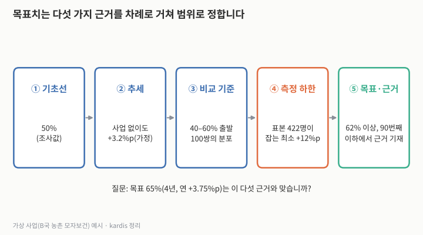
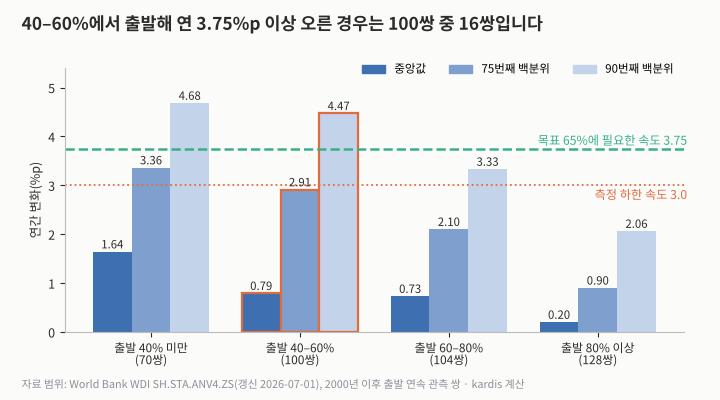
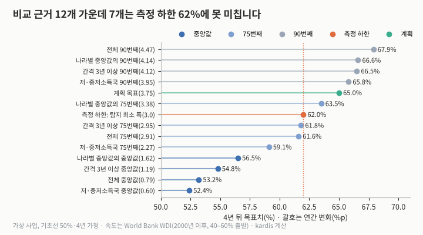
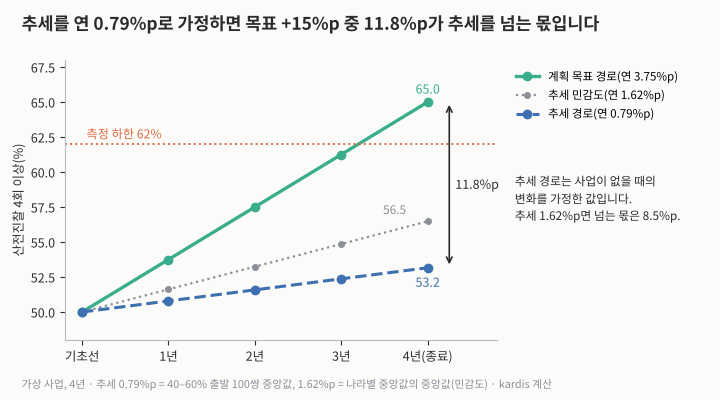

성과표에서 목표치는 근거가 가장 적게 남는 칸 가운데 하나입니다. 세계은행 보건·영양·인구 분야 보고서(Arur 외, 2011)는 2010 회계연도 사업 문서 11건 중 7건이 목표치를 고른 이유를 적지 않았고, 나머지 4건은 「현실성」을 들었지만 어떻게 판단했는지 보여 주지 않았다고 적었습니다. 목표치는 어떤 근거로 정해야 할까요? 이 글의 결론은 「목표치는 추세·비교 기준·측정 하한으로 좁힌 범위에서 고르고, 그 계산을 지표 정의서에 남겨야 한다」는 것입니다. 세계은행 세계개발지표(WDI)에서 산전진찰 4회 이상 비율을 내려받아, 40–60%에서 출발한 2000년 이후 연속 관측 100쌍(44개국)의 연간 변화를 계산했습니다. 3·4회의 가상 사업(기초선 50%, 4년 뒤 목표 65%)이 요구하는 연 3.75%p 이상 오른 경우는 100쌍 중 16쌍이었습니다. 이 분포에서 뽑은 비교 기준 12개로 4년 뒤 목표치를 계산하면 52.4–67.9%로 갈렸고, 그중 7개는 조사 표본이 변화로 확인할 수 있는 최소값 62%보다 낮았습니다.

## 국제 지침이 말하는 근거

미국 국제개발처(USAID)의 성과지표 목표치 기술 노트(2021)는 결과 목표를 정하는 방법으로 과거 추세 검토, 세분화 자료, 이해관계자·전문가 의견, 비슷한 사업과 연구의 근거, 비슷한 맥락의 지역 비교를 듭니다. 동시에 과거 추세가 미래를 예측하지 않는다고 경고하고, 목표를 정한 근거를 지표 정의서(PIRS)에 남기라고 요구합니다. 유엔개발계획(UNDP)의 글로벌펀드 사업 지침은 목표가 국가전략과 맞고 「야심 차되 실현 가능해야」 하며, 과거 실적과 맥락 요인을 고려하고, 기초선이 없으면 「추후 확정」으로 두라고 합니다. Arur 외(2011)는 기초선, 추세, 다른 지역과의 비교, 자료 검증 계획 등 여덟 가지 점검 질문을 제시합니다. 세 지침 모두 과거의 실적·추세를 목표치의 근거에 넣으라고 합니다.

## 직접 해 본 계산 1: 4회 이상 지표는 실제로 얼마나 빨리 바뀌었나

가상 「B국 농촌 모자보건 개선 사업」의 지표는 「최근 2년 내 출산 여성 중 산전진찰 4회 이상 비율」, 기초선 50%, 목표 65%입니다. 이번 회에서는 사업 기간을 4년으로 가정했습니다. 목표 65%는 연 3.75%p씩 오른다는 뜻입니다. 이 속도를 그림 1의 다섯 단계로 점검했습니다.

| 단계 | 확인할 것 | 가상 사업의 값 |
|---|---|---|
| ① 기초선 | 최근 조사값과 그 오차 | 50% |
| ② 추세 | 사업이 없어도 일어날 변화 | 연 0.79%p 가정 시 4년 +3.2%p |
| ③ 비교 기준 | 같은 지표, 비슷한 출발 수준의 변화 속도 분포 | 40–60% 출발 100쌍: 중앙값 0.79, 75번째 2.91, 90번째 4.47%p |
| ④ 측정 하한 | 조사 표본이 변화로 잡아낼 수 있는 최소 폭 | 조사 1회 422명으로 +12%p(62%) |
| ⑤ 목표·근거 | 범위와 계산을 지표 정의서에 기록 | 측정 하한 62% 이상, 90번째 백분위(65.8–67.9%) 이하에서 고르고 이유와 계산식 기재 |

표 1. 그림 1의 내용(가상, kardis 정리).

WDI에는 지역 합계를 뺀 산전진찰 4회 이상 값이 152개 경제권(국가·지역)에 671개 있었습니다(2026-07-01 갱신). 한 나라의 이웃한 두 관측값을 한 쌍으로 묶어 연간 변화를 구하고, 2000년 이후에 출발한 402쌍(117개국)을 출발 수준별로 나눴습니다. 중앙값은 40% 미만 출발 1.64%p에서 80% 이상 출발 0.20%p로 낮아졌고, 40–60%(0.79%p)와 60–80%(0.73%p)는 비슷했습니다. 40–60%에서 출발한 100쌍의 중앙값은 연 0.79%p였고, 27쌍은 오히려 떨어졌습니다. 연 3.0%p(측정 하한에 해당하는 속도) 이상 오른 쌍은 24개, 3.75%p 이상은 16개였습니다.

| 출발 수준 | 쌍(국가) | 중앙값 | 75번째 백분위 | 90번째 백분위 | 3.75%p 이상 비율 |
|---|---|---|---|---|---|
| 40% 미만 | 70(27) | 1.64%p | 3.36%p | 4.68%p | 17.1% |
| 40–60% | 100(44) | 0.79%p | 2.91%p | 4.47%p | 16.0% |
| 60–80% | 104(55) | 0.73%p | 2.10%p | 3.33%p | 9.6% |
| 80% 이상 | 128(44) | 0.20%p | 0.90%p | 2.06%p | 5.5% |

표 2. 그림 2의 값(World Bank WDI SH.STA.ANV4.ZS, 2000년 이후 출발 쌍, kardis 계산).

계산 방식을 바꿔 보았습니다. 저·중저소득국만 보면(88쌍) 11.4%, 1–2년 간격 쌍을 빼면(64쌍) 14.1%, 많이 관측된 나라의 영향을 줄이려 나라별 중앙값으로 다시 계산하면(44개국) 20.5%가 연 3.75%p 이상이었습니다(기본 16.0%). 네 가지 분포의 중앙값·75번째·90번째 값(12개)을 기초선 50%에 4년 동안 적용한 결과가 그림 3입니다.

| 근거(40–60% 출발) | 연간 변화 | 4년 뒤 목표치 |
|---|---|---|
| 저·중저소득국 중앙값 | 0.60%p | 52.4% |
| 전체 중앙값 | 0.79%p | 53.2% |
| 간격 3년 이상 중앙값 | 1.19%p | 54.8% |
| 나라별 중앙값의 중앙값 | 1.62%p | 56.5% |
| 저·중저소득국 75번째 | 2.27%p | 59.1% |
| 전체 75번째 | 2.91%p | 61.6% |
| 간격 3년 이상 75번째 | 2.95%p | 61.8% |
| 측정 하한(속도 근거가 아닌 탐지 최소 폭) | 3.00%p | 62.0% |
| 나라별 중앙값의 75번째 | 3.38%p | 63.5% |
| 계획 목표 | 3.75%p | 65.0% |
| 저·중저소득국 90번째 | 3.95%p | 65.8% |
| 간격 3년 이상 90번째 | 4.12%p | 66.5% |
| 나라별 중앙값의 90번째 | 4.14%p | 66.6% |
| 전체 90번째 | 4.47%p | 67.9% |

표 3. 그림 3의 값(목표치 = 50 + 4 × 연간 변화, kardis 계산).

측정 하한과 계획 목표를 뺀 12개 값 가운데 7개가 62%보다 낮습니다. 중앙값 기준 넷은 모두 57% 아래였고, 75번째 기준 넷은 59.1–63.5%, 90번째 기준 넷은 65.8–67.9%였습니다. 이 수치로 목표의 범위를 잡으면 아래는 측정 하한 62%, 위는 90번째 백분위(65.8–67.9%)입니다. 하한 62%는 조사 1회 422명일 때의 값이라 표본을 키우면 낮아지고, 62%보다 낮게 잡으면 달성해도 조사로 확인하기 어렵습니다. 계획 목표 65%는 이 범위 안에 있지만, 관측된 변화의 상위 16%(기본 분포)에 드는 속도를 요구합니다. 65%로 정할 수는 있지만, 그 이유(예: 이동 진료와 교통비 지원으로 접근성 장벽을 직접 낮춤)를 지표 정의서에 적어야 합니다.

## 직접 해 본 계산 2: 목표치 안에 들어 있는 추세

대상 지역이 사업 없이 40–60% 출발 쌍의 중앙값 속도(연 0.79%p)로 변한다고 가정하면 4년 뒤 값은 53.2%입니다. 이 가정에서 목표 +15%p 가운데 3.2%p는 추세로 올 수 있고, 추세를 넘는 몫은 11.8%p입니다. 추세를 나라별 중앙값의 중앙값(연 1.62%p)으로 잡으면 넘는 몫은 8.5%p입니다. 어떤 추세를 가정하느냐에 따라 같은 목표치의 어려움이 달라집니다.

| 시점 | 계획 목표 경로(연 3.75%p) | 추세 경로(연 0.79%p) | 추세 민감도(연 1.62%p) |
|---|---|---|---|
| 기초선 | 50.0% | 50.0% | 50.0% |
| 1년 | 53.8% | 50.8% | 51.6% |
| 2년 | 57.5% | 51.6% | 53.2% |
| 3년 | 61.3% | 52.4% | 54.9% |
| 4년(종료) | 65.0% | 53.2% | 56.5% |

표 4. 그림 4의 값(가상, kardis 계산). 측정 하한 62%는 종료 시점 비교 기준.

## 다른 해석과 한계

다른 해석도 있습니다. 첫째, 국가 단위 변화는 사업 대상 지역에 그대로 맞지 않습니다. 접근성이 낮은 일부 지역에 집중 투입하는 사업은 나라 평균보다 빠르게 바뀔 수 있으므로, 상위권 목표가 곧 비현실적이라는 뜻은 아닙니다. 둘째, 세계은행 데이터 블로그(Mahler 외, 2026)는 나라 자신의 과거 속도, 국가 간 전형적 속도, 지역 최고 성과국 속도 가운데 무엇을 기준으로 삼을지 고르는 방식을 소개합니다. 기준 선택에 따라 「야심 찬 목표」의 뜻이 달라집니다. 셋째, Arur 외(2011)는 산전진찰 1회 이상 지표에서 직전 수준이 연간 변화 차이의 9%만 설명한다고 밝혔습니다. 출발 수준별 속도는 참고값일 뿐 예측값이 아닙니다.

한계도 분명합니다. WDI의 국가별 값은 DHS·MICS·국가 조사 등 출처가 섞여 있어, 짧은 간격 쌍의 변화에는 조사 방식 차이가 섞였을 수 있습니다. 40–60% 출발 100쌍 중 36쌍이 1–2년 간격이고, 연간 변화가 가장 큰 5쌍(연 7.1–11.5%p) 가운데 4쌍이 이 쌍입니다. 1–2년 간격 쌍을 빼면 90번째 백분위는 4.47%p에서 4.12%p로 내려갑니다. 또 한 나라의 이웃한 쌍은 끝점을 공유해 서로 독립이 아니고, 관측이 많은 나라가 분포에 더 큰 영향을 줍니다(나라별 중앙값 계산은 이를 일부 보완합니다). 두 시점 사이의 평균 속도만 보므로 중간의 빠른 구간은 가려집니다. 사업 기간 4년과 추세 가정은 kardis가 정한 값이며, 추세를 넘는 11.8%p가 사업 때문인지는 비교 집단 없이 알 수 없습니다. 이 글은 목표치의 근거를 점검하는 방법을 다룰 뿐 사업 효과를 추정하지 않습니다.

## 시사점

| 단계 | 확인하거나 바꿀 일 |
|---|---|
| 기획 | 목표치를 정할 때 대상 지역이나 국가의 최근 추세를 먼저 확인하고, 「사업이 없어도 일어날 변화」를 숫자로 적습니다. 목표에서 추세를 뺀 몫이 사업 기간에 추가로 필요한 변화입니다. |
| 기획 | 같은 지표, 비슷한 출발 수준의 변화 속도 분포에서 목표 속도가 어디에 있는지 표시합니다. 상위 25% 밖의 속도를 요구한다면 그 이유를 사업 논리로 적습니다. |
| 착수 | 목표 변화 폭이 조사 표본이 잡아낼 수 있는 최소 폭(이 예에서 +12%p)보다 큰지 확인합니다. 추세 근거의 목표가 측정 하한보다 낮다면 표본을 늘릴지, 목표를 근거와 함께 높게 둘지 착수 전에 정합니다. |
| 집행 | 목표치 옆에 계산식, 출처, 가정을 지표 정의서에 남기고, 중간에 목표를 고칠 때도 같은 칸에 고친 이유와 새 근거를 적습니다. |

## 계산 방법

- 대상: kardis가 만든 가상 사업과 가정값, 그리고 World Bank WDI 공개 자료. 실제 사업·기관 자료는 쓰지 않았습니다.
- 원자료: WDI API(SH.STA.ANV4.ZS, 2026-07-01 갱신) 응답 9,540건 중 값이 있는 730건. 국가 목록 API의 region이 「Aggregates」인 지역 합계를 빼면 152개 경제권 671건.
- 쌍 만들기: 나라별로 연도순 정렬 후 이웃한 두 관측값(연도 y1, y2, 값 a, b)을 한 쌍으로 묶음. 연간 변화 = (b − a) ÷ (y2 − y1). y1이 2000년 이상인 402쌍(117개국)을 사용. 간격 1–16년, 중앙값 3년.
- 출발 수준 구간: a 기준 [0, 40), [40, 60), [60, 80), [80, 100]. 백분위는 선형 보간. 40–60% 구간 정확값: 중앙값 0.7875, 75번째 2.9125, 90번째 4.466. 소득 구성: 저소득 28, 중저소득 60, 중고소득 11, 고소득 1쌍.
- 민감도: 저·중저소득국 88쌍(36개국), 간격 3년 이상 64쌍(37개국), 나라별 중앙값 44개국.
- 4년 뒤 목표치 = 50 + 4 × 연간 변화(표에 적은 소수 둘째 자리 속도로 계산).
- 측정 하한: 기초선 50%→62%, 단측 5%, 검정력 80%, 설계효과 2. n = 2 × (1.645 × √(2 × 0.56 × 0.44) + 0.842 × √(0.25 + 0.2356))² ÷ 0.12² = 421.2 → 조사 1회당 422명. 연 환산 12 ÷ 4 = 3.0%p.
- 추세 분해: 추세 경로 = 50 + 0.79 × 연차(민감도 1.62), 목표 경로 = 50 + 3.75 × 연차.
- 그림은 위 계산값으로 kardis가 직접 그렸습니다(Python).

## 출처

- [Pregnant women receiving prenatal care of at least four visits (SH.STA.ANV4.ZS)](https://data.worldbank.org/indicator/SH.STA.ANV4.ZS) · World Bank, World Development Indicators, 자료 갱신 2026-07-01, 내려받음 2026-11-20
- [Setting Targets in Health, Nutrition, and Population Projects](https://openknowledge.worldbank.org/entities/publication/1ca96832-5671-5919-adb0-f9c3f940b85c) · Aneesa Arur, Rianna Mohammed-Roberts, Eduard Bos, World Bank HNP Discussion Paper, 2011-09
- [Performance Indicator Targets](https://usaidlearninglab.org/system/files/resource/files/mt_performance_indicator_targets_final2021.pdf) · USAID Bureau for Policy, Planning and Learning, 2021-03
- [Target-setting](https://healthimplementation.undp.org/functional-areas/monitoring-and-evaluation/me-components-of-grant-making/me-in-the-pr-capacity-assessment-tool-cat/types-of-indicators/target-setting) · UNDP, Global Fund 사업 M&E 지침, 발행일 미표기
- [How should countries set realistic and ambitious development targets?](https://blogs.worldbank.org/en/opendata/how-should-countries-set-realistic-and-ambitious-development-tar) · Daniel Gerszon Mahler 외, World Bank Data Blog, 2026-05-14
